# Java Learning Modules

[](https://www.oracle.com/java/)
[](https://github.com/weztcy/Java-Learning-Modules)
[](https://github.com/weztcy/Java-Learning-Modules)
[](https://github.com/weztcy/Java-Learning-Modules)
[](https://github.com/weztcy/Java-Learning-Modules)
[](./LICENSE)

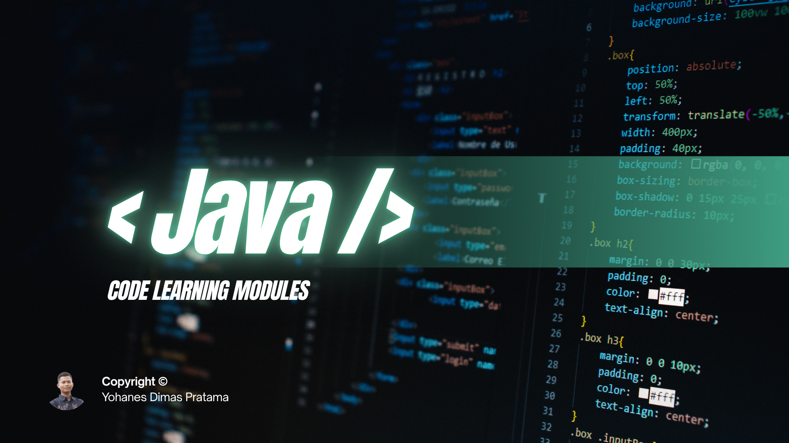

## Project Description

**Java Learning Modules** is a comprehensive, production-grade programming curriculum and code learning repository engineered to guide learners from core computing fundamentals to modern enterprise architecture. Built on a modern **Java SE 21 LTS** foundation, the curriculum systematically covers the entire Java developer spectrum: syntax primitives, memory layout, object-oriented design, functional programming with Streams, concurrent computing with Virtual Threads, database persistence with JDBC, software quality with JUnit 5/Mockito, and cloud-native backend development with Spring Boot.

The repository is architected around **300 self-contained, standalone single-file Java programs** organized into **18 pedagogical modules**. Every single lesson isolates a concrete language concept, algorithmic challenge, or architectural pattern without requiring bulky boilerplate or multi-file project scaffolding. Furthermore, each lesson includes an authentic terminal execution screenshot captured under its module's `output/` directory, allowing learners to immediately cross-reference their local console outputs with verified baseline executions.

Whether you are a computer science student establishing foundational software engineering principles, an experienced developer transitioning from Python, C#, TypeScript, or C++, or a backend engineer modernizing your skills with Java 21 features (Virtual Threads, Records, Pattern Matching, and Sealed Classes), this curriculum provides a transparent, verifiable roadmap toward professional Java mastery.

## Learning Objectives

Upon completing this curriculum, learners will have developed concrete, verified competencies across four distinct pedagogical tiers:

### Tier 1: Core Syntax, Data Types, and Imperative Control Flow
- Understand Java class anatomy, execution entry points (`main`), console output formatting (`printf`), and compilation mechanics on the Java Virtual Machine (JVM).
- Master memory representation across 8 primitive data types, explicit narrowing type casting, and implicit widening conversions.
- Implement complex decision logic using traditional `switch-case`, modern arrow-syntax `switch` expressions, and multi-branch condition ladders.
- Construct multi-tier iterative workflows using `for`, `while`, `do-while`, labeled break/continue statements, and the enhanced for-each loop.
- Modularize procedural code using parameterized methods, pass-by-value argument semantics, method overloading, varargs, and recursion.

### Tier 2: Data Structures, Object-Oriented Architecture, and Robustness
- Manage contiguous memory and multidimensional matrices using single- and multi-dimensional arrays, alongside text manipulation with `StringBuilder` and regular expressions.
- Encapsulate state and behavior within classes using constructor overloading, access modifiers, getters/setters, static blocks, and `final` immutability constraints.
- Build robust class hierarchies utilizing single/multilevel inheritance, method overriding (`@Override`), polymorphism, dynamic method dispatch, abstract classes, and multiple interface contracts.
- Implement defensive programming strategies using the `Throwable` hierarchy, checked/unchecked exceptions, custom domain exceptions, and automatic resource reclamation via try-with-resources.

### Tier 3: Modern Java APIs, Functional Pipelines, and High-Performance Concurrency
- Select and utilize appropriate data structures from the Java Collections Framework (`ArrayList`, `LinkedList`, `HashSet`, `TreeSet`, `HashMap`, `TreeMap`, `ArrayDeque`, `PriorityQueue`) based on algorithmic complexity.
- Write declarative, functional data pipelines using Generics, type bounds, wildcards, Lambda Expressions, Functional Interfaces (`Predicate`, `Function`, `Consumer`, `Supplier`), and the Java Streams API.
- Perform high-efficiency file I/O operations using classic character/byte streams, binary object serialization, and modern non-blocking Java NIO.2 (`Path`, `Files`, `WatchService`).
- Harness modern Java language enhancements including `Optional`, `Records`, `Sealed Classes`, and the `java.time` temporal package.
- Architect concurrent systems using `Thread`, `Runnable`, `Callable`, `Future`, explicit locks (`ReentrantLock`), atomic variables, thread pools (`ExecutorService`), reactive `CompletableFuture`, and lightweight **Virtual Threads** (Project Loom).

### Tier 4: Enterprise Persistence, Tooling, JVM Internals, and Capstone Systems
- Connect to relational databases using JDBC, write injection-safe `PreparedStatement` queries, manage ACID transactions, and implement the Data Access Object (DAO) pattern.
- Implement automated unit testing with JUnit 5 assertions, mock dependencies using Mockito, and orchestrate project builds via Maven and Gradle.
- Analyze JVM internal memory structure (Heap, Stack, Metaspace), garbage collection algorithms (G1, ZGC), and optimize execution with JVM arguments.
- Build cloud-ready RESTful web services with Spring Boot: Inversion of Control (IoC), Dependency Injection (DI), Spring Data JPA, Bean Validation, and Spring Security.
- Architect and deploy 5 comprehensive, end-to-end practical capstone applications.

## Learning Roadmap

The 18 modules are arranged in a strict pedagogical progression divided into four learning phases:

| Module | Title | Level | Topics & Focus | Lessons | Material Link |
| :---: | :--- | :---: | :--- | :---: | :---: |
| **01** | Introduction to Java and Program Structure | Level 1 | Java program anatomy, entry-point main method, console output streams, statements, identifiers, keywords, and compilation workflow. | 10 | [`module-01-pengenalan-java-dan-struktur-program`](./module-01-pengenalan-java-dan-struktur-program) |
| **02** | Variables and Data Types | Level 1 | Memory allocation, 8 primitive data types, String reference type, constants with final, type casting, and widening conversions. | 14 | [`module-02-variabel-dan-tipe-data`](./module-02-variabel-dan-tipe-data) |
| **03** | Input, Output, and Operators | Level 1 | Interactive console input (Scanner & BufferedReader), CLI arguments, arithmetic, bitwise, logical operators, precedence, and Math class utilities. | 14 | [`module-03-input-output-dan-operator`](./module-03-input-output-dan-operator) |
| **04** | Control Flow and Decision Making | Level 1 | Conditional branching (if, if-else, else-if ladders), nested conditionals, classic switch, modern switch expressions, and practical decision programs. | 12 | [`module-04-percabangan-dan-pengambilan-keputusan`](./module-04-percabangan-dan-pengambilan-keputusan) |
| **05** | Loops and Iteration | Level 1 | Definite and indefinite loops (for, while, do-while), nested iterations, loop control (break, continue, labeled jumps), enhanced for-each, and pattern generation. | 14 | [`module-05-perulangan`](./module-05-perulangan) |
| **06** | Methods and Program Modularization | Level 1 | Modular decomposition, method signatures, return types, overloading, varargs, variable scopes, static vs instance methods, recursion, and packages. | 14 | [`module-06-method-dan-modularisasi-program`](./module-06-method-dan-modularisasi-program) |
| **07** | Arrays and String Manipulation | Level 2 | 1D/2D arrays, indexing, traversals, matrix math, linear search, sorting, String immutability, StringBuilder, StringBuffer, RegEx, and text tokenization. | 22 | [`module-07-array-dan-manipulasi-string`](./module-07-array-dan-manipulasi-string) |
| **08** | Object-Oriented Programming (OOP) Fundamentals | Level 2 | Classes, objects, constructors, this keyword, encapsulation, access modifiers, getters/setters, static members, final constraints, and java.lang.Object methods. | 20 | [`module-08-oop-dasar`](./module-08-oop-dasar) |
| **09** | Advanced Object-Oriented Programming | Level 2 | Inheritance hierarchies, super keyword, method overriding, runtime polymorphism, abstract classes, interfaces, default/static methods, composition, and inner classes. | 20 | [`module-09-oop-lanjutan`](./module-09-oop-lanjutan) |
| **10** | Exception and Error Handling | Level 2 | Throwable hierarchy, try-catch-finally, multiple catch blocks, throw/throws, checked vs unchecked exceptions, custom exceptions, try-with-resources, and assertions. | 16 | [`module-10-exception-handling`](./module-10-exception-handling) |
| **11** | Java Collections Framework | Level 3 | List, Set, Map, and Queue hierarchies (ArrayList, LinkedList, HashSet, TreeSet, HashMap, TreeMap), iterators, Comparable, Comparator, and Collections utility. | 22 | [`module-11-collections-framework`](./module-11-collections-framework) |
| **12** | Generics and Functional Programming | Level 3 | Generic classes/methods, wildcards, type erasure, lambda expressions, functional interfaces, method references, and declarative data pipelines with the Streams API. | 22 | [`module-12-generics-dan-functional-programming`](./module-12-generics-dan-functional-programming) |
| **13** | File Handling and Input/Output (I/O & NIO.2) | Level 3 | Character/byte streams, buffered I/O, object serialization, transient keyword, modern Java NIO.2 (Path, Paths, Files), CSV parsing, Properties, ZIP, and WatchService. | 18 | [`module-13-file-handling-dan-io`](./module-13-file-handling-dan-io) |
| **14** | Java Standard Library and Modern Language Features | Level 3 | Advanced Math, SecureRandom, BigInteger, BigDecimal, java.time (LocalDate, ZonedDateTime), Optional, UUID, Enums, Annotations, Reflection API, Records, and Sealed Classes. | 18 | [`module-14-standard-library-dan-fitur-bahasa-modern`](./module-14-standard-library-dan-fitur-bahasa-modern) |
| **15** | Multithreading and Concurrency | Level 3 | Thread lifecycle, Runnable/Callable/Future, synchronization, volatile, ReentrantLock, Atomic variables, ExecutorService, CompletableFuture, and Virtual Threads (Loom). | 16 | [`module-15-multithreading-dan-concurrency`](./module-15-multithreading-dan-concurrency) |
| **16** | Database Programming with JDBC | Level 4 | JDBC architecture, DriverManager, Statement, PreparedStatement, ResultSet, CRUD operations, ACID transactions, batch processing, metadata, DAO pattern, and connection pooling. | 14 | [`module-16-database-programming-dengan-jdbc`](./module-16-database-programming-dengan-jdbc) |
| **17** | Testing, Build Tools, JVM Internals, and Security | Level 4 | JUnit 5, Mockito, Maven/Gradle build automation, JAR packaging, JavaDoc, logging, JVM memory architecture, Garbage Collection, Java 14-21 modern features, JPMS, and cryptography. | 22 | [`module-17-testing-build-tools-jvm-dan-keamanan`](./module-17-testing-build-tools-jvm-dan-keamanan) |
| **18** | Enterprise Frameworks and Capstone Projects | Level 4 | Spring Framework IoC/DI, Spring Boot, REST Controllers, Spring Data JPA, Bean Validation, Spring Security, MockMvc, and 5 complete practical capstone projects. | 12 | [`module-18-framework-dan-proyek-praktik-java`](./module-18-framework-dan-proyek-praktik-java) |

## Prerequisites

To compile and execute the code examples in this repository, ensure your environment meets the following baseline requirements:

- **Java Development Kit (JDK):** **JDK 21 LTS** is strongly recommended to run all 300 lessons without restriction (including Virtual Threads and pattern matching in switch). Minimum requirement: **JDK 17 LTS** (modules 1–14 and 16–18 work seamlessly).
- **Command-Line Environment:** Terminal shell such as PowerShell, Command Prompt (cmd), Bash, or Zsh.
- **Editor or IDE:** Any development environment supporting Java (Visual Studio Code with Extension Pack for Java, IntelliJ IDEA, Eclipse, Apache NetBeans, or a text editor).
- **Prior Experience:** No prior Java experience is required. Basic familiarity with general programming concepts and command-line navigation is beneficial.

## Tech Stack & Tools

| Category | Technology / Tool | Version / Standard | Purpose in Curriculum |
| :--- | :--- | :--- | :--- |
| **Core Language** | Java Standard Edition (Java SE) | 21 LTS (or 17+ LTS) | Primary programming language |
| **Runtime Engine** | HotSpot Java Virtual Machine (JVM) | JDK 21+ | Bytecode execution, JIT compilation, and memory management |
| **Launcher** | Single-File Source Code Runner | Java 11+ (`java <File>.java`) | Instant compilation and execution of single-file lessons |
| **Standard Libraries** | Java Collections, Streams, java.time, NIO.2 | Core SE API | Data structures, declarative pipelines, file I/O, and dates |
| **Modern Language** | Records, Sealed Classes, Pattern Matching | Java 14–21 | Modern data modeling, type-safe switch, and expressiveness |
| **Concurrency** | java.util.concurrent & Virtual Threads | Project Loom / SE 21 | High-throughput asynchronous and multi-threaded processing |
| **Database Access** | Java Database Connectivity (JDBC) | java.sql | Relational database connectivity, transactions, and DAO pattern |
| **Testing Framework** | JUnit 5 (Jupiter) & Mockito | 5.x / 5.x | Unit testing, assertions, parameterized tests, and mocking |
| **Build Ecosystem** | Apache Maven & Gradle | Standard Manifests | Enterprise dependency management and build automation |
| **Enterprise Stack** | Spring Framework & Spring Boot | 3.x Ecosystem | Dependency injection, REST controllers, JPA, and security |

## Getting Started

Follow these steps to set up your local development environment and run your first Java lesson:

### 1. Clone the Repository
```bash
git clone https://github.com/weztcy/Java-Learning-Modules.git
cd "Java-Learning-Modules"
```

### 2. Verify Your Java Development Environment
Verify that the Java compiler (`javac`) and runtime (`java`) are properly registered in your system's `PATH`:
```bash
java -version
javac -version
```
*(Expected output: `openjdk version "21.x.x"` or compatible JDK 17+)*

### 3. Run Your First Lesson
Thanks to Java's single-file source execution feature (introduced in Java 11), you can execute any lesson directly from your terminal without manual bytecode compilation:
```bash
cd module-01-pengenalan-java-dan-struktur-program
java 01_HelloWorld.java
```

## How to Use This Repository

To maximize your learning retention and practical mastery, follow this recommended six-step study methodology for each subtopic:

```
[Select Module] ──> [Study Theory & README] ──> [Inspect Source Code]
                                                       │
                                                       ▼
[Experiment & Modify] <── [Compare with Output/ PNG] <── [Execute Program]
```

1. **Select a Module:** Begin with Module 01 if you are new to Java, or jump to specialized topics (such as Module 11 for Collections, Module 15 for Concurrency, or Module 18 for Spring Boot) according to your learning path.
2. **Read the Module Guide:** Review the target module's dedicated `README.md` to understand its objectives, theoretical concepts, and subtopic catalog.
3. **Inspect the Source Code:** Open the corresponding `.java` file in your editor. Every file contains clean code accompanied by descriptive comments explaining each structural component.
4. **Execute the Code:** Run the lesson directly using `java <FileName>.java` in your terminal.
5. **Verify Against Execution Screenshots:** Compare your console output against the verified capture in `output/<FileName>.png`. This ensures that your local environment matches expected behavior.
6. **Modify and Experiment:** Alter variable inputs, test boundary conditions, introduce deliberate errors, and implement refactorings to test your mental model.

## Learning Modules & Subtopics

Below is the complete curriculum covering all **18 modules** and **300 standalone lessons**. Every lesson includes a direct link to its source file and its verified execution capture.

### Module 01: Pengenalan Java dan Struktur Program (Introduction to Java and Program Structure)

- **Pedagogical Level:** Level 1: Fundamental
- **Module Overview:** Java program anatomy, entry-point main method, console output streams, statements, identifiers, keywords, and compilation workflow.
- **Module Directory:** [`./module-01-pengenalan-java-dan-struktur-program/`](./module-01-pengenalan-java-dan-struktur-program) | **Lessons Count:** 10

| Lesson | Source Code | Pedagogical Concept & Scope | Verified Execution Output |
| :---: | :--- | :--- | :---: |
| **01** | [`01_HelloWorld.java`](./module-01-pengenalan-java-dan-struktur-program/01_HelloWorld.java) | First Java program, main method entry point, and standard output printing | [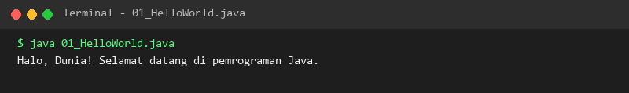](./module-01-pengenalan-java-dan-struktur-program/output/01_HelloWorld.png) |
| **02** | [`02_JavaProgramStructure.java`](./module-01-pengenalan-java-dan-struktur-program/02_JavaProgramStructure.java) | Anatomy of a Java class, structural components, and sequential execution | [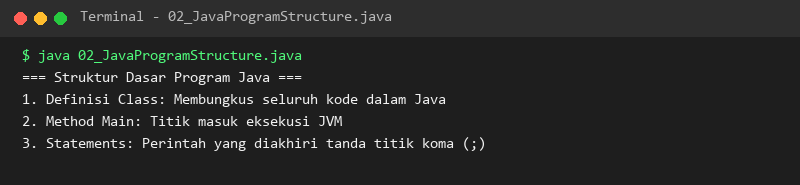](./module-01-pengenalan-java-dan-struktur-program/output/02_JavaProgramStructure.png) |
| **03** | [`03_JavaComments.java`](./module-01-pengenalan-java-dan-struktur-program/03_JavaComments.java) | Single-line, multi-line, and Javadoc documentation comments | [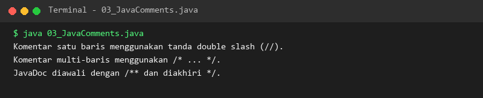](./module-01-pengenalan-java-dan-struktur-program/output/03_JavaComments.png) |
| **04** | [`04_SystemOutPrint.java`](./module-01-pengenalan-java-dan-struktur-program/04_SystemOutPrint.java) | Continuous stream console output without newlines using print() | [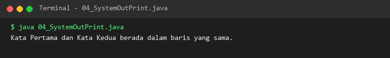](./module-01-pengenalan-java-dan-struktur-program/output/04_SystemOutPrint.png) |
| **05** | [`05_SystemOutPrintln.java`](./module-01-pengenalan-java-dan-struktur-program/05_SystemOutPrintln.java) | Standard console output with trailing newline termination using println() | [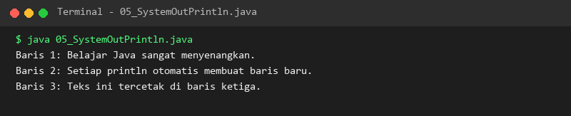](./module-01-pengenalan-java-dan-struktur-program/output/05_SystemOutPrintln.png) |
| **06** | [`06_SystemOutPrintf.java`](./module-01-pengenalan-java-dan-struktur-program/06_SystemOutPrintf.java) | Formatted output specifiers (%s, %d, %.2f, %n) with printf() | [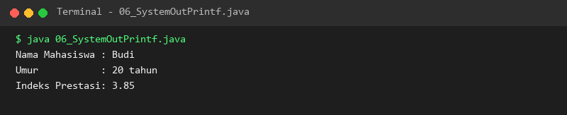](./module-01-pengenalan-java-dan-struktur-program/output/06_SystemOutPrintf.png) |
| **07** | [`07_JavaStatements.java`](./module-01-pengenalan-java-dan-struktur-program/07_JavaStatements.java) | Statements, expressions, variable assignment, and semicolon syntax | [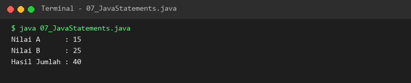](./module-01-pengenalan-java-dan-struktur-program/output/07_JavaStatements.png) |
| **08** | [`08_JavaIdentifiers.java`](./module-01-pengenalan-java-dan-struktur-program/08_JavaIdentifiers.java) | Identifier naming rules, camelCase conventions, and legal character rules | [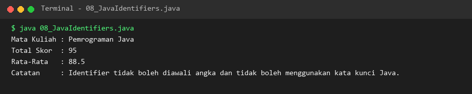](./module-01-pengenalan-java-dan-struktur-program/output/08_JavaIdentifiers.png) |
| **09** | [`09_JavaKeywords.java`](./module-01-pengenalan-java-dan-struktur-program/09_JavaKeywords.java) | Reserved Java keywords, syntax rules, and identifier restrictions | [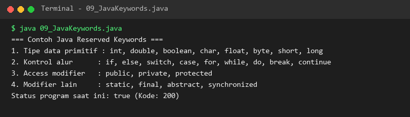](./module-01-pengenalan-java-dan-struktur-program/output/09_JavaKeywords.png) |
| **10** | [`10_CompileAndRun.java`](./module-01-pengenalan-java-dan-struktur-program/10_CompileAndRun.java) | Compilation lifecycle from source (.java) to bytecode (.class) to JVM execution | [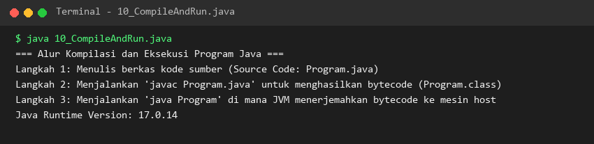](./module-01-pengenalan-java-dan-struktur-program/output/10_CompileAndRun.png) |

### Module 02: Variabel dan Tipe Data (Variables and Data Types)

- **Pedagogical Level:** Level 1: Fundamental
- **Module Overview:** Memory allocation, 8 primitive data types, String reference type, constants with final, type casting, and widening conversions.
- **Module Directory:** [`./module-02-variabel-dan-tipe-data/`](./module-02-variabel-dan-tipe-data) | **Lessons Count:** 14

| Lesson | Source Code | Pedagogical Concept & Scope | Verified Execution Output |
| :---: | :--- | :--- | :---: |
| **11** | [`11_Variables.java`](./module-02-variabel-dan-tipe-data/11_Variables.java) | Variable declaration syntax and memory allocation fundamentals | [](./module-02-variabel-dan-tipe-data/output/11_Variables.png) |
| **12** | [`12_VariableInitialization.java`](./module-02-variabel-dan-tipe-data/12_VariableInitialization.java) | Variable initialization, default unassigned values, and compile-time assignment | [](./module-02-variabel-dan-tipe-data/output/12_VariableInitialization.png) |
| **13** | [`13_ByteDataType.java`](./module-02-variabel-dan-tipe-data/13_ByteDataType.java) | 8-bit signed two's complement integer primitive type (byte) | [](./module-02-variabel-dan-tipe-data/output/13_ByteDataType.png) |
| **14** | [`14_ShortDataType.java`](./module-02-variabel-dan-tipe-data/14_ShortDataType.java) | 16-bit signed integer primitive type (short) | [](./module-02-variabel-dan-tipe-data/output/14_ShortDataType.png) |
| **15** | [`15_IntDataType.java`](./module-02-variabel-dan-tipe-data/15_IntDataType.java) | 32-bit standard integer primitive type (int) | [](./module-02-variabel-dan-tipe-data/output/15_IntDataType.png) |
| **16** | [`16_LongDataType.java`](./module-02-variabel-dan-tipe-data/16_LongDataType.java) | 64-bit wide integer primitive type (long) with literal suffix 'L' | [](./module-02-variabel-dan-tipe-data/output/16_LongDataType.png) |
| **17** | [`17_FloatDataType.java`](./module-02-variabel-dan-tipe-data/17_FloatDataType.java) | Single-precision 32-bit IEEE 754 floating-point primitive (float) with 'f' suffix | [](./module-02-variabel-dan-tipe-data/output/17_FloatDataType.png) |
| **18** | [`18_DoubleDataType.java`](./module-02-variabel-dan-tipe-data/18_DoubleDataType.java) | Double-precision 64-bit IEEE 754 floating-point primitive (double) | [](./module-02-variabel-dan-tipe-data/output/18_DoubleDataType.png) |
| **19** | [`19_CharDataType.java`](./module-02-variabel-dan-tipe-data/19_CharDataType.java) | 16-bit Unicode character primitive (char) and escape sequences | [](./module-02-variabel-dan-tipe-data/output/19_CharDataType.png) |
| **20** | [`20_BooleanDataType.java`](./module-02-variabel-dan-tipe-data/20_BooleanDataType.java) | Logical primitive type (boolean) with true and false literal values | [](./module-02-variabel-dan-tipe-data/output/20_BooleanDataType.png) |
| **21** | [`21_StringDataType.java`](./module-02-variabel-dan-tipe-data/21_StringDataType.java) | Reference data type String, literal allocation, and immutability characteristics | [](./module-02-variabel-dan-tipe-data/output/21_StringDataType.png) |
| **22** | [`22_ConstantsFinal.java`](./module-02-variabel-dan-tipe-data/22_ConstantsFinal.java) | Immutable constant declaration using the final keyword | [](./module-02-variabel-dan-tipe-data/output/22_ConstantsFinal.png) |
| **23** | [`23_TypeCasting.java`](./module-02-variabel-dan-tipe-data/23_TypeCasting.java) | Explicit narrowing type casting and precision truncation handling | [](./module-02-variabel-dan-tipe-data/output/23_TypeCasting.png) |
| **24** | [`24_TypeConversion.java`](./module-02-variabel-dan-tipe-data/24_TypeConversion.java) | Implicit widening automatic type conversion across numeric primitives | [](./module-02-variabel-dan-tipe-data/output/24_TypeConversion.png) |

### Module 03: Input, Output, dan Operator (Input, Output, and Operators)

- **Pedagogical Level:** Level 1: Fundamental
- **Module Overview:** Interactive console input (Scanner & BufferedReader), CLI arguments, arithmetic, bitwise, logical operators, precedence, and Math class utilities.
- **Module Directory:** [`./module-03-input-output-dan-operator/`](./module-03-input-output-dan-operator) | **Lessons Count:** 14

| Lesson | Source Code | Pedagogical Concept & Scope | Verified Execution Output |
| :---: | :--- | :--- | :---: |
| **25** | [`25_ScannerInput.java`](./module-03-input-output-dan-operator/25_ScannerInput.java) | Interactive user input processing from System.in using java.util.Scanner | [](./module-03-input-output-dan-operator/output/25_ScannerInput.png) |
| **26** | [`26_BufferedReaderInput.java`](./module-03-input-output-dan-operator/26_BufferedReaderInput.java) | High-performance buffered console input parsing using BufferedReader | [](./module-03-input-output-dan-operator/output/26_BufferedReaderInput.png) |
| **27** | [`27_CommandLineArguments.java`](./module-03-input-output-dan-operator/27_CommandLineArguments.java) | Processing command-line argument array parameters via String[] args | [](./module-03-input-output-dan-operator/output/27_CommandLineArguments.png) |
| **28** | [`28_ArithmeticOperators.java`](./module-03-input-output-dan-operator/28_ArithmeticOperators.java) | Arithmetic operators (+, -, *, /, %) and integer division behavior | [](./module-03-input-output-dan-operator/output/28_ArithmeticOperators.png) |
| **29** | [`29_AssignmentOperators.java`](./module-03-input-output-dan-operator/29_AssignmentOperators.java) | Compound assignment operators (+=, -=, *=, /=, %=) | [](./module-03-input-output-dan-operator/output/29_AssignmentOperators.png) |
| **30** | [`30_ComparisonOperators.java`](./module-03-input-output-dan-operator/30_ComparisonOperators.java) | Relational comparison operators (==, !=, <, >, <=, >=) | [](./module-03-input-output-dan-operator/output/30_ComparisonOperators.png) |
| **31** | [`31_LogicalOperators.java`](./module-03-input-output-dan-operator/31_LogicalOperators.java) | Boolean logical operators (&&, ||, !) and short-circuit evaluation | [](./module-03-input-output-dan-operator/output/31_LogicalOperators.png) |
| **32** | [`32_IncrementDecrement.java`](./module-03-input-output-dan-operator/32_IncrementDecrement.java) | Prefix and postfix increment (++) and decrement (--) operator evaluation | [](./module-03-input-output-dan-operator/output/32_IncrementDecrement.png) |
| **33** | [`33_BitwiseOperators.java`](./module-03-input-output-dan-operator/33_BitwiseOperators.java) | Bitwise manipulation and bit shift operations (&, |, ^, ~, <<, >>, >>>) | [](./module-03-input-output-dan-operator/output/33_BitwiseOperators.png) |
| **34** | [`34_TernaryOperator.java`](./module-03-input-output-dan-operator/34_TernaryOperator.java) | Inline conditional ternary expression (condition ? expr1 : expr2) | [](./module-03-input-output-dan-operator/output/34_TernaryOperator.png) |
| **35** | [`35_OperatorPrecedence.java`](./module-03-input-output-dan-operator/35_OperatorPrecedence.java) | Operator precedence hierarchy and evaluation ordering in expressions | [](./module-03-input-output-dan-operator/output/35_OperatorPrecedence.png) |
| **36** | [`36_StringConcatenation.java`](./module-03-input-output-dan-operator/36_StringConcatenation.java) | String concatenation using the overloaded + operator and type coercion | [](./module-03-input-output-dan-operator/output/36_StringConcatenation.png) |
| **37** | [`37_StringFormatting.java`](./module-03-input-output-dan-operator/37_StringFormatting.java) | Template text formatting using String.format() and alignment specifiers | [](./module-03-input-output-dan-operator/output/37_StringFormatting.png) |
| **38** | [`38_MathClass.java`](./module-03-input-output-dan-operator/38_MathClass.java) | Mathematical operations and functions from java.lang.Math | [](./module-03-input-output-dan-operator/output/38_MathClass.png) |

### Module 04: Percabangan dan Pengambilan Keputusan (Control Flow and Decision Making)

- **Pedagogical Level:** Level 1: Fundamental
- **Module Overview:** Conditional branching (if, if-else, else-if ladders), nested conditionals, classic switch, modern switch expressions, and practical decision programs.
- **Module Directory:** [`./module-04-percabangan-dan-pengambilan-keputusan/`](./module-04-percabangan-dan-pengambilan-keputusan) | **Lessons Count:** 12

| Lesson | Source Code | Pedagogical Concept & Scope | Verified Execution Output |
| :---: | :--- | :--- | :---: |
| **39** | [`39_IfStatement.java`](./module-04-percabangan-dan-pengambilan-keputusan/39_IfStatement.java) | Single conditional decision branching using the if statement | [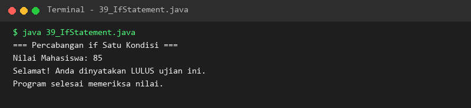](./module-04-percabangan-dan-pengambilan-keputusan/output/39_IfStatement.png) |
| **40** | [`40_IfElseStatement.java`](./module-04-percabangan-dan-pengambilan-keputusan/40_IfElseStatement.java) | Binary decision branching using if-else control structures | [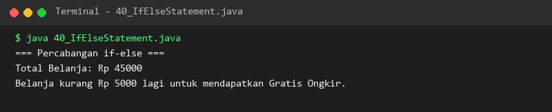](./module-04-percabangan-dan-pengambilan-keputusan/output/40_IfElseStatement.png) |
| **41** | [`41_ElseIfStatement.java`](./module-04-percabangan-dan-pengambilan-keputusan/41_ElseIfStatement.java) | Multi-branch decision ladder evaluation with else-if chains | [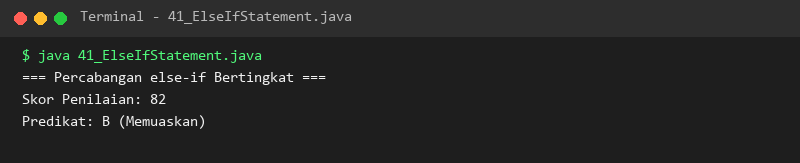](./module-04-percabangan-dan-pengambilan-keputusan/output/41_ElseIfStatement.png) |
| **42** | [`42_NestedIf.java`](./module-04-percabangan-dan-pengambilan-keputusan/42_NestedIf.java) | Hierarchical nested conditional decision-making structures | [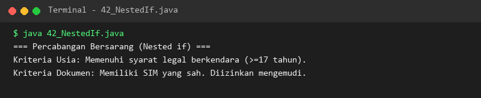](./module-04-percabangan-dan-pengambilan-keputusan/output/42_NestedIf.png) |
| **43** | [`43_SwitchStatement.java`](./module-04-percabangan-dan-pengambilan-keputusan/43_SwitchStatement.java) | Multi-case branching with traditional switch-case-break-default syntax | [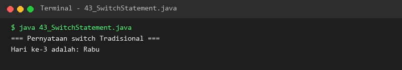](./module-04-percabangan-dan-pengambilan-keputusan/output/43_SwitchStatement.png) |
| **44** | [`44_SwitchExpression.java`](./module-04-percabangan-dan-pengambilan-keputusan/44_SwitchExpression.java) | Modern switch expressions with arrow syntax returning computed values | [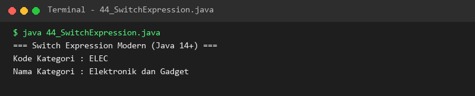](./module-04-percabangan-dan-pengambilan-keputusan/output/44_SwitchExpression.png) |
| **45** | [`45_NestedSwitch.java`](./module-04-percabangan-dan-pengambilan-keputusan/45_NestedSwitch.java) | Multi-level nested switch statements for categorical routing | [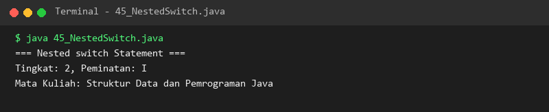](./module-04-percabangan-dan-pengambilan-keputusan/output/45_NestedSwitch.png) |
| **46** | [`46_GradeCalculator.java`](./module-04-percabangan-dan-pengambilan-keputusan/46_GradeCalculator.java) | Practical application: Academic score calculation and grade determination | [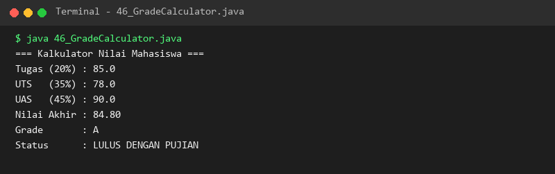](./module-04-percabangan-dan-pengambilan-keputusan/output/46_GradeCalculator.png) |
| **47** | [`47_EvenOddChecker.java`](./module-04-percabangan-dan-pengambilan-keputusan/47_EvenOddChecker.java) | Practical application: Integer parity validation using modulus evaluation | [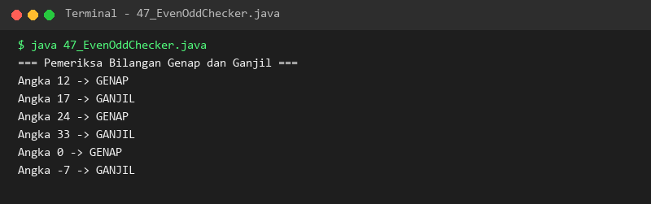](./module-04-percabangan-dan-pengambilan-keputusan/output/47_EvenOddChecker.png) |
| **48** | [`48_LeapYearChecker.java`](./module-04-percabangan-dan-pengambilan-keputusan/48_LeapYearChecker.java) | Practical application: Gregorian calendar leap year determination algorithm | [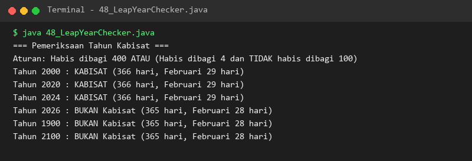](./module-04-percabangan-dan-pengambilan-keputusan/output/48_LeapYearChecker.png) |
| **49** | [`49_LoginValidation.java`](./module-04-percabangan-dan-pengambilan-keputusan/49_LoginValidation.java) | Practical application: User credential validation and access control gatekeeper | [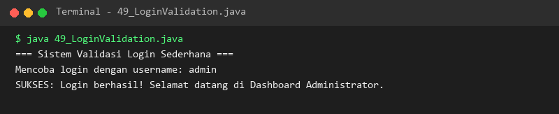](./module-04-percabangan-dan-pengambilan-keputusan/output/49_LoginValidation.png) |
| **50** | [`50_DiscountCalculator.java`](./module-04-percabangan-dan-pengambilan-keputusan/50_DiscountCalculator.java) | Practical application: Tiered e-commerce customer discount and total price calculator | [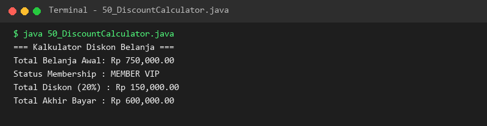](./module-04-percabangan-dan-pengambilan-keputusan/output/50_DiscountCalculator.png) |

### Module 05: Perulangan (Loops and Iteration)

- **Pedagogical Level:** Level 1: Fundamental
- **Module Overview:** Definite and indefinite loops (for, while, do-while), nested iterations, loop control (break, continue, labeled jumps), enhanced for-each, and pattern generation.
- **Module Directory:** [`./module-05-perulangan/`](./module-05-perulangan) | **Lessons Count:** 14

| Lesson | Source Code | Pedagogical Concept & Scope | Verified Execution Output |
| :---: | :--- | :--- | :---: |
| **51** | [`51_ForLoop.java`](./module-05-perulangan/51_ForLoop.java) | Standard indexed loop iteration with initialization, condition, and step updates | [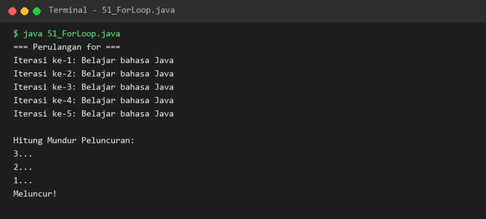](./module-05-perulangan/output/51_ForLoop.png) |
| **52** | [`52_WhileLoop.java`](./module-05-perulangan/52_WhileLoop.java) | Pre-condition evaluation iteration loop for indefinite repetitions | [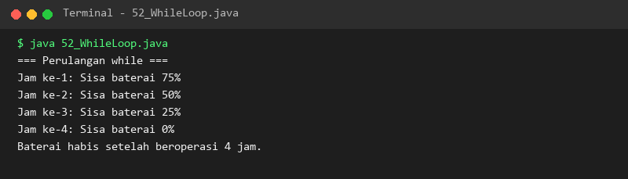](./module-05-perulangan/output/52_WhileLoop.png) |
| **53** | [`53_DoWhileLoop.java`](./module-05-perulangan/53_DoWhileLoop.java) | Post-condition evaluated iteration loop guaranteeing at least one execution | [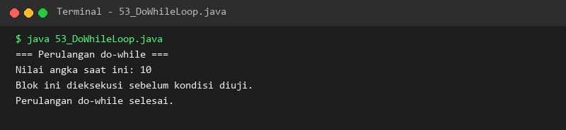](./module-05-perulangan/output/53_DoWhileLoop.png) |
| **54** | [`54_NestedLoop.java`](./module-05-perulangan/54_NestedLoop.java) | Two-dimensional multi-tiered nested looping structures | [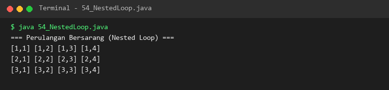](./module-05-perulangan/output/54_NestedLoop.png) |
| **55** | [`55_BreakStatement.java`](./module-05-perulangan/55_BreakStatement.java) | Early loop termination control using the break statement | [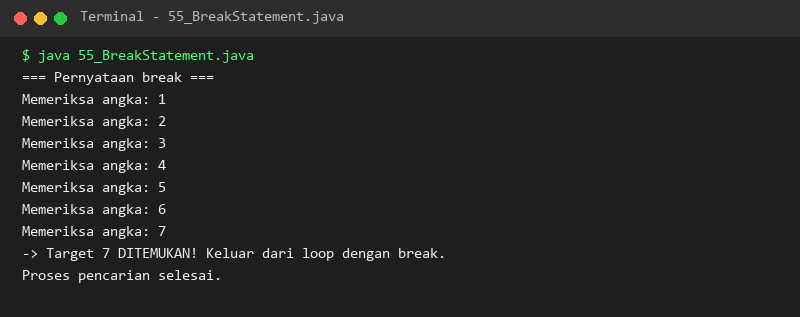](./module-05-perulangan/output/55_BreakStatement.png) |
| **56** | [`56_ContinueStatement.java`](./module-05-perulangan/56_ContinueStatement.java) | Skipping current loop iteration passes using the continue statement | [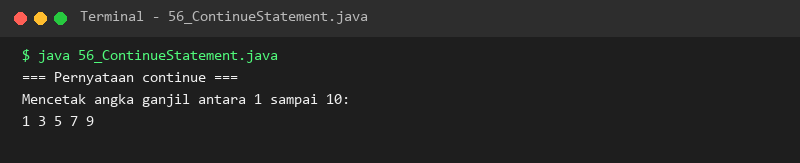](./module-05-perulangan/output/56_ContinueStatement.png) |
| **57** | [`57_LabeledBreak.java`](./module-05-perulangan/57_LabeledBreak.java) | Exiting outer enclosing loop scopes using labeled break statements | [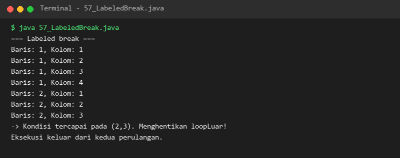](./module-05-perulangan/output/57_LabeledBreak.png) |
| **58** | [`58_LabeledContinue.java`](./module-05-perulangan/58_LabeledContinue.java) | Skipping to the next iteration of an outer loop using labeled continue | [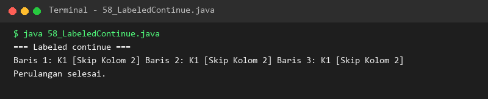](./module-05-perulangan/output/58_LabeledContinue.png) |
| **59** | [`59_EnhancedForLoop.java`](./module-05-perulangan/59_EnhancedForLoop.java) | Enhanced for-each loop iterating across array and collection elements | [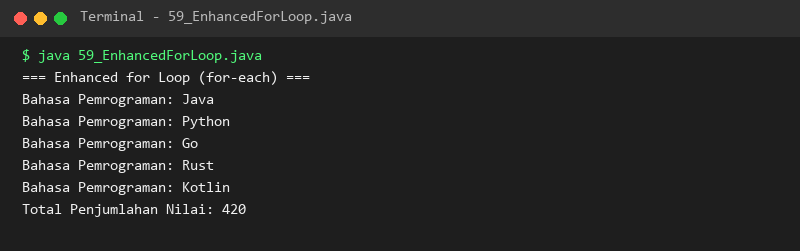](./module-05-perulangan/output/59_EnhancedForLoop.png) |
| **60** | [`60_LoopCounter.java`](./module-05-perulangan/60_LoopCounter.java) | Counter pattern tracking step occurrences and iteration boundaries | [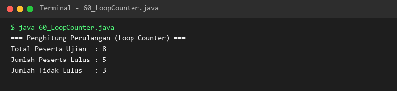](./module-05-perulangan/output/60_LoopCounter.png) |
| **61** | [`61_SumNumbers.java`](./module-05-perulangan/61_SumNumbers.java) | Accumulator pattern computing arithmetic series summations | [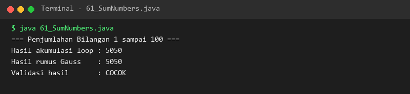](./module-05-perulangan/output/61_SumNumbers.png) |
| **62** | [`62_FactorialLoop.java`](./module-05-perulangan/62_FactorialLoop.java) | Iterative computation of factorial numbers (n!) using loops | [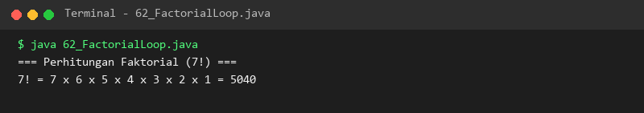](./module-05-perulangan/output/62_FactorialLoop.png) |
| **63** | [`63_MultiplicationTable.java`](./module-05-perulangan/63_MultiplicationTable.java) | Algorithmic generation of 2D mathematical multiplication tables | [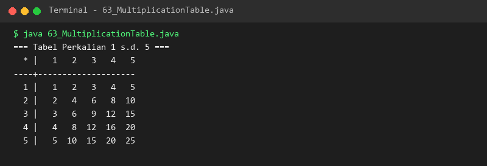](./module-05-perulangan/output/63_MultiplicationTable.png) |
| **64** | [`64_NumberPatterns.java`](./module-05-perulangan/64_NumberPatterns.java) | Algorithmic rendering of triangular, pyramid, and geometric asterisk patterns | [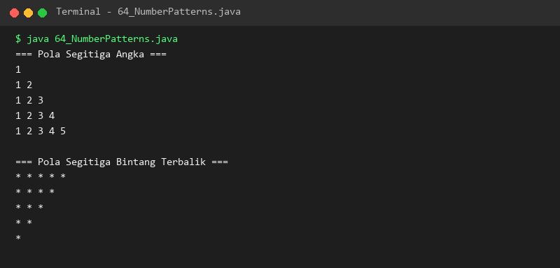](./module-05-perulangan/output/64_NumberPatterns.png) |

### Module 06: Method dan Modularisasi Program (Methods and Program Modularization)

- **Pedagogical Level:** Level 1: Fundamental
- **Module Overview:** Modular decomposition, method signatures, return types, overloading, varargs, variable scopes, static vs instance methods, recursion, and packages.
- **Module Directory:** [`./module-06-method-dan-modularisasi-program/`](./module-06-method-dan-modularisasi-program) | **Lessons Count:** 14

| Lesson | Source Code | Pedagogical Concept & Scope | Verified Execution Output |
| :---: | :--- | :--- | :---: |
| **65** | [`65_MethodBasic.java`](./module-06-method-dan-modularisasi-program/65_MethodBasic.java) | Method declaration syntax, signature anatomy, and method execution | [](./module-06-method-dan-modularisasi-program/output/65_MethodBasic.png) |
| **66** | [`66_MethodParameters.java`](./module-06-method-dan-modularisasi-program/66_MethodParameters.java) | Passing parameters, arguments handling, and pass-by-value semantics | [](./module-06-method-dan-modularisasi-program/output/66_MethodParameters.png) |
| **67** | [`67_ReturnStatement.java`](./module-06-method-dan-modularisasi-program/67_ReturnStatement.java) | Returning typed values from methods and early exit control | [](./module-06-method-dan-modularisasi-program/output/67_ReturnStatement.png) |
| **68** | [`68_VoidMethods.java`](./module-06-method-dan-modularisasi-program/68_VoidMethods.java) | Procedural methods with side-effects using the void return type | [](./module-06-method-dan-modularisasi-program/output/68_VoidMethods.png) |
| **69** | [`69_MethodOverloading.java`](./module-06-method-dan-modularisasi-program/69_MethodOverloading.java) | Defining overloaded methods with distinct parameter signatures | [](./module-06-method-dan-modularisasi-program/output/69_MethodOverloading.png) |
| **70** | [`70_VarargsMethods.java`](./module-06-method-dan-modularisasi-program/70_VarargsMethods.java) | Variable-length argument methods (Type... args) for dynamic input lists | [](./module-06-method-dan-modularisasi-program/output/70_VarargsMethods.png) |
| **71** | [`71_MethodScope.java`](./module-06-method-dan-modularisasi-program/71_MethodScope.java) | Variable scope boundaries: local, block, method, and class levels | [](./module-06-method-dan-modularisasi-program/output/71_MethodScope.png) |
| **72** | [`72_StaticMethods.java`](./module-06-method-dan-modularisasi-program/72_StaticMethods.java) | Class-level static utility methods called without object instantiation | [](./module-06-method-dan-modularisasi-program/output/72_StaticMethods.png) |
| **73** | [`73_InstanceMethods.java`](./module-06-method-dan-modularisasi-program/73_InstanceMethods.java) | Object-bound instance methods operating on state properties | [](./module-06-method-dan-modularisasi-program/output/73_InstanceMethods.png) |
| **74** | [`74_RecursiveMethods.java`](./module-06-method-dan-modularisasi-program/74_RecursiveMethods.java) | Recursive method mechanics, base termination conditions, and call stacks | [](./module-06-method-dan-modularisasi-program/output/74_RecursiveMethods.png) |
| **75** | [`75_RecursiveFactorial.java`](./module-06-method-dan-modularisasi-program/75_RecursiveFactorial.java) | Recursive implementation of the mathematical factorial function | [](./module-06-method-dan-modularisasi-program/output/75_RecursiveFactorial.png) |
| **76** | [`76_RecursiveFibonacci.java`](./module-06-method-dan-modularisasi-program/76_RecursiveFibonacci.java) | Recursive calculation of Fibonacci sequence numbers | [](./module-06-method-dan-modularisasi-program/output/76_RecursiveFibonacci.png) |
| **77** | [`77_MethodReferencesIntro.java`](./module-06-method-dan-modularisasi-program/77_MethodReferencesIntro.java) | Introduction to method references syntax (Class::method) | [](./module-06-method-dan-modularisasi-program/output/77_MethodReferencesIntro.png) |
| **78** | [`78_PackagesBasic.java`](./module-06-method-dan-modularisasi-program/78_PackagesBasic.java) | Code modularization, package organization, and import statements | [](./module-06-method-dan-modularisasi-program/output/78_PackagesBasic.png) |

### Module 07: Array dan Manipulasi String (Arrays and String Manipulation)

- **Pedagogical Level:** Level 2: Data Structures & OOP
- **Module Overview:** 1D/2D arrays, indexing, traversals, matrix math, linear search, sorting, String immutability, StringBuilder, StringBuffer, RegEx, and text tokenization.
- **Module Directory:** [`./module-07-array-dan-manipulasi-string/`](./module-07-array-dan-manipulasi-string) | **Lessons Count:** 22

| Lesson | Source Code | Pedagogical Concept & Scope | Verified Execution Output |
| :---: | :--- | :--- | :---: |
| **79** | [`79_ArrayBasic.java`](./module-07-array-dan-manipulasi-string/79_ArrayBasic.java) | Single-dimensional array declaration, contiguous memory, and fixed sizing | [](./module-07-array-dan-manipulasi-string/output/79_ArrayBasic.png) |
| **80** | [`80_ArrayInitialization.java`](./module-07-array-dan-manipulasi-string/80_ArrayInitialization.java) | Array instantiation, default element values, and inline literal initialization | [](./module-07-array-dan-manipulasi-string/output/80_ArrayInitialization.png) |
| **81** | [`81_ArrayIndexing.java`](./module-07-array-dan-manipulasi-string/81_ArrayIndexing.java) | Zero-based indexing, element mutation, and bounds error protection | [](./module-07-array-dan-manipulasi-string/output/81_ArrayIndexing.png) |
| **82** | [`82_ArrayIteration.java`](./module-07-array-dan-manipulasi-string/82_ArrayIteration.java) | Array traversal using indexed for loops and enhanced for-each syntax | [](./module-07-array-dan-manipulasi-string/output/82_ArrayIteration.png) |
| **83** | [`83_ArraySumAverage.java`](./module-07-array-dan-manipulasi-string/83_ArraySumAverage.java) | Statistical array aggregation calculating total sum and arithmetic mean | [](./module-07-array-dan-manipulasi-string/output/83_ArraySumAverage.png) |
| **84** | [`84_ArrayMinMax.java`](./module-07-array-dan-manipulasi-string/84_ArrayMinMax.java) | Linear scan algorithm determining minimum and maximum array elements | [](./module-07-array-dan-manipulasi-string/output/84_ArrayMinMax.png) |
| **85** | [`85_ArraySearch.java`](./module-07-array-dan-manipulasi-string/85_ArraySearch.java) | Linear search algorithm finding target values and index positions | [](./module-07-array-dan-manipulasi-string/output/85_ArraySearch.png) |
| **86** | [`86_ArraySorting.java`](./module-07-array-dan-manipulasi-string/86_ArraySorting.java) | Array sorting algorithms and in-place sorting via java.util.Arrays.sort() | [](./module-07-array-dan-manipulasi-string/output/86_ArraySorting.png) |
| **87** | [`87_MultidimensionalArray.java`](./module-07-array-dan-manipulasi-string/87_MultidimensionalArray.java) | Two-dimensional matrices, row-column structures, and jagged arrays | [](./module-07-array-dan-manipulasi-string/output/87_MultidimensionalArray.png) |
| **88** | [`88_MatrixAddition.java`](./module-07-array-dan-manipulasi-string/88_MatrixAddition.java) | Matrix mathematics: element-wise addition of two 2D matrices | [](./module-07-array-dan-manipulasi-string/output/88_MatrixAddition.png) |
| **89** | [`89_MatrixMultiplication.java`](./module-07-array-dan-manipulasi-string/89_MatrixMultiplication.java) | Matrix mathematics: row-by-column dot product multiplication | [](./module-07-array-dan-manipulasi-string/output/89_MatrixMultiplication.png) |
| **90** | [`90_StringMethods.java`](./module-07-array-dan-manipulasi-string/90_StringMethods.java) | Core String inspection methods (length, charAt, substring, trim) | [](./module-07-array-dan-manipulasi-string/output/90_StringMethods.png) |
| **91** | [`91_StringComparison.java`](./module-07-array-dan-manipulasi-string/91_StringComparison.java) | Value comparison (equals, equalsIgnoreCase) vs reference equality (==) | [](./module-07-array-dan-manipulasi-string/output/91_StringComparison.png) |
| **92** | [`92_StringSearching.java`](./module-07-array-dan-manipulasi-string/92_StringSearching.java) | Substring search methods (indexOf, lastIndexOf, contains, startsWith) | [](./module-07-array-dan-manipulasi-string/output/92_StringSearching.png) |
| **93** | [`93_StringReplacement.java`](./module-07-array-dan-manipulasi-string/93_StringReplacement.java) | Character and substring replacement using replace() and replaceAll() | [](./module-07-array-dan-manipulasi-string/output/93_StringReplacement.png) |
| **94** | [`94_StringSplitting.java`](./module-07-array-dan-manipulasi-string/94_StringSplitting.java) | Splitting delimited text strings into arrays with split() | [](./module-07-array-dan-manipulasi-string/output/94_StringSplitting.png) |
| **95** | [`95_StringBuilder.java`](./module-07-array-dan-manipulasi-string/95_StringBuilder.java) | High-performance mutable character sequence construction with StringBuilder | [](./module-07-array-dan-manipulasi-string/output/95_StringBuilder.png) |
| **96** | [`96_StringBuffer.java`](./module-07-array-dan-manipulasi-string/96_StringBuffer.java) | Thread-safe synchronized mutable string manipulation with StringBuffer | [](./module-07-array-dan-manipulasi-string/output/96_StringBuffer.png) |
| **97** | [`97_StringFormatting.java`](./module-07-array-dan-manipulasi-string/97_StringFormatting.java) | String template formatting with flags, precision, and column padding | [](./module-07-array-dan-manipulasi-string/output/97_StringFormatting.png) |
| **98** | [`98_RegularExpressions.java`](./module-07-array-dan-manipulasi-string/98_RegularExpressions.java) | Regex pattern matching and validation using Pattern and Matcher | [](./module-07-array-dan-manipulasi-string/output/98_RegularExpressions.png) |
| **99** | [`99_StringTokenizer.java`](./module-07-array-dan-manipulasi-string/99_StringTokenizer.java) | Parsing text tokens with custom delimiters using StringTokenizer | [](./module-07-array-dan-manipulasi-string/output/99_StringTokenizer.png) |
| **100** | [`100_TextProcessing.java`](./module-07-array-dan-manipulasi-string/100_TextProcessing.java) | Comprehensive text analysis: word counting, sentence parsing, and metrics | [](./module-07-array-dan-manipulasi-string/output/100_TextProcessing.png) |

### Module 08: OOP Dasar (Object-Oriented Programming (OOP) Fundamentals)

- **Pedagogical Level:** Level 2: Data Structures & OOP
- **Module Overview:** Classes, objects, constructors, this keyword, encapsulation, access modifiers, getters/setters, static members, final constraints, and java.lang.Object methods.
- **Module Directory:** [`./module-08-oop-dasar/`](./module-08-oop-dasar) | **Lessons Count:** 20

| Lesson | Source Code | Pedagogical Concept & Scope | Verified Execution Output |
| :---: | :--- | :--- | :---: |
| **101** | [`101_ClassBasic.java`](./module-08-oop-dasar/101_ClassBasic.java) | Class blueprint definition, state encapsulation, and behavior modeling | [](./module-08-oop-dasar/output/101_ClassBasic.png) |
| **102** | [`102_ObjectInstantiation.java`](./module-08-oop-dasar/102_ObjectInstantiation.java) | Object instantiation in heap memory using the new operator | [](./module-08-oop-dasar/output/102_ObjectInstantiation.png) |
| **103** | [`103_InstanceVariables.java`](./module-08-oop-dasar/103_InstanceVariables.java) | Instance-level fields and per-object memory state segregation | [](./module-08-oop-dasar/output/103_InstanceVariables.png) |
| **104** | [`104_InstanceMethods.java`](./module-08-oop-dasar/104_InstanceMethods.java) | Instance methods manipulating and operating on internal object fields | [](./module-08-oop-dasar/output/104_InstanceMethods.png) |
| **105** | [`105_Constructors.java`](./module-08-oop-dasar/105_Constructors.java) | Default and parameterized constructor definitions for state initialization | [](./module-08-oop-dasar/output/105_Constructors.png) |
| **106** | [`106_ConstructorOverloading.java`](./module-08-oop-dasar/106_ConstructorOverloading.java) | Defining multiple constructors with distinct parameter signatures | [](./module-08-oop-dasar/output/106_ConstructorOverloading.png) |
| **107** | [`107_ThisKeyword.java`](./module-08-oop-dasar/107_ThisKeyword.java) | Field disambiguation and constructor chaining using the this keyword | [](./module-08-oop-dasar/output/107_ThisKeyword.png) |
| **108** | [`108_AccessModifiers.java`](./module-08-oop-dasar/108_AccessModifiers.java) | Access control levels: public, private, protected, and package-private | [](./module-08-oop-dasar/output/108_AccessModifiers.png) |
| **109** | [`109_Encapsulation.java`](./module-08-oop-dasar/109_Encapsulation.java) | Information hiding principles protecting class state from direct external mutation | [](./module-08-oop-dasar/output/109_Encapsulation.png) |
| **110** | [`110_GettersSetters.java`](./module-08-oop-dasar/110_GettersSetters.java) | Accessor and mutator methods with data validation logic | [](./module-08-oop-dasar/output/110_GettersSetters.png) |
| **111** | [`111_StaticVariables.java`](./module-08-oop-dasar/111_StaticVariables.java) | Class-level static variables shared across all instantiated objects | [](./module-08-oop-dasar/output/111_StaticVariables.png) |
| **112** | [`112_StaticMethods.java`](./module-08-oop-dasar/112_StaticMethods.java) | Static utility methods operating independently of instance state | [](./module-08-oop-dasar/output/112_StaticMethods.png) |
| **113** | [`113_StaticBlocks.java`](./module-08-oop-dasar/113_StaticBlocks.java) | Static initialization blocks executed upon class loading | [](./module-08-oop-dasar/output/113_StaticBlocks.png) |
| **114** | [`114_FinalVariables.java`](./module-08-oop-dasar/114_FinalVariables.java) | Declaring immutable fields and constants using the final modifier | [](./module-08-oop-dasar/output/114_FinalVariables.png) |
| **115** | [`115_FinalMethods.java`](./module-08-oop-dasar/115_FinalMethods.java) | Preventing method overriding in subclasses using final methods | [](./module-08-oop-dasar/output/115_FinalMethods.png) |
| **116** | [`116_FinalClasses.java`](./module-08-oop-dasar/116_FinalClasses.java) | Preventing class inheritance extension by declaring final classes | [](./module-08-oop-dasar/output/116_FinalClasses.png) |
| **117** | [`117_ObjectClass.java`](./module-08-oop-dasar/117_ObjectClass.java) | The universal root parent class java.lang.Object in the Java type hierarchy | [](./module-08-oop-dasar/output/117_ObjectClass.png) |
| **118** | [`118_ToStringMethod.java`](./module-08-oop-dasar/118_ToStringMethod.java) | Overriding the toString() method for readable string representations | [](./module-08-oop-dasar/output/118_ToStringMethod.png) |
| **119** | [`119_EqualsMethod.java`](./module-08-oop-dasar/119_EqualsMethod.java) | Overriding equals() for logical content comparison between objects | [](./module-08-oop-dasar/output/119_EqualsMethod.png) |
| **120** | [`120_HashCodeMethod.java`](./module-08-oop-dasar/120_HashCodeMethod.java) | Overriding hashCode() to maintain the equals-hashCode contract | [](./module-08-oop-dasar/output/120_HashCodeMethod.png) |

### Module 09: OOP Lanjutan (Advanced Object-Oriented Programming)

- **Pedagogical Level:** Level 2: Data Structures & OOP
- **Module Overview:** Inheritance hierarchies, super keyword, method overriding, runtime polymorphism, abstract classes, interfaces, default/static methods, composition, and inner classes.
- **Module Directory:** [`./module-09-oop-lanjutan/`](./module-09-oop-lanjutan) | **Lessons Count:** 20

| Lesson | Source Code | Pedagogical Concept & Scope | Verified Execution Output |
| :---: | :--- | :--- | :---: |
| **121** | [`121_Inheritance.java`](./module-09-oop-lanjutan/121_Inheritance.java) | Class inheritance principles using the extends keyword for code reuse | [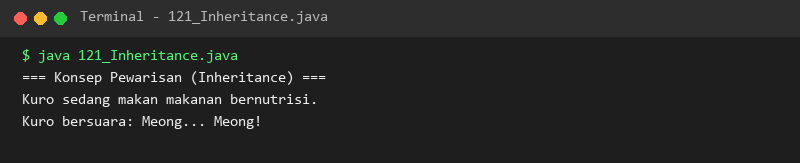](./module-09-oop-lanjutan/output/121_Inheritance.png) |
| **122** | [`122_SingleInheritance.java`](./module-09-oop-lanjutan/122_SingleInheritance.java) | Single direct inheritance between a parent and child class | [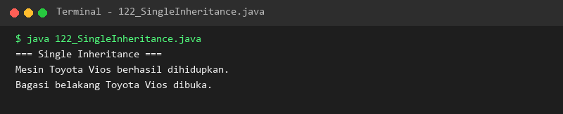](./module-09-oop-lanjutan/output/122_SingleInheritance.png) |
| **123** | [`123_MultilevelInheritance.java`](./module-09-oop-lanjutan/123_MultilevelInheritance.java) | Multilevel inheritance chains traversing successive derived classes | [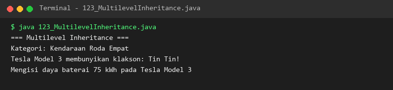](./module-09-oop-lanjutan/output/123_MultilevelInheritance.png) |
| **124** | [`124_HierarchicalInheritance.java`](./module-09-oop-lanjutan/124_HierarchicalInheritance.java) | Hierarchical inheritance with multiple child classes extending one parent | [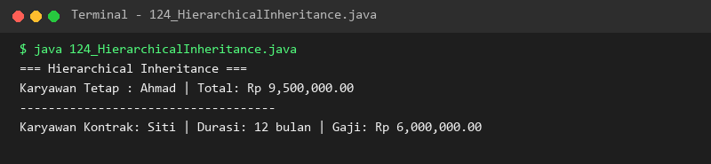](./module-09-oop-lanjutan/output/124_HierarchicalInheritance.png) |
| **125** | [`125_SuperKeyword.java`](./module-09-oop-lanjutan/125_SuperKeyword.java) | Accessing parent members and invoking parent constructors with super() | [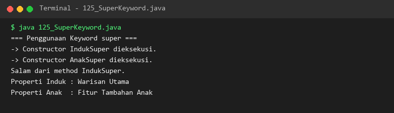](./module-09-oop-lanjutan/output/125_SuperKeyword.png) |
| **126** | [`126_MethodOverriding.java`](./module-09-oop-lanjutan/126_MethodOverriding.java) | Overriding parent class methods in child classes using @Override | [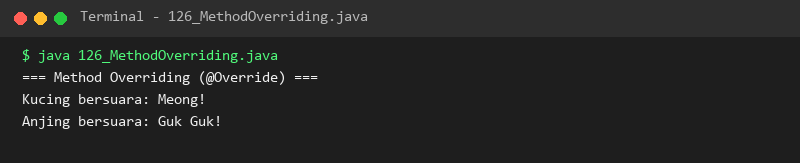](./module-09-oop-lanjutan/output/126_MethodOverriding.png) |
| **127** | [`127_Polymorphism.java`](./module-09-oop-lanjutan/127_Polymorphism.java) | Polymorphic method behavior treating diverse derived objects uniformly | [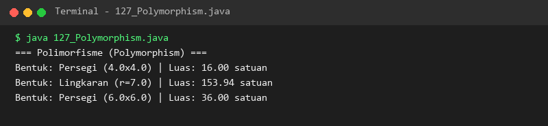](./module-09-oop-lanjutan/output/127_Polymorphism.png) |
| **128** | [`128_DynamicMethodDispatch.java`](./module-09-oop-lanjutan/128_DynamicMethodDispatch.java) | Runtime resolution of overridden methods via dynamic method dispatch | [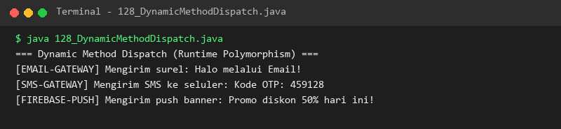](./module-09-oop-lanjutan/output/128_DynamicMethodDispatch.png) |
| **129** | [`129_AbstractClasses.java`](./module-09-oop-lanjutan/129_AbstractClasses.java) | Declaring abstract template classes using the abstract keyword | [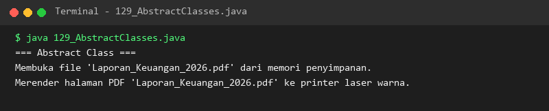](./module-09-oop-lanjutan/output/129_AbstractClasses.png) |
| **130** | [`130_AbstractMethods.java`](./module-09-oop-lanjutan/130_AbstractMethods.java) | Defining abstract method contracts enforced upon extending subclasses | [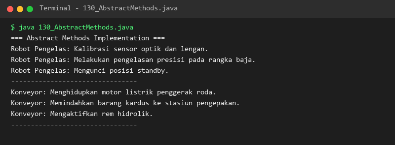](./module-09-oop-lanjutan/output/130_AbstractMethods.png) |
| **131** | [`131_Interfaces.java`](./module-09-oop-lanjutan/131_Interfaces.java) | Declaring pure behavioral contracts using the interface keyword | [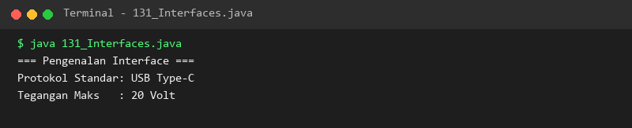](./module-09-oop-lanjutan/output/131_Interfaces.png) |
| **132** | [`132_InterfaceImplementation.java`](./module-09-oop-lanjutan/132_InterfaceImplementation.java) | Implementing interface method contracts using the implements keyword | [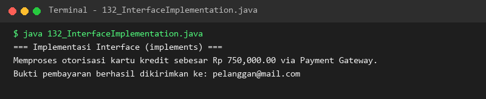](./module-09-oop-lanjutan/output/132_InterfaceImplementation.png) |
| **133** | [`133_MultipleInterfaces.java`](./module-09-oop-lanjutan/133_MultipleInterfaces.java) | Multiple interface implementation achieving multiple behavior inheritance | [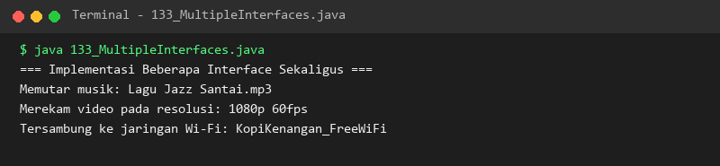](./module-09-oop-lanjutan/output/133_MultipleInterfaces.png) |
| **134** | [`134_DefaultInterfaceMethods.java`](./module-09-oop-lanjutan/134_DefaultInterfaceMethods.java) | Providing backward-compatible concrete implementations with default methods | [](./module-09-oop-lanjutan/output/134_DefaultInterfaceMethods.png) |
| **135** | [`135_StaticInterfaceMethods.java`](./module-09-oop-lanjutan/135_StaticInterfaceMethods.java) | Defining static utility methods directly within interface definitions | [](./module-09-oop-lanjutan/output/135_StaticInterfaceMethods.png) |
| **136** | [`136_InterfaceInheritance.java`](./module-09-oop-lanjutan/136_InterfaceInheritance.java) | Extending and composing multiple interfaces using the extends keyword | [](./module-09-oop-lanjutan/output/136_InterfaceInheritance.png) |
| **137** | [`137_Composition.java`](./module-09-oop-lanjutan/137_Composition.java) | Strong 'has-a' composition modeling where component lifecycles are bound | [](./module-09-oop-lanjutan/output/137_Composition.png) |
| **138** | [`138_Aggregation.java`](./module-09-oop-lanjutan/138_Aggregation.java) | Loose 'has-a' aggregation where associated objects exist independently | [](./module-09-oop-lanjutan/output/138_Aggregation.png) |
| **139** | [`139_NestedClasses.java`](./module-09-oop-lanjutan/139_NestedClasses.java) | Static nested classes and non-static inner member classes | [](./module-09-oop-lanjutan/output/139_NestedClasses.png) |
| **140** | [`140_AnonymousClasses.java`](./module-09-oop-lanjutan/140_AnonymousClasses.java) | On-the-fly anonymous inner classes for ad-hoc interface implementation | [](./module-09-oop-lanjutan/output/140_AnonymousClasses.png) |

### Module 10: Exception Handling (Exception and Error Handling)

- **Pedagogical Level:** Level 2: Data Structures & OOP
- **Module Overview:** Throwable hierarchy, try-catch-finally, multiple catch blocks, throw/throws, checked vs unchecked exceptions, custom exceptions, try-with-resources, and assertions.
- **Module Directory:** [`./module-10-exception-handling/`](./module-10-exception-handling) | **Lessons Count:** 16

| Lesson | Source Code | Pedagogical Concept & Scope | Verified Execution Output |
| :---: | :--- | :--- | :---: |
| **141** | [`141_ExceptionBasic.java`](./module-10-exception-handling/141_ExceptionBasic.java) | Exception hierarchy (Throwable, Exception, Error) and runtime error mechanics | [](./module-10-exception-handling/output/141_ExceptionBasic.png) |
| **142** | [`142_TryCatch.java`](./module-10-exception-handling/142_TryCatch.java) | Intercepting and handling runtime exceptions with try-catch blocks | [](./module-10-exception-handling/output/142_TryCatch.png) |
| **143** | [`143_MultipleCatch.java`](./module-10-exception-handling/143_MultipleCatch.java) | Handling multiple exception types ordered from specific to general | [](./module-10-exception-handling/output/143_MultipleCatch.png) |
| **144** | [`144_FinallyBlock.java`](./module-10-exception-handling/144_FinallyBlock.java) | Guaranteed resource cleanup execution logic using the finally block | [](./module-10-exception-handling/output/144_FinallyBlock.png) |
| **145** | [`145_ThrowKeyword.java`](./module-10-exception-handling/145_ThrowKeyword.java) | Explicitly throwing exception instances using the throw keyword | [](./module-10-exception-handling/output/145_ThrowKeyword.png) |
| **146** | [`146_ThrowsKeyword.java`](./module-10-exception-handling/146_ThrowsKeyword.java) | Declaring exception propagation in method signatures with throws | [](./module-10-exception-handling/output/146_ThrowsKeyword.png) |
| **147** | [`147_CheckedExceptions.java`](./module-10-exception-handling/147_CheckedExceptions.java) | Handling compile-time verified checked exceptions (IOException, SQLException) | [](./module-10-exception-handling/output/147_CheckedExceptions.png) |
| **148** | [`148_UncheckedExceptions.java`](./module-10-exception-handling/148_UncheckedExceptions.java) | Managing runtime unchecked exceptions (NullPointerException, ArithmeticException) | [](./module-10-exception-handling/output/148_UncheckedExceptions.png) |
| **149** | [`149_CustomExceptions.java`](./module-10-exception-handling/149_CustomExceptions.java) | Designing domain-specific custom exception classes extending Exception | [](./module-10-exception-handling/output/149_CustomExceptions.png) |
| **150** | [`150_ExceptionPropagation.java`](./module-10-exception-handling/150_ExceptionPropagation.java) | Tracking exception bubbling up through the active method call stack | [](./module-10-exception-handling/output/150_ExceptionPropagation.png) |
| **151** | [`151_ExceptionChaining.java`](./module-10-exception-handling/151_ExceptionChaining.java) | Preserving root-cause exception chains using initCause() and constructors | [](./module-10-exception-handling/output/151_ExceptionChaining.png) |
| **152** | [`152_TryWithResources.java`](./module-10-exception-handling/152_TryWithResources.java) | Automatic resource management with AutoCloseable and try-with-resources | [](./module-10-exception-handling/output/152_TryWithResources.png) |
| **153** | [`153_MultiCatch.java`](./module-10-exception-handling/153_MultiCatch.java) | Handling multiple disjoint exception types in a single catch block (|) | [](./module-10-exception-handling/output/153_MultiCatch.png) |
| **154** | [`154_Assertions.java`](./module-10-exception-handling/154_Assertions.java) | Validating internal program invariants using the assert keyword | [](./module-10-exception-handling/output/154_Assertions.png) |
| **155** | [`155_StackTrace.java`](./module-10-exception-handling/155_StackTrace.java) | Extracting and analyzing stack trace elements for debugging root causes | [](./module-10-exception-handling/output/155_StackTrace.png) |
| **156** | [`156_ExceptionHandlingPatterns.java`](./module-10-exception-handling/156_ExceptionHandlingPatterns.java) | Enterprise exception handling patterns, fallback strategies, and logging | [](./module-10-exception-handling/output/156_ExceptionHandlingPatterns.png) |

### Module 11: Collections Framework (Java Collections Framework)

- **Pedagogical Level:** Level 3: Modern Java & Systems
- **Module Overview:** List, Set, Map, and Queue hierarchies (ArrayList, LinkedList, HashSet, TreeSet, HashMap, TreeMap), iterators, Comparable, Comparator, and Collections utility.
- **Module Directory:** [`./module-11-collections-framework/`](./module-11-collections-framework) | **Lessons Count:** 22

| Lesson | Source Code | Pedagogical Concept & Scope | Verified Execution Output |
| :---: | :--- | :--- | :---: |
| **157** | [`157_ArrayListBasic.java`](./module-11-collections-framework/157_ArrayListBasic.java) | Dynamic resizable array implementation of the List interface | [](./module-11-collections-framework/output/157_ArrayListBasic.png) |
| **158** | [`158_LinkedListBasic.java`](./module-11-collections-framework/158_LinkedListBasic.java) | Doubly-linked list collection optimized for sequential insertion and deletion | [](./module-11-collections-framework/output/158_LinkedListBasic.png) |
| **159** | [`159_VectorCollection.java`](./module-11-collections-framework/159_VectorCollection.java) | Legacy thread-safe synchronized dynamic array collection | [](./module-11-collections-framework/output/159_VectorCollection.png) |
| **160** | [`160_StackCollection.java`](./module-11-collections-framework/160_StackCollection.java) | Last-In-First-Out (LIFO) stack data structure (push, pop, peek) | [](./module-11-collections-framework/output/160_StackCollection.png) |
| **161** | [`161_QueueInterface.java`](./module-11-collections-framework/161_QueueInterface.java) | First-In-First-Out (FIFO) queue semantics (offer, poll, element) | [](./module-11-collections-framework/output/161_QueueInterface.png) |
| **162** | [`162_PriorityQueue.java`](./module-11-collections-framework/162_PriorityQueue.java) | Heap-based priority queue ordering elements by priority or custom comparator | [](./module-11-collections-framework/output/162_PriorityQueue.png) |
| **163** | [`163_ArrayDeque.java`](./module-11-collections-framework/163_ArrayDeque.java) | High-performance resizable array double-ended queue (ArrayDeque) | [](./module-11-collections-framework/output/163_ArrayDeque.png) |
| **164** | [`164_HashSet.java`](./module-11-collections-framework/164_HashSet.java) | Hash table backed Set implementation enforcing unique unordered elements | [](./module-11-collections-framework/output/164_HashSet.png) |
| **165** | [`165_LinkedHashSet.java`](./module-11-collections-framework/165_LinkedHashSet.java) | Hash table with doubly-linked list preserving predictable insertion order | [](./module-11-collections-framework/output/165_LinkedHashSet.png) |
| **166** | [`166_TreeSet.java`](./module-11-collections-framework/166_TreeSet.java) | Red-black tree backed NavigableSet maintaining sorted element order | [](./module-11-collections-framework/output/166_TreeSet.png) |
| **167** | [`167_HashMap.java`](./module-11-collections-framework/167_HashMap.java) | Key-value pair dictionary backed by bucket hashing algorithms | [](./module-11-collections-framework/output/167_HashMap.png) |
| **168** | [`168_LinkedHashMap.java`](./module-11-collections-framework/168_LinkedHashMap.java) | Key-value dictionary preserving predictable insertion or access order | [](./module-11-collections-framework/output/168_LinkedHashMap.png) |
| **169** | [`169_TreeMap.java`](./module-11-collections-framework/169_TreeMap.java) | Red-black tree backed NavigableMap maintaining keys in sorted order | [](./module-11-collections-framework/output/169_TreeMap.png) |
| **170** | [`170_HashTable.java`](./module-11-collections-framework/170_HashTable.java) | Legacy synchronized thread-safe key-value hashtable implementation | [](./module-11-collections-framework/output/170_HashTable.png) |
| **171** | [`171_IteratorInterface.java`](./module-11-collections-framework/171_IteratorInterface.java) | Universal fail-fast collection traversal using Iterator (hasNext, next) | [](./module-11-collections-framework/output/171_IteratorInterface.png) |
| **172** | [`172_ListIterator.java`](./module-11-collections-framework/172_ListIterator.java) | Bidirectional list traversal and element modification with ListIterator | [](./module-11-collections-framework/output/172_ListIterator.png) |
| **173** | [`173_ComparableInterface.java`](./module-11-collections-framework/173_ComparableInterface.java) | Defining natural ordering by implementing Comparable and compareTo() | [](./module-11-collections-framework/output/173_ComparableInterface.png) |
| **174** | [`174_ComparatorInterface.java`](./module-11-collections-framework/174_ComparatorInterface.java) | Custom sorting strategies using Comparator lambdas and comparison chains | [](./module-11-collections-framework/output/174_ComparatorInterface.png) |
| **175** | [`175_CollectionsUtility.java`](./module-11-collections-framework/175_CollectionsUtility.java) | Utility algorithms in java.util.Collections (sort, reverse, shuffle, min, max) | [](./module-11-collections-framework/output/175_CollectionsUtility.png) |
| **176** | [`176_CollectionSorting.java`](./module-11-collections-framework/176_CollectionSorting.java) | Sorting collection elements across multiple comparison criteria | [](./module-11-collections-framework/output/176_CollectionSorting.png) |
| **177** | [`177_CollectionSearching.java`](./module-11-collections-framework/177_CollectionSearching.java) | Binary search and lookup algorithms on indexed list collections | [](./module-11-collections-framework/output/177_CollectionSearching.png) |
| **178** | [`178_ImmutableCollections.java`](./module-11-collections-framework/178_ImmutableCollections.java) | Creating unmodifiable collections using factory methods (List.of, Set.of, Map.of) | [](./module-11-collections-framework/output/178_ImmutableCollections.png) |

### Module 12: Generics dan Functional Programming (Generics and Functional Programming)

- **Pedagogical Level:** Level 3: Modern Java & Systems
- **Module Overview:** Generic classes/methods, wildcards, type erasure, lambda expressions, functional interfaces, method references, and declarative data pipelines with the Streams API.
- **Module Directory:** [`./module-12-generics-dan-functional-programming/`](./module-12-generics-dan-functional-programming) | **Lessons Count:** 22

| Lesson | Source Code | Pedagogical Concept & Scope | Verified Execution Output |
| :---: | :--- | :--- | :---: |
| **179** | [`179_GenericsBasic.java`](./module-12-generics-dan-functional-programming/179_GenericsBasic.java) | Compile-time type safety preventing runtime ClassCastException | [](./module-12-generics-dan-functional-programming/output/179_GenericsBasic.png) |
| **180** | [`180_GenericClasses.java`](./module-12-generics-dan-functional-programming/180_GenericClasses.java) | Designing reusable classes parameterized with generic type variables (<T>) | [](./module-12-generics-dan-functional-programming/output/180_GenericClasses.png) |
| **181** | [`181_GenericMethods.java`](./module-12-generics-dan-functional-programming/181_GenericMethods.java) | Defining methods with independent generic type parameter scopes | [](./module-12-generics-dan-functional-programming/output/181_GenericMethods.png) |
| **182** | [`182_BoundedTypeParameters.java`](./module-12-generics-dan-functional-programming/182_BoundedTypeParameters.java) | Restricting generic type parameters using upper bounds (<T extends Number>) | [](./module-12-generics-dan-functional-programming/output/182_BoundedTypeParameters.png) |
| **183** | [`183_Wildcards.java`](./module-12-generics-dan-functional-programming/183_Wildcards.java) | Unbounded (?), upper-bounded (? extends T), and lower-bounded (? super T) wildcards | [](./module-12-generics-dan-functional-programming/output/183_Wildcards.png) |
| **184** | [`184_GenericInterfaces.java`](./module-12-generics-dan-functional-programming/184_GenericInterfaces.java) | Designing parameterized generic interface contracts | [](./module-12-generics-dan-functional-programming/output/184_GenericInterfaces.png) |
| **185** | [`185_TypeErasure.java`](./module-12-generics-dan-functional-programming/185_TypeErasure.java) | Understanding compiler bytecode type erasure and type safety guarantees | [](./module-12-generics-dan-functional-programming/output/185_TypeErasure.png) |
| **186** | [`186_LambdaExpressions.java`](./module-12-generics-dan-functional-programming/186_LambdaExpressions.java) | Concise anonymous function syntax with arrow expressions (() -> {}) | [](./module-12-generics-dan-functional-programming/output/186_LambdaExpressions.png) |
| **187** | [`187_FunctionalInterfaces.java`](./module-12-generics-dan-functional-programming/187_FunctionalInterfaces.java) | Defining Single Abstract Method interfaces with @FunctionalInterface | [](./module-12-generics-dan-functional-programming/output/187_FunctionalInterfaces.png) |
| **188** | [`188_PredicateInterface.java`](./module-12-generics-dan-functional-programming/188_PredicateInterface.java) | Boolean condition evaluation using java.util.function.Predicate<T> | [](./module-12-generics-dan-functional-programming/output/188_PredicateInterface.png) |
| **189** | [`189_FunctionInterface.java`](./module-12-generics-dan-functional-programming/189_FunctionInterface.java) | Value transformation and mapping using java.util.function.Function<T, R> | [](./module-12-generics-dan-functional-programming/output/189_FunctionInterface.png) |
| **190** | [`190_ConsumerInterface.java`](./module-12-generics-dan-functional-programming/190_ConsumerInterface.java) | Executing side-effect operations using java.util.function.Consumer<T> | [](./module-12-generics-dan-functional-programming/output/190_ConsumerInterface.png) |
| **191** | [`191_SupplierInterface.java`](./module-12-generics-dan-functional-programming/191_SupplierInterface.java) | Lazy value generation and supply using java.util.function.Supplier<T> | [](./module-12-generics-dan-functional-programming/output/191_SupplierInterface.png) |
| **192** | [`192_MethodReferences.java`](./module-12-generics-dan-functional-programming/192_MethodReferences.java) | Shorthand method reference syntax (Class::method) in functional pipelines | [](./module-12-generics-dan-functional-programming/output/192_MethodReferences.png) |
| **193** | [`193_StreamBasic.java`](./module-12-generics-dan-functional-programming/193_StreamBasic.java) | Creating and executing declarative data pipelines with the Java Streams API | [](./module-12-generics-dan-functional-programming/output/193_StreamBasic.png) |
| **194** | [`194_StreamFilter.java`](./module-12-generics-dan-functional-programming/194_StreamFilter.java) | Filtering stream items based on predicate conditions with filter() | [](./module-12-generics-dan-functional-programming/output/194_StreamFilter.png) |
| **195** | [`195_StreamMap.java`](./module-12-generics-dan-functional-programming/195_StreamMap.java) | Transforming stream elements to new types and values with map() | [](./module-12-generics-dan-functional-programming/output/195_StreamMap.png) |
| **196** | [`196_StreamReduce.java`](./module-12-generics-dan-functional-programming/196_StreamReduce.java) | Aggregating stream elements into an accumulated result with reduce() | [](./module-12-generics-dan-functional-programming/output/196_StreamReduce.png) |
| **197** | [`197_StreamCollect.java`](./module-12-generics-dan-functional-programming/197_StreamCollect.java) | Collecting stream pipelines into collections using Collectors.toList() and toSet() | [](./module-12-generics-dan-functional-programming/output/197_StreamCollect.png) |
| **198** | [`198_StreamSorting.java`](./module-12-generics-dan-functional-programming/198_StreamSorting.java) | Sorting stream elements using natural order and custom comparators | [](./module-12-generics-dan-functional-programming/output/198_StreamSorting.png) |
| **199** | [`199_StreamGrouping.java`](./module-12-generics-dan-functional-programming/199_StreamGrouping.java) | Grouping and partitioning stream data using Collectors.groupingBy() | [](./module-12-generics-dan-functional-programming/output/199_StreamGrouping.png) |
| **200** | [`200_ParallelStreams.java`](./module-12-generics-dan-functional-programming/200_ParallelStreams.java) | Leveraging multi-core processors with parallelStream() and ForkJoinPool | [](./module-12-generics-dan-functional-programming/output/200_ParallelStreams.png) |

### Module 13: File Handling dan I/O (File Handling and Input/Output (I/O & NIO.2))

- **Pedagogical Level:** Level 3: Modern Java & Systems
- **Module Overview:** Character/byte streams, buffered I/O, object serialization, transient keyword, modern Java NIO.2 (Path, Paths, Files), CSV parsing, Properties, ZIP, and WatchService.
- **Module Directory:** [`./module-13-file-handling-dan-io/`](./module-13-file-handling-dan-io) | **Lessons Count:** 18

| Lesson | Source Code | Pedagogical Concept & Scope | Verified Execution Output |
| :---: | :--- | :--- | :---: |
| **201** | [`201_FileClass.java`](./module-13-file-handling-dan-io/201_FileClass.java) | File and directory system metadata operations using java.io.File | [](./module-13-file-handling-dan-io/output/201_FileClass.png) |
| **202** | [`202_FileReader.java`](./module-13-file-handling-dan-io/202_FileReader.java) | Reading character text streams from disk files with FileReader | [](./module-13-file-handling-dan-io/output/202_FileReader.png) |
| **203** | [`203_FileWriter.java`](./module-13-file-handling-dan-io/203_FileWriter.java) | Writing character text data to disk files with overwrite and append options | [](./module-13-file-handling-dan-io/output/203_FileWriter.png) |
| **204** | [`204_BufferedReader.java`](./module-13-file-handling-dan-io/204_BufferedReader.java) | High-efficiency buffered character reading line-by-line (readLine()) | [](./module-13-file-handling-dan-io/output/204_BufferedReader.png) |
| **205** | [`205_BufferedWriter.java`](./module-13-file-handling-dan-io/205_BufferedWriter.java) | Buffered character writing minimizing physical disk write operations | [](./module-13-file-handling-dan-io/output/205_BufferedWriter.png) |
| **206** | [`206_FileInputStream.java`](./module-13-file-handling-dan-io/206_FileInputStream.java) | Reading raw binary byte streams from disk files with FileInputStream | [](./module-13-file-handling-dan-io/output/206_FileInputStream.png) |
| **207** | [`207_FileOutputStream.java`](./module-13-file-handling-dan-io/207_FileOutputStream.java) | Writing raw binary byte streams to files using FileOutputStream | [](./module-13-file-handling-dan-io/output/207_FileOutputStream.png) |
| **208** | [`208_ObjectInputStream.java`](./module-13-file-handling-dan-io/208_ObjectInputStream.java) | Deserializing binary object streams into live Java memory objects | [](./module-13-file-handling-dan-io/output/208_ObjectInputStream.png) |
| **209** | [`209_ObjectOutputStream.java`](./module-13-file-handling-dan-io/209_ObjectOutputStream.java) | Serializing Java object graphs into binary streams via Serializable | [](./module-13-file-handling-dan-io/output/209_ObjectOutputStream.png) |
| **210** | [`210_Serialization.java`](./module-13-file-handling-dan-io/210_Serialization.java) | Serialization contracts, deep object graphs, and serialVersionUID | [](./module-13-file-handling-dan-io/output/210_Serialization.png) |
| **211** | [`211_TransientKeyword.java`](./module-13-file-handling-dan-io/211_TransientKeyword.java) | Excluding sensitive attributes from serialization using the transient keyword | [](./module-13-file-handling-dan-io/output/211_TransientKeyword.png) |
| **212** | [`212_PathAndPaths.java`](./module-13-file-handling-dan-io/212_PathAndPaths.java) | Modern filesystem path management using NIO.2 Path and Paths | [](./module-13-file-handling-dan-io/output/212_PathAndPaths.png) |
| **213** | [`213_FilesClass.java`](./module-13-file-handling-dan-io/213_FilesClass.java) | High-level NIO.2 file operations with java.nio.file.Files | [](./module-13-file-handling-dan-io/output/213_FilesClass.png) |
| **214** | [`214_NIOFileOperations.java`](./module-13-file-handling-dan-io/214_NIOFileOperations.java) | Non-blocking NIO.2 channel reading, file copying, and tree walking | [](./module-13-file-handling-dan-io/output/214_NIOFileOperations.png) |
| **215** | [`215_CSVReadWrite.java`](./module-13-file-handling-dan-io/215_CSVReadWrite.java) | Parsing and writing structured tabular comma-separated values (CSV) | [](./module-13-file-handling-dan-io/output/215_CSVReadWrite.png) |
| **216** | [`216_PropertiesFile.java`](./module-13-file-handling-dan-io/216_PropertiesFile.java) | Loading and persisting key-value application configuration via Properties | [](./module-13-file-handling-dan-io/output/216_PropertiesFile.png) |
| **217** | [`217_ZipFileOperations.java`](./module-13-file-handling-dan-io/217_ZipFileOperations.java) | Compressing files into ZIP archives and extracting zipped content | [](./module-13-file-handling-dan-io/output/217_ZipFileOperations.png) |
| **218** | [`218_WatchService.java`](./module-13-file-handling-dan-io/218_WatchService.java) | Real-time filesystem monitoring for file create, modify, and delete events | [](./module-13-file-handling-dan-io/output/218_WatchService.png) |

### Module 14: Standard Library dan Fitur Bahasa Modern (Java Standard Library and Modern Language Features)

- **Pedagogical Level:** Level 3: Modern Java & Systems
- **Module Overview:** Advanced Math, SecureRandom, BigInteger, BigDecimal, java.time (LocalDate, ZonedDateTime), Optional, UUID, Enums, Annotations, Reflection API, Records, and Sealed Classes.
- **Module Directory:** [`./module-14-standard-library-dan-fitur-bahasa-modern/`](./module-14-standard-library-dan-fitur-bahasa-modern) | **Lessons Count:** 18

| Lesson | Source Code | Pedagogical Concept & Scope | Verified Execution Output |
| :---: | :--- | :--- | :---: |
| **219** | [`219_MathClassAdvanced.java`](./module-14-standard-library-dan-fitur-bahasa-modern/219_MathClassAdvanced.java) | Advanced scientific mathematical functions (logarithms, trigonometry, powers) | [](./module-14-standard-library-dan-fitur-bahasa-modern/output/219_MathClassAdvanced.png) |
| **220** | [`220_RandomClass.java`](./module-14-standard-library-dan-fitur-bahasa-modern/220_RandomClass.java) | Pseudorandom number generation using java.util.Random | [](./module-14-standard-library-dan-fitur-bahasa-modern/output/220_RandomClass.png) |
| **221** | [`221_SecureRandom.java`](./module-14-standard-library-dan-fitur-bahasa-modern/221_SecureRandom.java) | Cryptographically secure random generation for tokens and security keys | [](./module-14-standard-library-dan-fitur-bahasa-modern/output/221_SecureRandom.png) |
| **222** | [`222_BigInteger.java`](./module-14-standard-library-dan-fitur-bahasa-modern/222_BigInteger.java) | Arbitrary-precision integer arithmetic for astronomical calculations | [](./module-14-standard-library-dan-fitur-bahasa-modern/output/222_BigInteger.png) |
| **223** | [`223_BigDecimal.java`](./module-14-standard-library-dan-fitur-bahasa-modern/223_BigDecimal.java) | High-precision decimal arithmetic avoiding floating-point rounding errors | [](./module-14-standard-library-dan-fitur-bahasa-modern/output/223_BigDecimal.png) |
| **224** | [`224_LocalDate.java`](./module-14-standard-library-dan-fitur-bahasa-modern/224_LocalDate.java) | Modern calendar date representation without time using java.time.LocalDate | [](./module-14-standard-library-dan-fitur-bahasa-modern/output/224_LocalDate.png) |
| **225** | [`225_LocalTime.java`](./module-14-standard-library-dan-fitur-bahasa-modern/225_LocalTime.java) | Modern time of day representation without dates using LocalTime | [](./module-14-standard-library-dan-fitur-bahasa-modern/output/225_LocalTime.png) |
| **226** | [`226_LocalDateTime.java`](./module-14-standard-library-dan-fitur-bahasa-modern/226_LocalDateTime.java) | Combined ISO-8601 date and time representation without timezones | [](./module-14-standard-library-dan-fitur-bahasa-modern/output/226_LocalDateTime.png) |
| **227** | [`227_ZonedDateTime.java`](./module-14-standard-library-dan-fitur-bahasa-modern/227_ZonedDateTime.java) | Timezone-aware date-time calculations handling Daylight Saving Time offsets | [](./module-14-standard-library-dan-fitur-bahasa-modern/output/227_ZonedDateTime.png) |
| **228** | [`228_DateTimeFormatter.java`](./module-14-standard-library-dan-fitur-bahasa-modern/228_DateTimeFormatter.java) | Parsing and formatting date-time values with localized custom patterns | [](./module-14-standard-library-dan-fitur-bahasa-modern/output/228_DateTimeFormatter.png) |
| **229** | [`229_OptionalClass.java`](./module-14-standard-library-dan-fitur-bahasa-modern/229_OptionalClass.java) | Preventing NullPointerException using the Optional<T> value container | [](./module-14-standard-library-dan-fitur-bahasa-modern/output/229_OptionalClass.png) |
| **230** | [`230_UUIDGeneration.java`](./module-14-standard-library-dan-fitur-bahasa-modern/230_UUIDGeneration.java) | Generating universally unique identifiers (UUID version 4) | [](./module-14-standard-library-dan-fitur-bahasa-modern/output/230_UUIDGeneration.png) |
| **231** | [`231_EnumTypes.java`](./module-14-standard-library-dan-fitur-bahasa-modern/231_EnumTypes.java) | Type-safe enumerations with custom fields, constructors, and methods | [](./module-14-standard-library-dan-fitur-bahasa-modern/output/231_EnumTypes.png) |
| **232** | [`232_Annotations.java`](./module-14-standard-library-dan-fitur-bahasa-modern/232_Annotations.java) | Standard compiler metadata annotations (@Override, @Deprecated, @SuppressWarnings) | [](./module-14-standard-library-dan-fitur-bahasa-modern/output/232_Annotations.png) |
| **233** | [`233_CustomAnnotations.java`](./module-14-standard-library-dan-fitur-bahasa-modern/233_CustomAnnotations.java) | Designing custom runtime annotations with @Retention and @Target | [](./module-14-standard-library-dan-fitur-bahasa-modern/output/233_CustomAnnotations.png) |
| **234** | [`234_ReflectionAPI.java`](./module-14-standard-library-dan-fitur-bahasa-modern/234_ReflectionAPI.java) | Runtime class introspection and dynamic method invocation via Reflection | [](./module-14-standard-library-dan-fitur-bahasa-modern/output/234_ReflectionAPI.png) |
| **235** | [`235_Records.java`](./module-14-standard-library-dan-fitur-bahasa-modern/235_Records.java) | Concise immutable data carrier classes using Java Records (Java 16+) | [](./module-14-standard-library-dan-fitur-bahasa-modern/output/235_Records.png) |
| **236** | [`236_SealedClasses.java`](./module-14-standard-library-dan-fitur-bahasa-modern/236_SealedClasses.java) | Constrained class inheritance hierarchies using sealed and permits (Java 17+) | [](./module-14-standard-library-dan-fitur-bahasa-modern/output/236_SealedClasses.png) |

### Module 15: Multithreading dan Concurrency (Multithreading and Concurrency)

- **Pedagogical Level:** Level 3: Modern Java & Systems
- **Module Overview:** Thread lifecycle, Runnable/Callable/Future, synchronization, volatile, ReentrantLock, Atomic variables, ExecutorService, CompletableFuture, and Virtual Threads (Loom).
- **Module Directory:** [`./module-15-multithreading-dan-concurrency/`](./module-15-multithreading-dan-concurrency) | **Lessons Count:** 16

| Lesson | Source Code | Pedagogical Concept & Scope | Verified Execution Output |
| :---: | :--- | :--- | :---: |
| **237** | [`237_ThreadBasic.java`](./module-15-multithreading-dan-concurrency/237_ThreadBasic.java) | Creating and starting concurrent execution threads by extending Thread | [](./module-15-multithreading-dan-concurrency/output/237_ThreadBasic.png) |
| **238** | [`238_RunnableInterface.java`](./module-15-multithreading-dan-concurrency/238_RunnableInterface.java) | Decoupling thread task logic from lifecycle using the Runnable interface | [](./module-15-multithreading-dan-concurrency/output/238_RunnableInterface.png) |
| **239** | [`239_CallableInterface.java`](./module-15-multithreading-dan-concurrency/239_CallableInterface.java) | Asynchronous tasks returning computed values and throwing checked exceptions | [](./module-15-multithreading-dan-concurrency/output/239_CallableInterface.png) |
| **240** | [`240_FutureInterface.java`](./module-15-multithreading-dan-concurrency/240_FutureInterface.java) | Monitoring task status, cancellation, and blocking retrieval with Future.get() | [](./module-15-multithreading-dan-concurrency/output/240_FutureInterface.png) |
| **241** | [`241_ThreadLifecycle.java`](./module-15-multithreading-dan-concurrency/241_ThreadLifecycle.java) | Thread states: NEW, RUNNABLE, BLOCKED, WAITING, TIMED_WAITING, TERMINATED | [](./module-15-multithreading-dan-concurrency/output/241_ThreadLifecycle.png) |
| **242** | [`242_ThreadSleep.java`](./module-15-multithreading-dan-concurrency/242_ThreadSleep.java) | Pausing thread execution for specified durations using Thread.sleep() | [](./module-15-multithreading-dan-concurrency/output/242_ThreadSleep.png) |
| **243** | [`243_SynchronizedMethods.java`](./module-15-multithreading-dan-concurrency/243_SynchronizedMethods.java) | Mutual exclusion on method invocations preventing concurrent race conditions | [](./module-15-multithreading-dan-concurrency/output/243_SynchronizedMethods.png) |
| **244** | [`244_SynchronizedBlocks.java`](./module-15-multithreading-dan-concurrency/244_SynchronizedBlocks.java) | Fine-grained object-level synchronization blocks minimizing lock contention | [](./module-15-multithreading-dan-concurrency/output/244_SynchronizedBlocks.png) |
| **245** | [`245_VolatileKeyword.java`](./module-15-multithreading-dan-concurrency/245_VolatileKeyword.java) | Ensuring CPU cache coherency and cross-thread memory visibility with volatile | [](./module-15-multithreading-dan-concurrency/output/245_VolatileKeyword.png) |
| **246** | [`246_ReentrantLock.java`](./module-15-multithreading-dan-concurrency/246_ReentrantLock.java) | Explicit locking, fairness policies, and tryLock() timeouts with ReentrantLock | [](./module-15-multithreading-dan-concurrency/output/246_ReentrantLock.png) |
| **247** | [`247_AtomicVariables.java`](./module-15-multithreading-dan-concurrency/247_AtomicVariables.java) | High-performance lock-free atomic operations using AtomicInteger | [](./module-15-multithreading-dan-concurrency/output/247_AtomicVariables.png) |
| **248** | [`248_ExecutorService.java`](./module-15-multithreading-dan-concurrency/248_ExecutorService.java) | Managing worker thread pools and asynchronous task queues with ExecutorService | [](./module-15-multithreading-dan-concurrency/output/248_ExecutorService.png) |
| **249** | [`249_ScheduledExecutorService.java`](./module-15-multithreading-dan-concurrency/249_ScheduledExecutorService.java) | Scheduling periodic and delayed task executions with ScheduledExecutorService | [](./module-15-multithreading-dan-concurrency/output/249_ScheduledExecutorService.png) |
| **250** | [`250_CompletableFuture.java`](./module-15-multithreading-dan-concurrency/250_CompletableFuture.java) | Asynchronous reactive computation pipelines and non-blocking chaining | [](./module-15-multithreading-dan-concurrency/output/250_CompletableFuture.png) |
| **251** | [`251_ConcurrentCollections.java`](./module-15-multithreading-dan-concurrency/251_ConcurrentCollections.java) | Thread-safe high-throughput concurrent collections (ConcurrentHashMap) | [](./module-15-multithreading-dan-concurrency/output/251_ConcurrentCollections.png) |
| **252** | [`252_VirtualThreads.java`](./module-15-multithreading-dan-concurrency/252_VirtualThreads.java) | High-throughput lightweight Virtual Threads architecture (Java 21 Project Loom) | [](./module-15-multithreading-dan-concurrency/output/252_VirtualThreads.png) |

### Module 16: Database Programming dengan JDBC (Database Programming with JDBC)

- **Pedagogical Level:** Level 4: Enterprise & Capstones
- **Module Overview:** JDBC architecture, DriverManager, Statement, PreparedStatement, ResultSet, CRUD operations, ACID transactions, batch processing, metadata, DAO pattern, and connection pooling.
- **Module Directory:** [`./module-16-database-programming-dengan-jdbc/`](./module-16-database-programming-dengan-jdbc) | **Lessons Count:** 14

| Lesson | Source Code | Pedagogical Concept & Scope | Verified Execution Output |
| :---: | :--- | :--- | :---: |
| **253** | [`253_JDBCConnection.java`](./module-16-database-programming-dengan-jdbc/253_JDBCConnection.java) | JDBC architecture overview and establishing database connections | [](./module-16-database-programming-dengan-jdbc/output/253_JDBCConnection.png) |
| **254** | [`254_JDBCDriverManager.java`](./module-16-database-programming-dengan-jdbc/254_JDBCDriverManager.java) | Managing database drivers and JDBC connection string parameters | [](./module-16-database-programming-dengan-jdbc/output/254_JDBCDriverManager.png) |
| **255** | [`255_JDBCStatement.java`](./module-16-database-programming-dengan-jdbc/255_JDBCStatement.java) | Executing static SQL DDL and DML queries using Statement | [](./module-16-database-programming-dengan-jdbc/output/255_JDBCStatement.png) |
| **256** | [`256_JDBCPreparedStatement.java`](./module-16-database-programming-dengan-jdbc/256_JDBCPreparedStatement.java) | Parameterized SQL execution preventing SQL injection vulnerabilities | [](./module-16-database-programming-dengan-jdbc/output/256_JDBCPreparedStatement.png) |
| **257** | [`257_JDBCResultSet.java`](./module-16-database-programming-dengan-jdbc/257_JDBCResultSet.java) | Navigating query result sets, column mapping, and cursor iteration | [](./module-16-database-programming-dengan-jdbc/output/257_JDBCResultSet.png) |
| **258** | [`258_JDBCInsert.java`](./module-16-database-programming-dengan-jdbc/258_JDBCInsert.java) | Executing SQL INSERT statements and retrieving auto-generated primary keys | [](./module-16-database-programming-dengan-jdbc/output/258_JDBCInsert.png) |
| **259** | [`259_JDBCSelect.java`](./module-16-database-programming-dengan-jdbc/259_JDBCSelect.java) | Querying relational records and mapping rows into Java domain models | [](./module-16-database-programming-dengan-jdbc/output/259_JDBCSelect.png) |
| **260** | [`260_JDBCUpdate.java`](./module-16-database-programming-dengan-jdbc/260_JDBCUpdate.java) | Executing SQL UPDATE operations and evaluating affected row counts | [](./module-16-database-programming-dengan-jdbc/output/260_JDBCUpdate.png) |
| **261** | [`261_JDBCDelete.java`](./module-16-database-programming-dengan-jdbc/261_JDBCDelete.java) | Safely executing SQL DELETE operations with parameterized constraints | [](./module-16-database-programming-dengan-jdbc/output/261_JDBCDelete.png) |
| **262** | [`262_JDBCTransactions.java`](./module-16-database-programming-dengan-jdbc/262_JDBCTransactions.java) | ACID transaction management with setAutoCommit(false), commit(), and rollback() | [](./module-16-database-programming-dengan-jdbc/output/262_JDBCTransactions.png) |
| **263** | [`263_JDBCBatchProcessing.java`](./module-16-database-programming-dengan-jdbc/263_JDBCBatchProcessing.java) | Executing high-volume bulk SQL batch operations for optimal performance | [](./module-16-database-programming-dengan-jdbc/output/263_JDBCBatchProcessing.png) |
| **264** | [`264_JDBCMetadata.java`](./module-16-database-programming-dengan-jdbc/264_JDBCMetadata.java) | Introspecting database catalog metadata with DatabaseMetaData and ResultSetMetaData | [](./module-16-database-programming-dengan-jdbc/output/264_JDBCMetadata.png) |
| **265** | [`265_DAODesignPattern.java`](./module-16-database-programming-dengan-jdbc/265_DAODesignPattern.java) | Implementing the Data Access Object (DAO) architecture pattern | [](./module-16-database-programming-dengan-jdbc/output/265_DAODesignPattern.png) |
| **266** | [`266_ConnectionPooling.java`](./module-16-database-programming-dengan-jdbc/266_ConnectionPooling.java) | Connection pooling concepts and reuse mechanisms for scalable enterprise apps | [](./module-16-database-programming-dengan-jdbc/output/266_ConnectionPooling.png) |

### Module 17: Testing, Build Tools, JVM, dan Keamanan (Testing, Build Tools, JVM Internals, and Security)

- **Pedagogical Level:** Level 4: Enterprise & Capstones
- **Module Overview:** JUnit 5, Mockito, Maven/Gradle build automation, JAR packaging, JavaDoc, logging, JVM memory architecture, Garbage Collection, Java 14-21 modern features, JPMS, and cryptography.
- **Module Directory:** [`./module-17-testing-build-tools-jvm-dan-keamanan/`](./module-17-testing-build-tools-jvm-dan-keamanan) | **Lessons Count:** 22

| Lesson | Source Code | Pedagogical Concept & Scope | Verified Execution Output |
| :---: | :--- | :--- | :---: |
| **267** | [`267_JUnitBasic.java`](./module-17-testing-build-tools-jvm-dan-keamanan/267_JUnitBasic.java) | Writing and executing unit tests with JUnit 5 Jupiter framework (@Test) | [](./module-17-testing-build-tools-jvm-dan-keamanan/output/267_JUnitBasic.png) |
| **268** | [`268_JUnitAssertions.java`](./module-17-testing-build-tools-jvm-dan-keamanan/268_JUnitAssertions.java) | Test assertion assertions (assertEquals, assertTrue, assertThrows) | [](./module-17-testing-build-tools-jvm-dan-keamanan/output/268_JUnitAssertions.png) |
| **269** | [`269_ParameterizedTests.java`](./module-17-testing-build-tools-jvm-dan-keamanan/269_ParameterizedTests.java) | Data-driven parameterized unit testing with @ValueSource and @CsvSource | [](./module-17-testing-build-tools-jvm-dan-keamanan/output/269_ParameterizedTests.png) |
| **270** | [`270_MockitoBasic.java`](./module-17-testing-build-tools-jvm-dan-keamanan/270_MockitoBasic.java) | Mocking dependencies, method stubbing, and call verification with Mockito | [](./module-17-testing-build-tools-jvm-dan-keamanan/output/270_MockitoBasic.png) |
| **271** | [`271_IntegrationTesting.java`](./module-17-testing-build-tools-jvm-dan-keamanan/271_IntegrationTesting.java) | Validating multi-component interaction across service and persistence layers | [](./module-17-testing-build-tools-jvm-dan-keamanan/output/271_IntegrationTesting.png) |
| **272** | [`272_MavenProject.java`](./module-17-testing-build-tools-jvm-dan-keamanan/272_MavenProject.java) | Project build lifecycle and dependency management with Maven pom.xml | [](./module-17-testing-build-tools-jvm-dan-keamanan/output/272_MavenProject.png) |
| **273** | [`273_GradleProject.java`](./module-17-testing-build-tools-jvm-dan-keamanan/273_GradleProject.java) | Modern build automation, task graphs, and configuration with Gradle | [](./module-17-testing-build-tools-jvm-dan-keamanan/output/273_GradleProject.png) |
| **274** | [`274_ProjectPackageStructure.java`](./module-17-testing-build-tools-jvm-dan-keamanan/274_ProjectPackageStructure.java) | Standard Maven/Gradle package conventions and Clean Architecture layout | [](./module-17-testing-build-tools-jvm-dan-keamanan/output/274_ProjectPackageStructure.png) |
| **275** | [`275_JarPackaging.java`](./module-17-testing-build-tools-jvm-dan-keamanan/275_JarPackaging.java) | Compiling and packaging Java classes into executable standalone JAR archives | [](./module-17-testing-build-tools-jvm-dan-keamanan/output/275_JarPackaging.png) |
| **276** | [`276_JavaDoc.java`](./module-17-testing-build-tools-jvm-dan-keamanan/276_JavaDoc.java) | Writing standard API documentation comments and generating HTML docs | [](./module-17-testing-build-tools-jvm-dan-keamanan/output/276_JavaDoc.png) |
| **277** | [`277_JavaLogging.java`](./module-17-testing-build-tools-jvm-dan-keamanan/277_JavaLogging.java) | Configuring and using the Java Logging API (java.util.logging) | [](./module-17-testing-build-tools-jvm-dan-keamanan/output/277_JavaLogging.png) |
| **278** | [`278_DebuggingJava.java`](./module-17-testing-build-tools-jvm-dan-keamanan/278_DebuggingJava.java) | Debugging methodologies, breakpoint inspection, and call stack evaluation | [](./module-17-testing-build-tools-jvm-dan-keamanan/output/278_DebuggingJava.png) |
| **279** | [`279_JVMMemoryManagement.java`](./module-17-testing-build-tools-jvm-dan-keamanan/279_JVMMemoryManagement.java) | JVM internal memory architecture (Heap, Stack, Metaspace, Program Counter) | [](./module-17-testing-build-tools-jvm-dan-keamanan/output/279_JVMMemoryManagement.png) |
| **280** | [`280_GarbageCollection.java`](./module-17-testing-build-tools-jvm-dan-keamanan/280_GarbageCollection.java) | Garbage collection generational algorithms, Mark-Sweep, G1, and ZGC | [](./module-17-testing-build-tools-jvm-dan-keamanan/output/280_GarbageCollection.png) |
| **281** | [`281_JVMArguments.java`](./module-17-testing-build-tools-jvm-dan-keamanan/281_JVMArguments.java) | JVM runtime tuning arguments (-Xms, -Xmx, -XX:+UseG1GC, diagnostics) | [](./module-17-testing-build-tools-jvm-dan-keamanan/output/281_JVMArguments.png) |
| **282** | [`282_SwitchExpressions.java`](./module-17-testing-build-tools-jvm-dan-keamanan/282_SwitchExpressions.java) | Modern switch expressions with arrow syntax and yield statements (Java 14+) | [](./module-17-testing-build-tools-jvm-dan-keamanan/output/282_SwitchExpressions.png) |
| **283** | [`283_PatternMatchingInstanceof.java`](./module-17-testing-build-tools-jvm-dan-keamanan/283_PatternMatchingInstanceof.java) | Type testing pattern matching for instanceof eliminating explicit casts (Java 16+) | [](./module-17-testing-build-tools-jvm-dan-keamanan/output/283_PatternMatchingInstanceof.png) |
| **284** | [`284_PatternMatchingSwitch.java`](./module-17-testing-build-tools-jvm-dan-keamanan/284_PatternMatchingSwitch.java) | Pattern matching for switch with guarded pattern case clauses (Java 21+) | [](./module-17-testing-build-tools-jvm-dan-keamanan/output/284_PatternMatchingSwitch.png) |
| **285** | [`285_TextBlocks.java`](./module-17-testing-build-tools-jvm-dan-keamanan/285_TextBlocks.java) | Multi-line string literals with text blocks """ preserving whitespace (Java 15+) | [](./module-17-testing-build-tools-jvm-dan-keamanan/output/285_TextBlocks.png) |
| **286** | [`286_ModuleSystem.java`](./module-17-testing-build-tools-jvm-dan-keamanan/286_ModuleSystem.java) | Java Platform Module System (JPMS) and module-info.java encapsulation | [](./module-17-testing-build-tools-jvm-dan-keamanan/output/286_ModuleSystem.png) |
| **287** | [`287_CryptographyBasics.java`](./module-17-testing-build-tools-jvm-dan-keamanan/287_CryptographyBasics.java) | Cryptographic hashing (SHA-256) and symmetric AES data encryption | [](./module-17-testing-build-tools-jvm-dan-keamanan/output/287_CryptographyBasics.png) |
| **288** | [`288_StaticCodeAnalysis.java`](./module-17-testing-build-tools-jvm-dan-keamanan/288_StaticCodeAnalysis.java) | Static code analysis concepts, vulnerability scanning, and code smells | [](./module-17-testing-build-tools-jvm-dan-keamanan/output/288_StaticCodeAnalysis.png) |

### Module 18: Framework dan Proyek Praktik Java (Enterprise Frameworks and Capstone Projects)

- **Pedagogical Level:** Level 4: Enterprise & Capstones
- **Module Overview:** Spring Framework IoC/DI, Spring Boot, REST Controllers, Spring Data JPA, Bean Validation, Spring Security, MockMvc, and 5 complete practical capstone projects.
- **Module Directory:** [`./module-18-framework-dan-proyek-praktik-java/`](./module-18-framework-dan-proyek-praktik-java) | **Lessons Count:** 12

| Lesson | Source Code | Pedagogical Concept & Scope | Verified Execution Output |
| :---: | :--- | :--- | :---: |
| **289** | [`289_SpringDependencyInjection.java`](./module-18-framework-dan-proyek-praktik-java/289_SpringDependencyInjection.java) | Inversion of Control (IoC) container and Constructor Dependency Injection | [](./module-18-framework-dan-proyek-praktik-java/output/289_SpringDependencyInjection.png) |
| **290** | [`290_SpringBootBasic.java`](./module-18-framework-dan-proyek-praktik-java/290_SpringBootBasic.java) | Spring Boot bootstrapping, @SpringBootApplication, and embedded server | [](./module-18-framework-dan-proyek-praktik-java/output/290_SpringBootBasic.png) |
| **291** | [`291_SpringRestController.java`](./module-18-framework-dan-proyek-praktik-java/291_SpringRestController.java) | Building RESTful web API endpoints with HTTP method mappings and JSON payloads | [](./module-18-framework-dan-proyek-praktik-java/output/291_SpringRestController.png) |
| **292** | [`292_SpringDataJPA.java`](./module-18-framework-dan-proyek-praktik-java/292_SpringDataJPA.java) | Data persistence abstraction with Spring Data JPA and derived query methods | [](./module-18-framework-dan-proyek-praktik-java/output/292_SpringDataJPA.png) |
| **293** | [`293_SpringValidation.java`](./module-18-framework-dan-proyek-praktik-java/293_SpringValidation.java) | Automated input data validation with Bean Validation annotations (@NotBlank, @Email) | [](./module-18-framework-dan-proyek-praktik-java/output/293_SpringValidation.png) |
| **294** | [`294_SpringSecurityBasic.java`](./module-18-framework-dan-proyek-praktik-java/294_SpringSecurityBasic.java) | Securing API endpoints, authentication, and Role-Based Access Control (RBAC) | [](./module-18-framework-dan-proyek-praktik-java/output/294_SpringSecurityBasic.png) |
| **295** | [`295_SpringBootTesting.java`](./module-18-framework-dan-proyek-praktik-java/295_SpringBootTesting.java) | Integration testing of web controller endpoints using MockMvc assertions | [](./module-18-framework-dan-proyek-praktik-java/output/295_SpringBootTesting.png) |
| **296** | [`296_CalculatorProject.java`](./module-18-framework-dan-proyek-praktik-java/296_CalculatorProject.java) | Capstone 1: Interactive console calculator with calculation history and memory | [](./module-18-framework-dan-proyek-praktik-java/output/296_CalculatorProject.png) |
| **297** | [`297_StudentManagementProject.java`](./module-18-framework-dan-proyek-praktik-java/297_StudentManagementProject.java) | Capstone 2: Student Academic Information System with CRUD and grade analytics | [](./module-18-framework-dan-proyek-praktik-java/output/297_StudentManagementProject.png) |
| **298** | [`298_InventoryManagementProject.java`](./module-18-framework-dan-proyek-praktik-java/298_InventoryManagementProject.java) | Capstone 3: Warehouse Inventory & Stock Management System with low-stock alerts | [](./module-18-framework-dan-proyek-praktik-java/output/298_InventoryManagementProject.png) |
| **299** | [`299_LibraryManagementProject.java`](./module-18-framework-dan-proyek-praktik-java/299_LibraryManagementProject.java) | Capstone 4: Public Library Management System with borrowing tracking and overdue fines | [](./module-18-framework-dan-proyek-praktik-java/output/299_LibraryManagementProject.png) |
| **300** | [`300_SpringBootRestAPIProject.java`](./module-18-framework-dan-proyek-praktik-java/300_SpringBootRestAPIProject.java) | Capstone 5: Full layered enterprise REST API (Entity, DTO, Repository, Service, Controller) | [](./module-18-framework-dan-proyek-praktik-java/output/300_SpringBootRestAPIProject.png) |

## Exercises & Practice

Practical problem-solving and architectural synthesis are woven into every module. Learners can tackle algorithmic challenges and full-scale capstone systems:

### Algorithmic & Decision-Making Challenges (Modules 4, 5, and 7)
- **Academic Grade Evaluation ([`46_GradeCalculator.java`](./module-04-percabangan-dan-pengambilan-keputusan/46_GradeCalculator.java)):** Implements weighted grading formulas with multi-tier conditional grade assignment.
- **Parity & Leap Year Algorithms ([`47_EvenOddChecker.java`](./module-04-percabangan-dan-pengambilan-keputusan/47_EvenOddChecker.java), [`48_LeapYearChecker.java`](./module-04-percabangan-dan-pengambilan-keputusan/48_LeapYearChecker.java)):** Implements modular arithmetic and Gregorian leap year validation logic.
- **Authentication Gatekeeper ([`49_LoginValidation.java`](./module-04-percabangan-dan-pengambilan-keputusan/49_LoginValidation.java)):** Simulates credential verification with role-based dashboard redirection.
- **Dynamic Pricing & Discount Engine ([`50_DiscountCalculator.java`](./module-04-percabangan-dan-pengambilan-keputusan/50_DiscountCalculator.java)):** Calculates tiered customer discounts with threshold evaluation.
- **Pattern Rendering ([`64_NumberPatterns.java`](./module-05-perulangan/64_NumberPatterns.java)):** Generates 2D triangular, pyramid, and geometric matrix patterns using nested iterations.
- **Matrix Math & Statistical Analysis ([`83_ArraySumAverage.java`](./module-07-array-dan-manipulasi-string/83_ArraySumAverage.java), [`88_MatrixAddition.java`](./module-07-array-dan-manipulasi-string/88_MatrixAddition.java), [`89_MatrixMultiplication.java`](./module-07-array-dan-manipulasi-string/89_MatrixMultiplication.java)):** Computes statistical metrics and dot-product matrix transformations.
- **Text Analysis Engine ([`100_TextProcessing.java`](./module-07-array-dan-manipulasi-string/100_TextProcessing.java)):** Parses documents for character distributions, word frequencies, and lexical metrics.

### 5 Enterprise Capstone Systems (Module 18)
Module 18 concludes the curriculum by integrating all foundational, object-oriented, concurrent, and architectural competencies into five comprehensive real-world applications:

1. **Interactive Console Calculator with Calculation History ([`296_CalculatorProject.java`](./module-18-framework-dan-proyek-praktik-java/296_CalculatorProject.java)):**
   - Features: Arithmetic operations, error handling for division by zero, memory buffer (`M+`, `MR`), and persistent calculation history logging.
2. **Student Academic Information Management System ([`297_StudentManagementProject.java`](./module-18-framework-dan-proyek-praktik-java/297_StudentManagementProject.java)):**
   - Features: Full CRUD operations for student records, GPA ranking, department sorting, and academic status reporting.
3. **Warehouse Inventory & Stock Control System ([`298_InventoryManagementProject.java`](./module-18-framework-dan-proyek-praktik-java/298_InventoryManagementProject.java)):**
   - Features: SKU catalog management, stock replenishment, stock out flows, automated reorder threshold alerts, and inventory valuation.
4. **Public Library Management System with Overdue Fine Engine ([`299_LibraryManagementProject.java`](./module-18-framework-dan-proyek-praktik-java/299_LibraryManagementProject.java)):**
   - Features: Book cataloging, member borrowing/return lifecycles, due date tracking, and automated overdue fine calculations.
5. **Full Layered Enterprise Spring Boot REST API ([`300_SpringBootRestAPIProject.java`](./module-18-framework-dan-proyek-praktik-java/300_SpringBootRestAPIProject.java)):**
   - Features: Production-grade enterprise layered architecture (Entity, DTO, Repository, Service, and REST Controller), request payload validation, HTTP status code management (200, 201, 204, 400, 404), and error handling.

## Code Execution & Expected Output

The repository supports two execution modes depending on your workflow and JDK version:

### Method 1: Single-File Source Code Execution (Recommended, Java 11+)
Java 11 and later allow you to execute single-file Java applications directly without explicitly invoking `javac` to create `.class` files:
```bash
# Navigate to the desired module folder
cd module-01-pengenalan-java-dan-struktur-program

# Execute any .java file directly
java 01_HelloWorld.java
```

### Method 2: Classic Two-Step Compile and Execute (`javac` & `java`)
For environments running earlier Java releases or to inspect generated bytecode:
```bash
# Compile source code to bytecode
javac 01_HelloWorld.java

# Execute compiled class file
java HelloWorld
```

### Passing Runtime Arguments
Lessons such as [`27_CommandLineArguments.java`](./module-03-input-output-dan-operator/27_CommandLineArguments.java) receive parameters from the terminal:
```bash
cd module-03-input-output-dan-operator
java 27_CommandLineArguments.java "Java" "Spring Boot" "Cloud"
```

### Interpreting Execution Screenshots
Each module's `output/` folder contains high-resolution PNG captures showing the exact console results produced by running each lesson. Use these screenshots to verify:
- Expected format specifiers and decimal alignment in formatted outputs (`printf`).
- Expected sequential or interleaved output in multithreaded and asynchronous lessons.
- Handled exception stack traces and recovery messages.
- JSON response payloads and HTTP status codes in Spring Boot REST lessons.

## Learning Resources & References

To deepen your knowledge beyond these lessons, consult these authoritative resources:

- **Official Java Documentation:** [Oracle Java SE 21 Documentation](https://docs.oracle.com/en/java/javase/21/)
- **Language Specification:** [The Java Language Specification, Java SE 21 Edition](https://docs.oracle.com/javase/specs/jls/se21/html/index.html)
- **Java API Reference:** [Java Platform, Standard Edition API Specification](https://docs.oracle.com/en/java/javase/21/docs/api/index.html)
- **Spring Framework & Boot:** [Spring Boot Reference Documentation](https://docs.spring.io/spring-boot/docs/current/reference/html/)
- **Unit Testing:** [JUnit 5 User Guide](https://junit.org/junit5/docs/current/user-guide/) and [Mockito Framework](https://site.mockito.org/)
- **OpenJDK Project Loom:** [Project Loom: Virtual Threads for the JVM](https://openjdk.org/projects/loom/)

## Troubleshooting

Common environment issues and their verified resolutions:

### 1. `'javac'` or `'java'` is not recognized as an internal or external command
- **Cause:** The Java Development Kit binary folder is not in your operating system's `PATH` environment variable.
- **Fix:** Locate your JDK installation directory (e.g., `C:\Program Files\Java\jdk-21\bin` on Windows or `/usr/lib/jvm/jdk-21/bin` on Linux/macOS) and add it to your system `PATH`. Restart your terminal.

### 2. `UnsupportedClassVersionError: ... has been compiled by a more recent version of the Java Runtime`
- **Cause:** The source file uses features compiled with a newer JDK than the active runtime JRE.
- **Fix:** Verify your active Java version with `java -version`. Ensure you are running **JDK 21 LTS** or later.

### 3. Special Characters or Symbols Not Rendering on Windows Console
- **Cause:** The default Windows terminal code page (CP1252 or OEM 437) does not support UTF-8 characters.
- **Fix:** Set your terminal code page to UTF-8 before executing Java programs:
  ```powershell
  chcp 65001
  ```

### 4. `Error: Could not find or load main class`
- **Cause:** When using the classic `java <ClassName>` command, either you included the `.class` extension or you are executing from outside the directory where the compiled class resides.
- **Fix:** Run without the `.class` extension (e.g., `java HelloWorld`), or use single-file source execution: `java 01_HelloWorld.java`.

## License

Please see the [LICENSE](./LICENSE) file for the terms and conditions governing the use, modification, and distribution of this project.

## Author & Contact

**Yohanes Dimas Pratama**

- GitHub: [github.com/weztcy](https://github.com/weztcy)
- Portfolio: [dimaspratama.vercel.app](https://dimaspratama.vercel.app)
- LinkedIn: [linkedin.com/in/yohanes-dimas](https://www.linkedin.com/in/yohanes-dimas)
