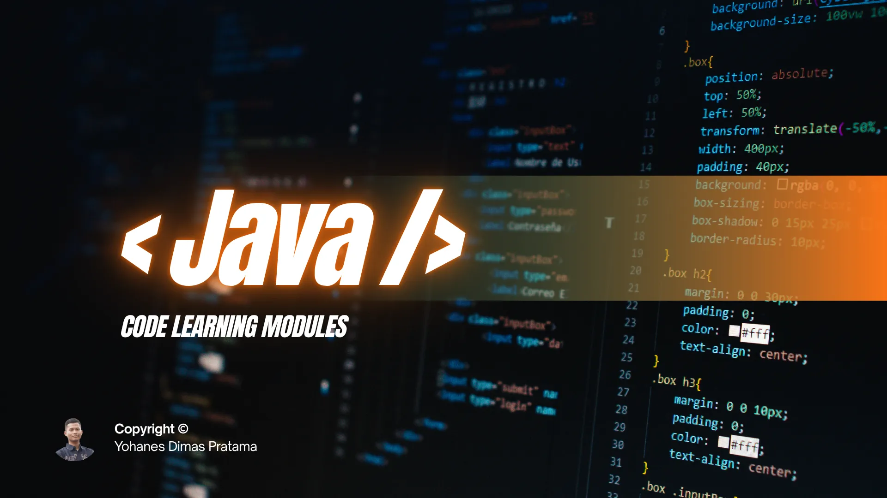

# Java Learning Modules




## Project Overview

Java Learning Modules is a structured programming education repository designed to teach Java from foundational syntax to modern JVM internals and layered application design. Across 18 sequential modules and 300 numbered submodules (`01_HelloWorld.java` through `300_SpringBootRestAPIProject.java`), learners progress through core language mechanics, object-oriented programming, collections, functional streams, file I/O, concurrency, JDBC database programming, testing, and enterprise architectural patterns. Every module directory pairs a dedicated `README.md` study guide with standalone single-file `.java` programs and captured console execution screenshots in `output/`, allowing each topic to be compiled and executed independently with OpenJDK 17 without external databases or build tool setup.

## Learning Objectives

This curriculum is structured to build progressive Java engineering competence from basic console programs to multi-layered backend architectures. The learning outcomes below represent the intended skills supported by the repository modules and practical projects rather than formal assessment or certification:

- Write, compile, and execute Java programs while understanding source structure, `main` entry points, primitive types, operators, control flow, and modular methods.
- Design maintainable object-oriented systems using encapsulation, inheritance, polymorphism, abstraction, interfaces, composition, and `java.lang.Object` contracts.
- Apply runtime safety and dynamic data structures using exception handling, try-with-resources, Java Collections Framework (`List`, `Set`, `Queue`, `Map`), Generics, Lambda expressions, and the Stream API.
- Implement filesystem persistence, binary serialization, Java NIO.2 operations, `BigDecimal` financial precision, `java.time` date/time handling, `Optional`, Reflection, Records, and Sealed Classes.
- Build concurrent and data-driven components using threads, synchronization, `ReentrantLock`, atomic variables, `ExecutorService`, `CompletableFuture`, JDBC `PreparedStatement` flows, transactions, and DAO patterns.
- Practice software quality concepts and layered architecture through standalone simulations of JUnit-style testing, Maven/Gradle lifecycles, JVM memory concepts, SHA-256/AES cryptography, Spring-style dependency injection, and five integrated console capstone projects.

## Learning Level & Approach

The repository follows a linear, module-based progression calibrated from introductory fundamentals to advanced Java platform engineering. Each module folder combines Indonesian-language practical study guides (`README.md`) with self-contained Java source files and verified execution captures (`output/*.png`), enabling self-paced, hands-on study.

| Attribute | Description |
| :--- | :--- |
| Learning Level | Beginner to Advanced (18 progressive modules) |
| Learning Approach | Module-Based, Practice-Driven & Self-Contained Simulations |
| Learning Format | Module Study Guides (`README.md`), Standalone `.java` Files, Output Captures (`.png`) |
| Programming Focus | Java (Core Language, OOP, Collections, Streams, Concurrency, JDBC, JVM & Layered Design) |
| Learning Pace | Self-Paced Modular Progression |

## Learning Path & Curriculum

The curriculum is organized into 18 sequential modules spanning four progressive learning stages: Foundations (`01`–`05`), Intermediate Core & OOP (`06`–`12`), Advanced Platform & Systems (`13`–`15`), and Enterprise Patterns & Capstone Projects (`16`–`18`).

1. **Java Fundamentals & Control Flow (`Modules 01–05`)**: Program anatomy, primitive data types, CLI I/O, operators, conditional branching, and loops.
2. **Modularization, OOP & Functional Collections (`Modules 06–12`)**: Methods, recursion, arrays, regex, OOP fundamentals and inheritance, exceptions, JCF, Generics, Lambdas, and Streams.
3. **Filesystem I/O, Modern Standard Library & Concurrency (`Modules 13–15`)**: Streams, serialization, NIO.2, `java.time`, `BigDecimal`, Reflection, Records, Sealed Classes, multithreading, and `CompletableFuture`.
4. **Database Access, JVM Quality & Integrated Projects (`Modules 16–18`)**: JDBC CRUD/DAO flows, JUnit-style testing, Maven/Gradle/JVM concepts, Spring-style layered simulations, and five capstone applications.

| Order | Module | Main Topics | Materials |
| :---: | :--- | :--- | :--- |
| 01 | [Module 01: Pengenalan Java dan Struktur Program](module-01-pengenalan-java-dan-struktur-program/README.md) | Hello World, anatomy, comments, `print`/`printf`, identifiers, keywords, JVM compilation | 1 README, 10 `.java` files, 10 outputs |
| 02 | [Module 02: Variabel dan Tipe Data](module-02-variabel-dan-tipe-data/README.md) | Variables, 8 primitives (`byte`–`boolean`), `String`, `final` constants, widening & narrowing casting | 1 README, 14 `.java` files, 14 outputs |
| 03 | [Module 03: Input, Output, dan Operator](module-03-input-output-dan-operator/README.md) | `Scanner`, `BufferedReader`, CLI args, arithmetic/logical/bitwise/ternary operators, `Math` | 1 README, 14 `.java` files, 14 outputs |
| 04 | [Module 04: Percabangan dan Pengambilan Keputusan](module-04-percabangan-dan-pengambilan-keputusan/README.md) | `if`/`else-if`, nested `if`, `switch`, modern switch expressions, applied decision mini-apps | 1 README, 12 `.java` files, 12 outputs |
| 05 | [Module 05: Perulangan](module-05-perulangan/README.md) | `for`, `while`, `do-while`, nested loops, `break`/`continue`, labels, enhanced `for`, number patterns | 1 README, 14 `.java` files, 14 outputs |
| 06 | [Module 06: Method dan Modularisasi Program](module-06-method-dan-modularisasi-program/README.md) | Parameters, return values, overloading, varargs, scope, static vs instance, recursion, packages | 1 README, 14 `.java` files, 14 outputs |
| 07 | [Module 07: Array dan Manipulasi String](module-07-array-dan-manipulasi-string/README.md) | 1D/2D arrays, search, sort, matrices, `StringBuilder`, `StringBuffer`, regex, `StringTokenizer` | 1 README, 22 `.java` files, 22 outputs |
| 08 | [Module 08: OOP Dasar](module-08-oop-dasar/README.md) | Classes, objects, constructors, `this`, access modifiers, encapsulation, `static`, `final`, `Object` | 1 README, 20 `.java` files, 20 outputs |
| 09 | [Module 09: OOP Lanjutan](module-09-oop-lanjutan/README.md) | Inheritance, `super`, overriding, polymorphism, abstract classes, interfaces, composition, inner classes | 1 README, 20 `.java` files, 20 outputs |
| 10 | [Module 10: Exception Handling](module-10-exception-handling/README.md) | `try-catch-finally`, `throw`/`throws`, checked vs unchecked, custom exceptions, try-with-resources | 1 README, 16 `.java` files, 16 outputs |
| 11 | [Module 11: Java Collections Framework](module-11-collections-framework/README.md) | `List`, `Queue`, `Deque`, `Set`, `Map`, `Iterator`, `Comparable`/`Comparator`, immutable collections | 1 README, 22 `.java` files, 22 outputs |
| 12 | [Module 12: Generics dan Functional Programming](module-12-generics-dan-functional-programming/README.md) | Generic classes/methods, wildcards, type erasure, Lambdas, functional interfaces, Stream API | 1 README, 22 `.java` files, 22 outputs |
| 13 | [Module 13: File Handling dan Input/Output](module-13-file-handling-dan-io/README.md) | `File`, buffered/byte streams, serialization, `transient`, NIO.2 `Files`, CSV, `Properties`, ZIP, `WatchService` | 1 README, 18 `.java` files, 18 outputs |
| 14 | [Module 14: Standard Library dan Fitur Bahasa Modern](module-14-standard-library-dan-fitur-bahasa-modern/README.md) | `SecureRandom`, `BigInteger`, `BigDecimal`, `java.time`, `Optional`, `Enum`, Reflection, Records, Sealed | 1 README, 18 `.java` files, 18 outputs |
| 15 | [Module 15: Multithreading dan Concurrency](module-15-multithreading-dan-concurrency/README.md) | `Thread`, `Runnable`, `Callable`/`Future`, `synchronized`, `volatile`, `ReentrantLock`, atomics, `CompletableFuture` | 1 README, 16 `.java` files, 16 outputs |
| 16 | [Module 16: Database Programming dengan JDBC](module-16-database-programming-dengan-jdbc/README.md) | `DriverManager`, `Statement`, `PreparedStatement`, `ResultSet`, CRUD, transactions, batching, DAO, pooling | 1 README, 14 `.java` files, 14 outputs |
| 17 | [Module 17: Testing, Build Tools, JVM, dan Keamanan](module-17-testing-build-tools-jvm-dan-keamanan/README.md) | JUnit/Mockito concepts, Maven/Gradle, JAR, JavaDoc, logging, JVM GC, Java 14–17 syntax, crypto, static analysis | 1 README, 22 `.java` files, 22 outputs |
| 18 | [Module 18: Framework dan Proyek Praktik Java](module-18-framework-dan-proyek-praktik-java/README.md) | Spring DI, Spring Boot, REST, JPA, validation, security, MockMvc, plus 5 integrated capstone projects | 1 README, 12 `.java` files, 12 outputs |

## Learning Modules & Contents

Each module folder serves as a self-contained unit with a detailed submodule guide (`README.md`), numbered `.java` source programs, and corresponding execution screenshots (`output/`). Representative entry, core, and milestone files are linked below for quick navigation.

### Module 01 — Pengenalan Java dan Struktur Program

- **Learning Guide:** [Module 01 README](module-01-pengenalan-java-dan-struktur-program/README.md)
- **Source Code (`01`–`10`):** [01_HelloWorld.java](module-01-pengenalan-java-dan-struktur-program/01_HelloWorld.java) · [06_SystemOutPrintf.java](module-01-pengenalan-java-dan-struktur-program/06_SystemOutPrintf.java) · [10_CompileAndRun.java](module-01-pengenalan-java-dan-struktur-program/10_CompileAndRun.java)
- **Execution Outputs:** [Module 01 Output Captures](module-01-pengenalan-java-dan-struktur-program/output)

### Module 02 — Variabel dan Tipe Data

- **Learning Guide:** [Module 02 README](module-02-variabel-dan-tipe-data/README.md)
- **Source Code (`11`–`24`):** [11_Variables.java](module-02-variabel-dan-tipe-data/11_Variables.java) · [21_StringDataType.java](module-02-variabel-dan-tipe-data/21_StringDataType.java) · [24_TypeConversion.java](module-02-variabel-dan-tipe-data/24_TypeConversion.java)
- **Execution Outputs:** [Module 02 Output Captures](module-02-variabel-dan-tipe-data/output)

### Module 03 — Input, Output, dan Operator

- **Learning Guide:** [Module 03 README](module-03-input-output-dan-operator/README.md)
- **Source Code (`25`–`38`):** [25_ScannerInput.java](module-03-input-output-dan-operator/25_ScannerInput.java) · [33_BitwiseOperators.java](module-03-input-output-dan-operator/33_BitwiseOperators.java) · [38_MathClass.java](module-03-input-output-dan-operator/38_MathClass.java)
- **Execution Outputs:** [Module 03 Output Captures](module-03-input-output-dan-operator/output)

### Module 04 — Percabangan dan Pengambilan Keputusan

- **Learning Guide:** [Module 04 README](module-04-percabangan-dan-pengambilan-keputusan/README.md)
- **Source Code (`39`–`50`):** [39_IfStatement.java](module-04-percabangan-dan-pengambilan-keputusan/39_IfStatement.java) · [44_SwitchExpression.java](module-04-percabangan-dan-pengambilan-keputusan/44_SwitchExpression.java) · [50_DiscountCalculator.java](module-04-percabangan-dan-pengambilan-keputusan/50_DiscountCalculator.java)
- **Execution Outputs:** [Module 04 Output Captures](module-04-percabangan-dan-pengambilan-keputusan/output)

### Module 05 — Perulangan

- **Learning Guide:** [Module 05 README](module-05-perulangan/README.md)
- **Source Code (`51`–`64`):** [51_ForLoop.java](module-05-perulangan/51_ForLoop.java) · [59_EnhancedForLoop.java](module-05-perulangan/59_EnhancedForLoop.java) · [64_NumberPatterns.java](module-05-perulangan/64_NumberPatterns.java)
- **Execution Outputs:** [Module 05 Output Captures](module-05-perulangan/output)

### Module 06 — Method dan Modularisasi Program

- **Learning Guide:** [Module 06 README](module-06-method-dan-modularisasi-program/README.md)
- **Source Code (`65`–`78`):** [65_MethodBasic.java](module-06-method-dan-modularisasi-program/65_MethodBasic.java) · [69_MethodOverloading.java](module-06-method-dan-modularisasi-program/69_MethodOverloading.java) · [78_PackagesBasic.java](module-06-method-dan-modularisasi-program/78_PackagesBasic.java)
- **Execution Outputs:** [Module 06 Output Captures](module-06-method-dan-modularisasi-program/output)

### Module 07 — Array dan Manipulasi String

- **Learning Guide:** [Module 07 README](module-07-array-dan-manipulasi-string/README.md)
- **Source Code (`79`–`100`):** [79_ArrayBasic.java](module-07-array-dan-manipulasi-string/79_ArrayBasic.java) · [95_StringBuilder.java](module-07-array-dan-manipulasi-string/95_StringBuilder.java) · [100_TextProcessing.java](module-07-array-dan-manipulasi-string/100_TextProcessing.java)
- **Execution Outputs:** [Module 07 Output Captures](module-07-array-dan-manipulasi-string/output)

### Module 08 — OOP Dasar

- **Learning Guide:** [Module 08 README](module-08-oop-dasar/README.md)
- **Source Code (`101`–`120`):** [101_ClassBasic.java](module-08-oop-dasar/101_ClassBasic.java) · [109_Encapsulation.java](module-08-oop-dasar/109_Encapsulation.java) · [120_HashCodeMethod.java](module-08-oop-dasar/120_HashCodeMethod.java)
- **Execution Outputs:** [Module 08 Output Captures](module-08-oop-dasar/output)

### Module 09 — OOP Lanjutan

- **Learning Guide:** [Module 09 README](module-09-oop-lanjutan/README.md)
- **Source Code (`121`–`140`):** [121_Inheritance.java](module-09-oop-lanjutan/121_Inheritance.java) · [127_Polymorphism.java](module-09-oop-lanjutan/127_Polymorphism.java) · [140_AnonymousClasses.java](module-09-oop-lanjutan/140_AnonymousClasses.java)
- **Execution Outputs:** [Module 09 Output Captures](module-09-oop-lanjutan/output)

### Module 10 — Exception Handling

- **Learning Guide:** [Module 10 README](module-10-exception-handling/README.md)
- **Source Code (`141`–`156`):** [141_ExceptionBasic.java](module-10-exception-handling/141_ExceptionBasic.java) · [152_TryWithResources.java](module-10-exception-handling/152_TryWithResources.java) · [156_ExceptionHandlingPatterns.java](module-10-exception-handling/156_ExceptionHandlingPatterns.java)
- **Execution Outputs:** [Module 10 Output Captures](module-10-exception-handling/output)

### Module 11 — Java Collections Framework

- **Learning Guide:** [Module 11 README](module-11-collections-framework/README.md)
- **Source Code (`157`–`178`):** [157_ArrayListBasic.java](module-11-collections-framework/157_ArrayListBasic.java) · [167_HashMap.java](module-11-collections-framework/167_HashMap.java) · [178_ImmutableCollections.java](module-11-collections-framework/178_ImmutableCollections.java)
- **Execution Outputs:** [Module 11 Output Captures](module-11-collections-framework/output)

### Module 12 — Generics dan Functional Programming

- **Learning Guide:** [Module 12 README](module-12-generics-dan-functional-programming/README.md)
- **Source Code (`179`–`200`):** [179_GenericsBasic.java](module-12-generics-dan-functional-programming/179_GenericsBasic.java) · [186_LambdaExpressions.java](module-12-generics-dan-functional-programming/186_LambdaExpressions.java) · [200_ParallelStreams.java](module-12-generics-dan-functional-programming/200_ParallelStreams.java)
- **Execution Outputs:** [Module 12 Output Captures](module-12-generics-dan-functional-programming/output)

### Module 13 — File Handling dan Input/Output

- **Learning Guide:** [Module 13 README](module-13-file-handling-dan-io/README.md)
- **Source Code (`201`–`218`):** [201_FileClass.java](module-13-file-handling-dan-io/201_FileClass.java) · [213_FilesClass.java](module-13-file-handling-dan-io/213_FilesClass.java) · [218_WatchService.java](module-13-file-handling-dan-io/218_WatchService.java)
- **Execution Outputs:** [Module 13 Output Captures](module-13-file-handling-dan-io/output)

### Module 14 — Standard Library dan Fitur Bahasa Modern

- **Learning Guide:** [Module 14 README](module-14-standard-library-dan-fitur-bahasa-modern/README.md)
- **Source Code (`219`–`236`):** [223_BigDecimal.java](module-14-standard-library-dan-fitur-bahasa-modern/223_BigDecimal.java) · [234_ReflectionAPI.java](module-14-standard-library-dan-fitur-bahasa-modern/234_ReflectionAPI.java) · [236_SealedClasses.java](module-14-standard-library-dan-fitur-bahasa-modern/236_SealedClasses.java)
- **Execution Outputs:** [Module 14 Output Captures](module-14-standard-library-dan-fitur-bahasa-modern/output)

### Module 15 — Multithreading dan Concurrency

- **Learning Guide:** [Module 15 README](module-15-multithreading-dan-concurrency/README.md)
- **Source Code (`237`–`252`):** [237_ThreadBasic.java](module-15-multithreading-dan-concurrency/237_ThreadBasic.java) · [250_CompletableFuture.java](module-15-multithreading-dan-concurrency/250_CompletableFuture.java) · [252_VirtualThreads.java](module-15-multithreading-dan-concurrency/252_VirtualThreads.java)
- **Execution Outputs:** [Module 15 Output Captures](module-15-multithreading-dan-concurrency/output)

### Module 16 — Database Programming dengan JDBC

- **Learning Guide:** [Module 16 README](module-16-database-programming-dengan-jdbc/README.md)
- **Source Code (`253`–`266`):** [253_JDBCConnection.java](module-16-database-programming-dengan-jdbc/253_JDBCConnection.java) · [262_JDBCTransactions.java](module-16-database-programming-dengan-jdbc/262_JDBCTransactions.java) · [266_ConnectionPooling.java](module-16-database-programming-dengan-jdbc/266_ConnectionPooling.java)
- **Execution Outputs:** [Module 16 Output Captures](module-16-database-programming-dengan-jdbc/output)

### Module 17 — Testing, Build Tools, JVM, dan Keamanan

- **Learning Guide:** [Module 17 README](module-17-testing-build-tools-jvm-dan-keamanan/README.md)
- **Source Code (`267`–`288`):** [267_JUnitBasic.java](module-17-testing-build-tools-jvm-dan-keamanan/267_JUnitBasic.java) · [279_JVMMemoryManagement.java](module-17-testing-build-tools-jvm-dan-keamanan/279_JVMMemoryManagement.java) · [288_StaticCodeAnalysis.java](module-17-testing-build-tools-jvm-dan-keamanan/288_StaticCodeAnalysis.java)
- **Execution Outputs:** [Module 17 Output Captures](module-17-testing-build-tools-jvm-dan-keamanan/output)

### Module 18 — Framework dan Proyek Praktik Java

- **Learning Guide:** [Module 18 README](module-18-framework-dan-proyek-praktik-java/README.md)
- **Source Code (`289`–`300`):** [289_SpringDependencyInjection.java](module-18-framework-dan-proyek-praktik-java/289_SpringDependencyInjection.java) · [295_SpringBootTesting.java](module-18-framework-dan-proyek-praktik-java/295_SpringBootTesting.java) · [300_SpringBootRestAPIProject.java](module-18-framework-dan-proyek-praktik-java/300_SpringBootRestAPIProject.java)
- **Execution Outputs:** [Module 18 Output Captures](module-18-framework-dan-proyek-praktik-java/output)

## Projects & Coding Challenges

Module 18 consolidates concepts from Modules 01 through 17 into five completed, self-contained console application implementations (`296`–`300`) stored alongside their captured execution outputs.

| Project / Challenge | Learning Focus | Source File |
| :--- | :--- | :--- |
| Console Calculator with History | Arithmetic operations, zero-division guard, calculation history log | [296_CalculatorProject.java](module-18-framework-dan-proyek-praktik-java/296_CalculatorProject.java) |
| Student Management System | Student records (`NIM`, major, GPA), CRUD operations, GPA statistics | [297_StudentManagementProject.java](module-18-framework-dan-proyek-praktik-java/297_StudentManagementProject.java) |
| Inventory Management System | Warehouse stock tracking, inbound/outbound mutations, low-stock alerts, asset valuation | [298_InventoryManagementProject.java](module-18-framework-dan-proyek-praktik-java/298_InventoryManagementProject.java) |
| Library Management System | Book catalog circulation, borrow/return state guard, overdue fine calculation | [299_LibraryManagementProject.java](module-18-framework-dan-proyek-praktik-java/299_LibraryManagementProject.java) |
| Layered REST API Architecture | Controller, Service, Repository, Request/Response DTOs, and 404 error handling | [300_SpringBootRestAPIProject.java](module-18-framework-dan-proyek-praktik-java/300_SpringBootRestAPIProject.java) |

## Programming Languages & Tech Stack

All 300 learning programs are authored in Java using standard JDK APIs and pure-Java educational simulations (for JDBC drivers, reflective JUnit-style test runners, build lifecycle models, and Spring-style IoC/REST layers) so learners can run every lesson without external dependencies.

| Category | Technology | Purpose |
| :--- | :--- | :--- |
| Language Taught | Java (JDK 17 LTS) | Core language syntax, OOP, Generics, Lambdas, Records, Sealed Classes, Pattern Matching |
| Runtime & Compiler | OpenJDK (`java`, `javac`) | Single-file source execution (`java File.java`) and bytecode compilation |
| Standard APIs | Java Collections, Stream API, NIO.2, `java.time` | Dynamic data structures, functional pipelines, filesystem I/O, date/time, `BigDecimal` |
| Concurrency & System | `java.util.concurrent`, `java.lang.reflect`, `javax.crypto` | Thread pools, locks, atomics, `CompletableFuture`, annotations, SHA-256/AES concepts |
| Database API | `java.sql` (JDBC API) + educational driver proxy | Connection lifecycle, `PreparedStatement`, transactions, batching, DAO simulation |
| Documentation & Verification | Markdown (`README.md`) & PNG captures (`output/*.png`) | Module study guides and verified console output screenshots per submodule |

## Prerequisites & Setup

Running the lessons requires only a local Java Development Kit (JDK 17 or newer is recommended to support single-file source execution and modern language features such as Switch Expressions, Text Blocks, Records, and Sealed Classes). No external database server, Maven/Gradle installation, or third-party JAR dependencies are needed.

- **Required:** Java Development Kit (JDK 17+), terminal (`PowerShell`, `bash`, or `zsh`), and `git` to clone the repository.
- **Optional:** Any Java IDE or editor (such as VS Code with Java extensions or IntelliJ IDEA) for browsing modules and inspecting output captures.

```bash
git clone https://github.com/weztcy/Java-Learning-Modules.git
cd "Java Learning Modules"
java -version
```

## Code Execution & Usage

Every `.java` file in Modules 01 through 18 is standalone and contains its own `main` method, so it can be run directly using Java's single-file source-code launcher or compiled manually with `javac`.

1. Navigate to the target module directory:
   ```bash
   cd module-01-pengenalan-java-dan-struktur-program
   ```
2. Run a submodule directly on OpenJDK 17+:
   ```bash
   java 01_HelloWorld.java
   ```
3. Or compile to bytecode first and execute the generated class (replace `HelloWorld` with the class name declared inside the file):
   ```bash
   javac 01_HelloWorld.java
   java HelloWorld
   ```
4. For advanced module demonstrations (such as JDBC, testing runners, or layered REST simulations), run the standalone file in the same way:
   ```bash
   cd ../module-18-framework-dan-proyek-praktik-java
   java 300_SpringBootRestAPIProject.java
   ```

## Contributing

Contributions to expand explanations, refine code comments, or improve documentation clarity are welcome through standard GitHub pull requests:

1. Fork the repository.
2. Create a branch for the change.
3. Add or improve learning materials, source code, exercises, or documentation.
4. Verify code examples and links where practical.
5. Commit and push the branch.
6. Open a pull request with a clear explanation.

## License

This project is licensed under the MIT License.
See the [LICENSE](LICENSE) file for details.

## Author & Contact

**Yohanes Dimas Pratama**

- GitHub: [github.com/weztcy](https://github.com/weztcy)
- Portfolio: [yohanesdimas.com](https://yohanesdimas.com)
- LinkedIn: [linkedin.com/in/yohanes-dimas](https://www.linkedin.com/in/yohanes-dimas)
