# MODUL 2: Variabel dan Tipe Data

## Deskripsi Modul
Modul ini membahas konsep penyimpanan data dalam memori melalui variabel dan tipe data pada bahasa Java. Pembahasan meliputi deklarasi dan inisialisasi variabel, 8 tipe data primitif (`byte`, `short`, `int`, `long`, `float`, `double`, `char`, `boolean`), tipe referensi `String`, pembuatan konstanta dengan kata kunci `final`, serta perbedaan antara konversi otomatis (*implicit widening conversion*) dan konversi manual (*explicit narrowing casting*).

## Tujuan Pembelajaran
Setelah menyelesaikan modul ini, pembelajar diharapkan mampu:
1. Mendeklarasikan dan menginisialisasi variabel dengan tepat sesuai tipe data yang dibutuhkan.
2. Memahami rentang nilai, ukuran memori, dan karakteristik ke-8 tipe data primitif Java.
3. Menggunakan tipe data referensi `String` dan memahami sifat immutability-nya.
4. Menerapkan keyword `final` untuk membuat nilai konstanta yang tidak dapat dimodifikasi.
5. Melakukan konversi tipe data yang aman (*widening*) maupun pemaksaan tipe (*narrowing casting*) beserta risikonya seperti hilangnya presisi atau overflow.

---

## Daftar Materi dan Submodul

| No | Berkas | Materi Pembelajaran |
|---|---|---|
| 11 | [11_Variables.java](11_Variables.java) | Deklarasi variabel |
| 12 | [12_VariableInitialization.java](12_VariableInitialization.java) | Inisialisasi variabel |
| 13 | [13_ByteDataType.java](13_ByteDataType.java) | Tipe data `byte` |
| 14 | [14_ShortDataType.java](14_ShortDataType.java) | Tipe data `short` |
| 15 | [15_IntDataType.java](15_IntDataType.java) | Tipe data `int` |
| 16 | [16_LongDataType.java](16_LongDataType.java) | Tipe data `long` |
| 17 | [17_FloatDataType.java](17_FloatDataType.java) | Tipe data `float` |
| 18 | [18_DoubleDataType.java](18_DoubleDataType.java) | Tipe data `double` |
| 19 | [19_CharDataType.java](19_CharDataType.java) | Tipe data `char` |
| 20 | [20_BooleanDataType.java](20_BooleanDataType.java) | Tipe data `boolean` |
| 21 | [21_StringDataType.java](21_StringDataType.java) | Tipe data `String` |
| 22 | [22_ConstantsFinal.java](22_ConstantsFinal.java) | Konstanta menggunakan `final` |
| 23 | [23_TypeCasting.java](23_TypeCasting.java) | Type casting |
| 24 | [24_TypeConversion.java](24_TypeConversion.java) | Konversi tipe data |

---

## Penjelasan Setiap Submodul

### 11. 11_Variables.java
- **Tujuan:** Mempelajari deklarasi variabel dengan menentukan tipe data sebelum nilai disimpan.
- **Konsep Utama:** Deklarasi menyediakan alokasi nama dan tipe di memori.
- **Penjelasan Source Code:** Mendeklarasikan variabel `usia`, `beratBadan`, `jenisKelamin`, dan `statusMenikah` kemudian mengisi dan menampilkannya.
- **Cara Menjalankan:**
  ```bash
  java 11_Variables.java
  ```
- **Hasil yang Diharapkan:** Nilai variabel yang telah diisi ditampilkan di konsol.
- **Screenshot Hasil Eksekusi:**
  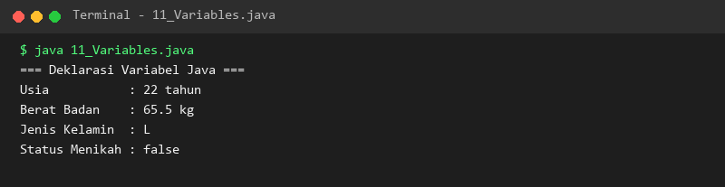

### 12. 12_VariableInitialization.java
- **Tujuan:** Memahami inisialisasi variabel saat deklarasi serta inisialisasi jamak.
- **Konsep Utama:** Inisialisasi memberikan nilai pertama pada variabel secara aman sebelum dibaca.
- **Penjelasan Source Code:** Menginisialisasi nilai awal pemain, skor, serta 3 koordinat sekaligus.
- **Cara Menjalankan:**
  ```bash
  java 12_VariableInitialization.java
  ```
- **Hasil yang Diharapkan:** Nilai terinisialisasi dicetak dengan rapi.
- **Screenshot Hasil Eksekusi:**
  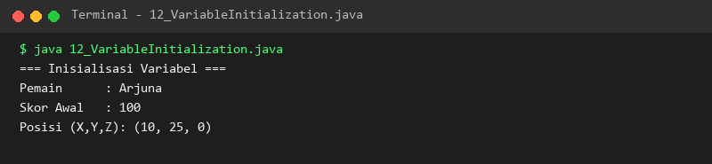

### 13. 13_ByteDataType.java
- **Tujuan:** Memahami karakteristik dan batasan tipe data primitif `byte`.
- **Konsep Utama:** Berukuran 8-bit bertanda dengan jangkauan nilai -128 hingga 127.
- **Penjelasan Source Code:** Menampilkan nilai minimum, maksimum, serta contoh penggunaannya untuk suhu ruangan.
- **Cara Menjalankan:**
  ```bash
  java 13_ByteDataType.java
  ```
- **Hasil yang Diharapkan:** Batas nilai minimum dan maksimum tipe byte tercetak di konsol.
- **Screenshot Hasil Eksekusi:**
  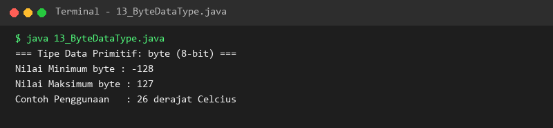

### 14. 14_ShortDataType.java
- **Tujuan:** Memahami karakteristik tipe data primitif `short`.
- **Konsep Utama:** Berukuran 16-bit bertanda dengan batas -32.768 hingga 32.767.
- **Penjelasan Source Code:** Menampilkan batas nilai `Short.MIN_VALUE` dan `Short.MAX_VALUE`.
- **Cara Menjalankan:**
  ```bash
  java 14_ShortDataType.java
  ```
- **Hasil yang Diharapkan:** Informasi rentang tipe short ditampilkan.
- **Screenshot Hasil Eksekusi:**
  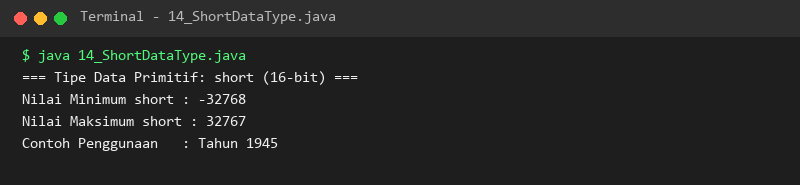

### 15. 15_IntDataType.java
- **Tujuan:** Memahami tipe data integer standar `int` pada Java.
- **Konsep Utama:** Berukuran 32-bit bertanda dan merupakan pilihan utama untuk bilangan bulat.
- **Penjelasan Source Code:** Menampilkan konstanta batas tipe integer dan contoh variabel populasi kota.
- **Cara Menjalankan:**
  ```bash
  java 15_IntDataType.java
  ```
- **Hasil yang Diharapkan:** Rentang nilai integer dan populasi kota ditampilkan.
- **Screenshot Hasil Eksekusi:**
  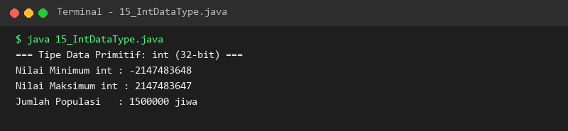

### 16. 16_LongDataType.java
- **Tujuan:** Memahami penggunaan tipe bilangan bulat sangat besar `long`.
- **Konsep Utama:** Berukuran 64-bit dengan akhiran literal huruf `L`.
- **Penjelasan Source Code:** Menyimpan angka jarak astronomis menggunakan akhiran `L` untuk mencegah error kompilasi.
- **Cara Menjalankan:**
  ```bash
  java 16_LongDataType.java
  ```
- **Hasil yang Diharapkan:** Nilai jarak tahun cahaya dan batas long ditampilkan.
- **Screenshot Hasil Eksekusi:**
  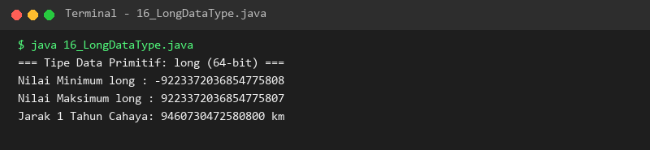

### 17. 17_FloatDataType.java
- **Tujuan:** Memahami tipe pecahan presisi tunggal `float`.
- **Konsep Utama:** Berukuran 32-bit, membutuhkan akhiran huruf `f` atau `F`.
- **Penjelasan Source Code:** Menunjukkan penyimpanan nilai pecahan pi singkat dan batas nilainya.
- **Cara Menjalankan:**
  ```bash
  java 17_FloatDataType.java
  ```
- **Hasil yang Diharapkan:** Nilai float dan jangkauan eksponennya ditampilkan.
- **Screenshot Hasil Eksekusi:**
  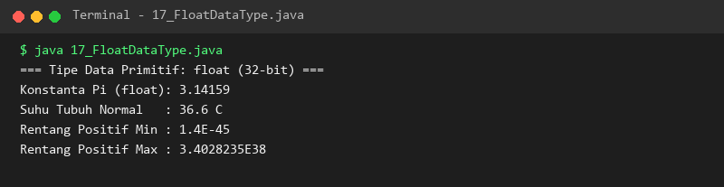

### 18. 18_DoubleDataType.java
- **Tujuan:** Memahami tipe pecahan presisi ganda `double`.
- **Konsep Utama:** Berukuran 64-bit dan menjadi standar default tipe desimal di Java.
- **Penjelasan Source Code:** Mendemonstrasikan presisi 15 digit desimal untuk perhitungan ilmiah dan finansial sederhana.
- **Cara Menjalankan:**
  ```bash
  java 18_DoubleDataType.java
  ```
- **Hasil yang Diharapkan:** Nilai double dengan presisi tinggi tercetak di konsol.
- **Screenshot Hasil Eksekusi:**
  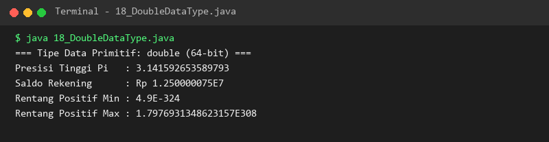

### 19. 19_CharDataType.java
- **Tujuan:** Memahami tipe data karakter 16-bit `char` dan representasi Unicode.
- **Konsep Utama:** Menggunakan tanda petik tunggal `'`, mendukung kode escape dan representasi integer ASCII.
- **Penjelasan Source Code:** Menampilkan karakter huruf, kode ASCII angka, serta simbol Unicode derajat (°).
- **Cara Menjalankan:**
  ```bash
  java 19_CharDataType.java
  ```
- **Hasil yang Diharapkan:** Karakter dan konversi kode angkanya tercetak di layar.
- **Screenshot Hasil Eksekusi:**
  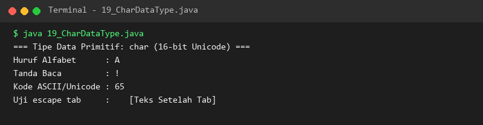

### 20. 20_BooleanDataType.java
- **Tujuan:** Memahami tipe data logika `boolean`.
- **Konsep Utama:** Hanya memiliki dua nilai: `true` atau `false`, menjadi fondasi percabangan.
- **Penjelasan Source Code:** Menyimpan kondisi lampu, pintu, dan hasil ekspresi perbandingan usia.
- **Cara Menjalankan:**
  ```bash
  java 20_BooleanDataType.java
  ```
- **Hasil yang Diharapkan:** Status kondisi boolean tercetak jelas.
- **Screenshot Hasil Eksekusi:**
  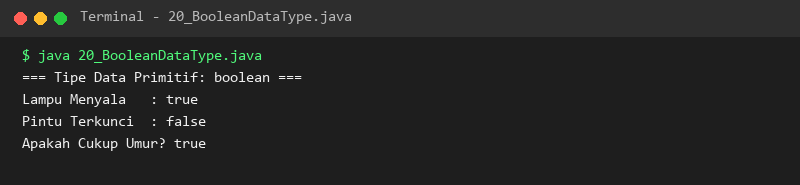

### 21. 21_StringDataType.java
- **Tujuan:** Memahami tipe data referensi `String` untuk pengolahan teks.
- **Konsep Utama:** Objek String bersifat *immutable* dan dilengkapi beragam method manipulasi.
- **Penjelasan Source Code:** Menggabungkan teks, menghitung panjang string dengan `.length()`, dan mengubah ke huruf kapital.
- **Cara Menjalankan:**
  ```bash
  java 21_StringDataType.java
  ```
- **Hasil yang Diharapkan:** Teks gabungan, panjang string, dan hasil konversi kapital tercetak.
- **Screenshot Hasil Eksekusi:**
  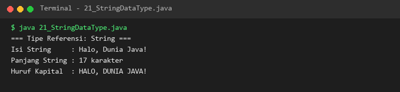

### 22. 22_ConstantsFinal.java
- **Tujuan:** Membuat variabel konstanta dengan modifier `final`.
- **Konsep Utama:** Nilai variabel final bersifat *read-only* setelah inisialisasi awal.
- **Penjelasan Source Code:** Mendefinisikan konstanta kecepatan cahaya dan batas maksimal SKS akademik.
- **Cara Menjalankan:**
  ```bash
  java 22_ConstantsFinal.java
  ```
- **Hasil yang Diharapkan:** Nilai konstanta tercetak dengan penjelasan perlindungan nilainya.
- **Screenshot Hasil Eksekusi:**
  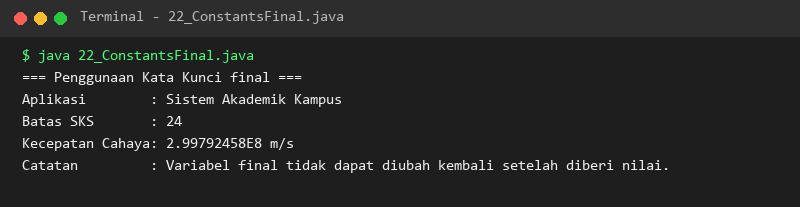

### 23. 23_TypeCasting.java
- **Tujuan:** Memahami mekanisme konversi manual *narrowing casting*.
- **Konsep Utama:** Konversi dari kapasitas besar ke kecil berisiko memotong data atau terjadi overflow.
- **Penjelasan Source Code:** Melakukan cast pecahan `double` ke `int` serta `long` besar ke `byte`.
- **Cara Menjalankan:**
  ```bash
  java 23_TypeCasting.java
  ```
- **Hasil yang Diharapkan:** Hasil pemotongan pecahan dan overflow nilai tercetak jelas.
- **Screenshot Hasil Eksekusi:**
  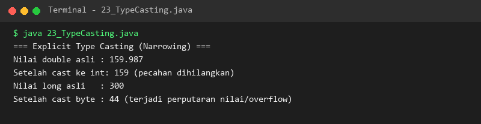

### 24. 24_TypeConversion.java
- **Tujuan:** Memahami konversi otomatis *widening conversion*.
- **Konsep Utama:** Perubahan dari tipe kecil ke besar dilakukan otomatis tanpa risiko kehilangan data.
- **Penjelasan Source Code:** Mengalirkan nilai dari `byte` ke `int` lalu ke `double` secara implisit.
- **Cara Menjalankan:**
  ```bash
  java 24_TypeConversion.java
  ```
- **Hasil yang Diharapkan:** Konversi otomatis bertingkat tercetak dengan konsisten.
- **Screenshot Hasil Eksekusi:**
  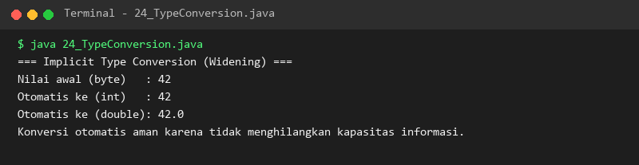

---

## Ringkasan Modul
Modul 2 memberikan wawasan lengkap mengenai pemilihan tipe data yang efisien dan tepat sesuai kebutuhan program. Kita telah menguasai seluruh tipe primitif bilangan bulat dan pecahan, karakter Unicode, tipe logika boolean, objek String, proteksi konstanta menggunakan `final`, serta aturan konversi tipe data yang aman (*widening*) maupun yang berisiko (*narrowing*).
