# MODUL 3: Input, Output, dan Operator

## Deskripsi Modul
Modul ini membahas interaksi program dengan pengguna melalui mekanisme input/output serta manipulasi data menggunakan berbagai jenis operator di Java. Pembahasan mencakup pembacaan masukan menggunakan `Scanner` dan `BufferedReader`, penerimaan argumen baris perintah (*command-line arguments*), seluruh spektrum operator (aritmetika, penugasan, perbandingan, logika, *increment/decrement*, *bitwise*, dan *ternary*), aturan urutan prioritas operator (*precedence*), teknik penggabungan string, pemformatan teks dengan `String.format()`, serta pemanfaatan fungsi utilitas matematika bawaan dari class `java.lang.Math`.

## Tujuan Pembelajaran
Setelah menyelesaikan modul ini, pembelajar diharapkan mampu:
1. Membaca input pengguna bertipe teks dan angka menggunakan `Scanner` maupun `BufferedReader`.
2. Menangkap dan mengolah argumen dari baris perintah (*CLI arguments*).
3. Melakukan manipulasi nilai dengan operator aritmetika, penugasan majemuk, logika, perbandingan, dan bitwise.
4. Memahami perbedaan cara kerja *pre-increment* dan *post-increment*.
5. Menyederhanakan percabangan dasar dengan operator *ternary*.
6. Memahami urutan evaluasi ekspresi (*operator precedence*) dan memanfaatkan tanda kurung untuk kepastian logika.
7. Memformat teks angka dan keuangan dengan rapi serta memanfaatkan fungsi-fungsi pada class `Math`.

---

## Daftar Materi dan Submodul

| No | Berkas | Materi Pembelajaran |
|---|---|---|
| 25 | [25_ScannerInput.java](25_ScannerInput.java) | Input menggunakan `Scanner` |
| 26 | [26_BufferedReaderInput.java](26_BufferedReaderInput.java) | Input menggunakan `BufferedReader` |
| 27 | [27_CommandLineArguments.java](27_CommandLineArguments.java) | Command-line arguments |
| 28 | [28_ArithmeticOperators.java](28_ArithmeticOperators.java) | Operator aritmetika |
| 29 | [29_AssignmentOperators.java](29_AssignmentOperators.java) | Operator penugasan |
| 30 | [30_ComparisonOperators.java](30_ComparisonOperators.java) | Operator perbandingan |
| 31 | [31_LogicalOperators.java](31_LogicalOperators.java) | Operator logika |
| 32 | [32_IncrementDecrement.java](32_IncrementDecrement.java) | Increment dan decrement |
| 33 | [33_BitwiseOperators.java](33_BitwiseOperators.java) | Operator bitwise |
| 34 | [34_TernaryOperator.java](34_TernaryOperator.java) | Operator ternary |
| 35 | [35_OperatorPrecedence.java](35_OperatorPrecedence.java) | Prioritas operator |
| 36 | [36_StringConcatenation.java](36_StringConcatenation.java) | Penggabungan string |
| 37 | [37_StringFormatting.java](37_StringFormatting.java) | Pemformatan string |
| 38 | [38_MathClass.java](38_MathClass.java) | Operasi matematika menggunakan `Math` |

---

## Penjelasan Setiap Submodul

### 25. 25_ScannerInput.java
- **Tujuan:** Membaca input interaktif berbagai tipe data melalui konsol.
- **Konsep Utama:** Class `Scanner` menyediakan method parsing seperti `nextLine()`, `nextInt()`, dan `nextDouble()`.
- **Penjelasan Source Code:** Membaca data nama, usia, dan IPK mahasiswa lalu menampilkan konfirmasinya.
- **Cara Menjalankan:**
  ```bash
  java 25_ScannerInput.java
  ```
- **Hasil yang Diharapkan:** Data input terbaca dan dicetak kembali ke konsol.
- **Screenshot Hasil Eksekusi:**
  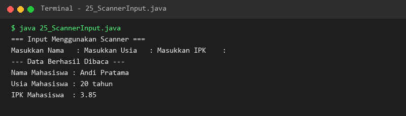

### 26. 26_BufferedReaderInput.java
- **Tujuan:** Membaca aliran input berbasis buffer yang efisien untuk data besar.
- **Konsep Utama:** Menggabungkan `InputStreamReader` dan `BufferedReader` dengan method `readLine()`.
- **Penjelasan Source Code:** Membaca nama dan jurusan mahasiswa serta menangani kemungkinan `IOException`.
- **Cara Menjalankan:**
  ```bash
  java 26_BufferedReaderInput.java
  ```
- **Hasil yang Diharapkan:** Teks yang dibaca buffer ditampilkan di layar.
- **Screenshot Hasil Eksekusi:**
  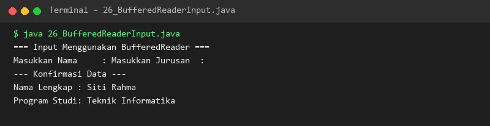

### 27. 27_CommandLineArguments.java
- **Tujuan:** Menangkap parameter eksekusi dari terminal melalui array `String[] args`.
- **Konsep Utama:** Array `args` menyimpan setiap parameter terpisah spasi yang diketikkan setelah nama class.
- **Penjelasan Source Code:** Memeriksa keberadaan argumen dan melakukan iterasi untuk mencetak setiap elemennya.
- **Cara Menjalankan:**
  ```bash
  java 27_CommandLineArguments.java
  ```
- **Hasil yang Diharapkan:** Jumlah dan daftar argumen baris perintah ditampilkan.
- **Screenshot Hasil Eksekusi:**
  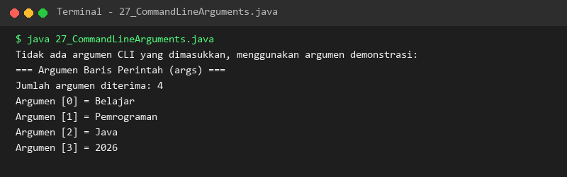

### 28. 28_ArithmeticOperators.java
- **Tujuan:** Melakukan perhitungan matematika dasar di Java.
- **Konsep Utama:** Operator `+`, `-`, `*`, `/`, dan modulus `%`.
- **Penjelasan Source Code:** Menghitung hasil tambah, kurang, kali, bagi bulat, pembagian desimal berpresisi, serta sisa bagi.
- **Cara Menjalankan:**
  ```bash
  java 28_ArithmeticOperators.java
  ```
- **Hasil yang Diharapkan:** Hasil operasi aritmetika dicetak dengan benar.
- **Screenshot Hasil Eksekusi:**
  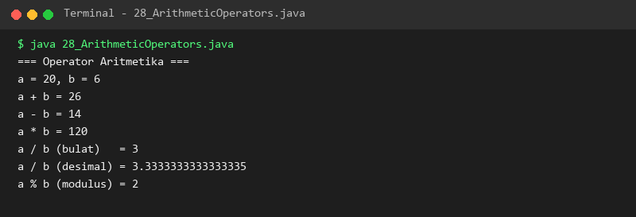

### 29. 29_AssignmentOperators.java
- **Tujuan:** Menguasai operator penugasan majemuk (*compound assignment*).
- **Konsep Utama:** Menyingkat operasi aritmetika dan penugasan menjadi `+=`, `-=`, `*=`, `/=`, `%=`.
- **Penjelasan Source Code:** Melakukan serangkaian transformasi nilai variabel secara bertahap menggunakan operator majemuk.
- **Cara Menjalankan:**
  ```bash
  java 29_AssignmentOperators.java
  ```
- **Hasil yang Diharapkan:** Nilai variabel pada setiap tahap mutasi ditampilkan.
- **Screenshot Hasil Eksekusi:**
  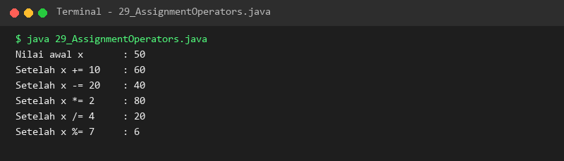

### 30. 30_ComparisonOperators.java
- **Tujuan:** Membandingkan dua nilai untuk menghasilkan keputusan kondisi boolean.
- **Konsep Utama:** Operator relasional `==`, `!=`, `>`, `<`, `>=`, `<=`.
- **Penjelasan Source Code:** Mengevaluasi relasi antara dua variabel integer dan menampilkan hasil kebenarannya.
- **Cara Menjalankan:**
  ```bash
  java 30_ComparisonOperators.java
  ```
- **Hasil yang Diharapkan:** Status boolean dari perbandingan nilai tercetak di konsol.
- **Screenshot Hasil Eksekusi:**
  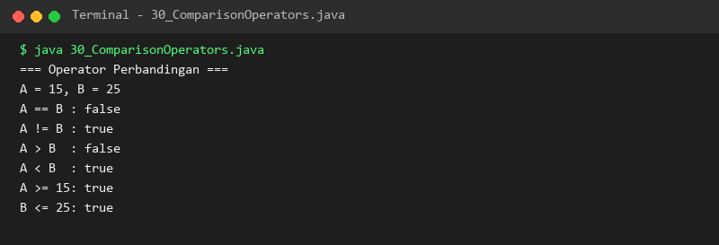

### 31. 31_LogicalOperators.java
- **Tujuan:** Menggabungkan beberapa kondisi boolean dengan logika AND, OR, dan NOT.
- **Konsep Utama:** `&&` (short-circuit AND), `||` (short-circuit OR), dan `!` (logical NOT).
- **Penjelasan Source Code:** Memeriksa kelayakan mengemudi berdasarkan usia, kepemilikan SIM, dan pemakaian helm.
- **Cara Menjalankan:**
  ```bash
  java 31_LogicalOperators.java
  ```
- **Hasil yang Diharapkan:** Hasil evaluasi logika gabungan ditampilkan dengan tepat.
- **Screenshot Hasil Eksekusi:**
  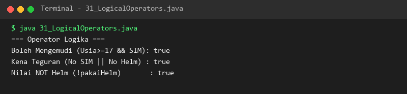

### 32. 32_IncrementDecrement.java
- **Tujuan:** Memahami perbedaan waktu evaluasi pada pre-increment dan post-increment.
- **Konsep Utama:** `++x` menaikkan nilai sebelum evaluasi, sedangkan `x++` mengevaluasi nilai lama baru menaikkan.
- **Penjelasan Source Code:** Mendemonstrasikan perbandingan hasil ekspresi dan nilai akhir variabel pada `a++` vs `++b`.
- **Cara Menjalankan:**
  ```bash
  java 32_IncrementDecrement.java
  ```
- **Hasil yang Diharapkan:** Perbedaan hasil antara pre dan post increment tercetak jelas.
- **Screenshot Hasil Eksekusi:**
  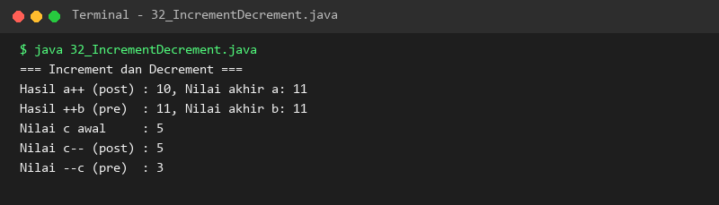

### 33. 33_BitwiseOperators.java
- **Tujuan:** Memahami manipulasi bit biner pada level perangkat keras.
- **Konsep Utama:** Operasi bitwise AND `&`, OR `|`, XOR `^`, serta pergeseran bit `<<` dan `>>`.
- **Penjelasan Source Code:** Menghitung operasi logika bit terhadap dua bilangan dan pergeseran bit untuk perkalian/pembagian biner.
- **Cara Menjalankan:**
  ```bash
  java 33_BitwiseOperators.java
  ```
- **Hasil yang Diharapkan:** Hasil operasi level bit ditampilkan dalam representasi desimal.
- **Screenshot Hasil Eksekusi:**
  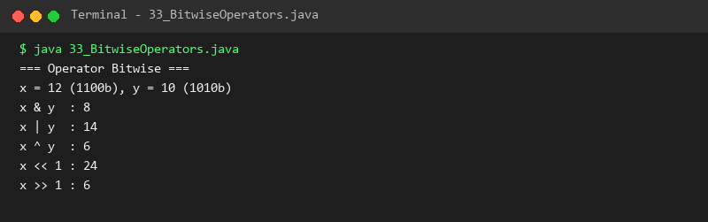

### 34. 34_TernaryOperator.java
- **Tujuan:** Menggunakan operator percabangan satu baris ternary.
- **Konsep Utama:** Sintaks `kondisi ? ekspresi_true : ekspresi_false`.
- **Penjelasan Source Code:** Menentukan status kelulusan ujian dan kategori bilangan positif/negatif.
- **Cara Menjalankan:**
  ```bash
  java 34_TernaryOperator.java
  ```
- **Hasil yang Diharapkan:** Hasil seleksi kondisi tampil ringkas di konsol.
- **Screenshot Hasil Eksekusi:**
  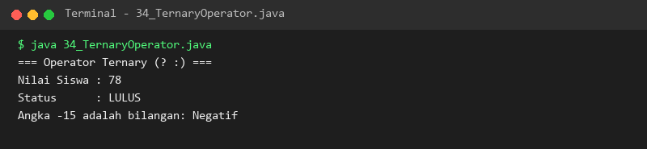

### 35. 35_OperatorPrecedence.java
- **Tujuan:** Memahami hierarki prioritas eksekusi operator dalam ekspresi kompleks.
- **Konsep Utama:** Operator aritmetika memiliki prioritas lebih tinggi daripada relasional, dan tanda kurung memiliki prioritas tertinggi.
- **Penjelasan Source Code:** Membandingkan hasil ekspresi dengan dan tanpa tanda kurung serta kombinasi logika kompleks.
- **Cara Menjalankan:**
  ```bash
  java 35_OperatorPrecedence.java
  ```
- **Hasil yang Diharapkan:** Evaluasi perbedaan prioritas operator tampil jelas.
- **Screenshot Hasil Eksekusi:**
  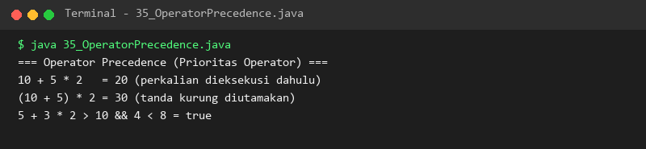

### 36. 36_StringConcatenation.java
- **Tujuan:** Menggabungkan teks menggunakan operator `+` dan method `concat()`.
- **Konsep Utama:** Konversi otomatis tipe data non-string saat digabungkan dengan string menggunakan operator `+`.
- **Penjelasan Source Code:** Menggabungkan kata, nama bahasa, dan versi aplikasi ke dalam satu kalimat utuh.
- **Cara Menjalankan:**
  ```bash
  java 36_StringConcatenation.java
  ```
- **Hasil yang Diharapkan:** Kalimat hasil penggabungan teks tercetak sempurna.
- **Screenshot Hasil Eksekusi:**
  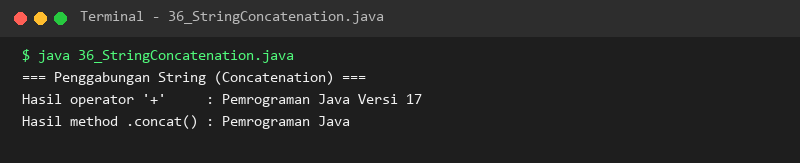

### 37. 37_StringFormatting.java
- **Tujuan:** Memformat teks dan angka menjadi string baru menggunakan `String.format()`.
- **Konsep Utama:** Pemformatan tanpa cetak langsung, mendukung penataan kolom dan pemisah ribuan.
- **Penjelasan Source Code:** Memformat informasi produk, stok dengan padding nol, dan harga dengan pemisah ribuan.
- **Cara Menjalankan:**
  ```bash
  java 37_StringFormatting.java
  ```
- **Hasil yang Diharapkan:** Laporan data tercetak rapi sesuai format kolom yang diinginkan.
- **Screenshot Hasil Eksekusi:**
  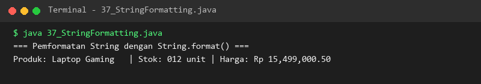

### 38. 38_MathClass.java
- **Tujuan:** Menggunakan berbagai fungsi matematika utilitas pada class `java.lang.Math`.
- **Konsep Utama:** Method-method statis seperti `abs()`, `pow()`, `sqrt()`, `max()`, `min()`, dan `round()`.
- **Penjelasan Source Code:** Menghitung nilai absolut, pemangkatan, penarikan akar kuadrat, dan pencarian nilai ekstrem.
- **Cara Menjalankan:**
  ```bash
  java 38_MathClass.java
  ```
- **Hasil yang Diharapkan:** Hasil kalkulasi fungsi matematika tercetak akurat.
- **Screenshot Hasil Eksekusi:**
  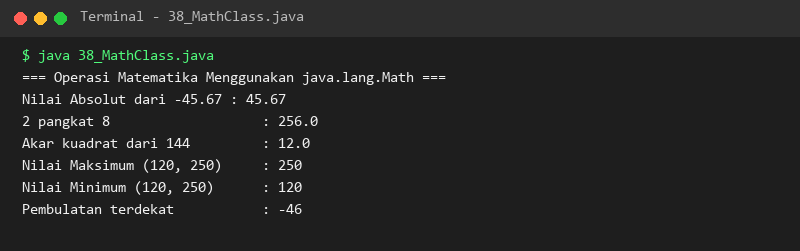

---

## Ringkasan Modul
Modul 3 telah membahas tuntas seluruh teknik pertukaran data masukan dan luaran serta manipulasi nilai dengan berbagai operator. Melalui pemahaman `Scanner`, `BufferedReader`, argumen baris perintah, operasi matematika, evaluasi logika, prioritas operator, dan pemformatan teks, program Java kini dapat berinteraksi secara dinamis dengan input pengguna dan menghasilkan keluaran yang terstruktur.
