# MODUL 6: Method dan Modularisasi Program

## Deskripsi Modul
Modul ini membahas teknik pemecahan kode program menjadi fungsi-fungsi kecil yang modular (*methods*) dalam bahasa Java. Topik yang dibahas mencakup deklarasi method dasar, penyaluran parameter dan argumen, instruksi nilai balik (*return statement*), method prosedural `void`, *method overloading*, argumen dengan panjang dinamis (*varargs*), ruang lingkup variabel (*scope*), perbedaan mendasar antara *static methods* dan *instance methods*, konsep rekursi (faktorial dan Fibonacci), pengenalan *method references*, serta struktur modularisasi berbasis paket (*package*).

## Tujuan Pembelajaran
Setelah menyelesaikan modul ini, pembelajar diharapkan mampu:
1. Mendefinisikan method mandiri untuk menghindari pengulangan kode (*Don't Repeat Yourself / DRY*).
2. Memahami perbedaan parameter formal dan argumen aktual.
3. Mengembalikan nilai hasil kalkulasi dengan instruksi `return`.
4. Menerapkan *overloading* untuk method dengan nama identik namun tipe/jumlah parameter berbeda.
5. Menangani argumen dinamis dengan fitur *varargs*.
6. Memahami daur hidup dan batasan variabel (*local*, *block*, dan *field scope*).
7. Membedakan pemanggilan *static method* milik class dan *instance method* milik objek.
8. Menyelesaikan persoalan secara rekursif dengan memastikan keberadaan *base case*.
9. Memahami sintaks referensi method (`::`) dan konsep pengorganisasian *package*.

---

## Daftar Materi dan Submodul

| No | Berkas | Materi Pembelajaran |
|---|---|---|
| 65 | [65_MethodBasic.java](65_MethodBasic.java) | Method dasar |
| 66 | [66_MethodParameters.java](66_MethodParameters.java) | Parameter method |
| 67 | [67_ReturnStatement.java](67_ReturnStatement.java) | Nilai balik method |
| 68 | [68_VoidMethods.java](68_VoidMethods.java) | Method dengan tipe `void` |
| 69 | [69_MethodOverloading.java](69_MethodOverloading.java) | Method overloading |
| 70 | [70_VarargsMethods.java](70_VarargsMethods.java) | Variable-length arguments |
| 71 | [71_MethodScope.java](71_MethodScope.java) | Scope variabel |
| 72 | [72_StaticMethods.java](72_StaticMethods.java) | Static methods |
| 73 | [73_InstanceMethods.java](73_InstanceMethods.java) | Instance methods |
| 74 | [74_RecursiveMethods.java](74_RecursiveMethods.java) | Rekursi |
| 75 | [75_RecursiveFactorial.java](75_RecursiveFactorial.java) | Faktorial rekursif |
| 76 | [76_RecursiveFibonacci.java](76_RecursiveFibonacci.java) | Fibonacci rekursif |
| 77 | [77_MethodReferencesIntro.java](77_MethodReferencesIntro.java) | Pengenalan method references |
| 78 | [78_PackagesBasic.java](78_PackagesBasic.java) | Package dan modularisasi kode |

---

## Penjelasan Setiap Submodul

### 65. 65_MethodBasic.java
- **Tujuan:** Membuat dan memanggil method sederhana tanpa parameter.
- **Konsep Utama:** Enkapsulasi blok kode fungsional yang dapat dipanggil berulang kali dari method utama.
- **Penjelasan Source Code:** Menjalankan method statis `sapaPengguna()` untuk menampilkan pesan salam pembuka.
- **Cara Menjalankan:**
  ```bash
  java 65_MethodBasic.java
  ```
- **Hasil yang Diharapkan:** Pesan salam dalam method tercetak di konsol.
- **Screenshot Hasil Eksekusi:**
  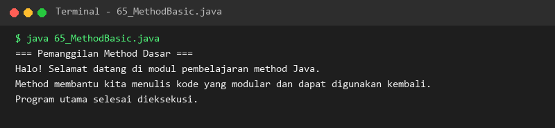

### 66. 66_MethodParameters.java
- **Tujuan:** Mengirimkan data masukan dinamis ke dalam parameter method.
- **Konsep Utama:** Parameter formal di dalam deklarasi method diisi oleh argumen aktual saat pemanggilan.
- **Penjelasan Source Code:** Mengirim nama dan usia pengguna ke method profil untuk dievaluasi dan dicetak.
- **Cara Menjalankan:**
  ```bash
  java 66_MethodParameters.java
  ```
- **Hasil yang Diharapkan:** Profil dua orang pengguna dengan data berbeda tercetak rapi.
- **Screenshot Hasil Eksekusi:**
  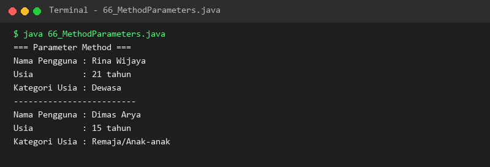

### 67. 67_ReturnStatement.java
- **Tujuan:** Menghasilkan nilai balik dari eksekusi sebuah method menggunakan kata kunci `return`.
- **Konsep Utama:** Tipe data nilai balik harus sesuai dengan deklarasi signature method.
- **Penjelasan Source Code:** Menghitung luas persegi panjang dan nilai rata-rata dari 3 komponen angka.
- **Cara Menjalankan:**
  ```bash
  java 67_ReturnStatement.java
  ```
- **Hasil yang Diharapkan:** Hasil komputasi angka dikembalikan dan dicetak oleh pemanggil.
- **Screenshot Hasil Eksekusi:**
  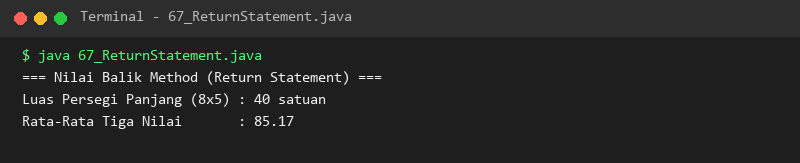

### 68. 68_VoidMethods.java
- **Tujuan:** Menyusun method prosedural tanpa nilai kembali (`void`).
- **Konsep Utama:** Method difokuskan untuk menghasilkan efek samping (*side-effect*) seperti pencetakan kartu pegawai.
- **Penjelasan Source Code:** Menghasilkan batas garis dekoratif dan mencetak kartu identitas pegawai ke konsol.
- **Cara Menjalankan:**
  ```bash
  java 68_VoidMethods.java
  ```
- **Hasil yang Diharapkan:** Format kartu pegawai tercetak lengkap dengan bingkai garis pemisah.
- **Screenshot Hasil Eksekusi:**
  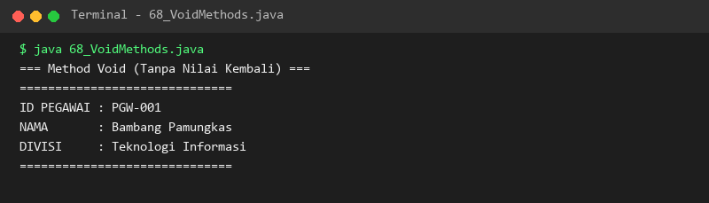

### 69. 69_MethodOverloading.java
- **Tujuan:** Mendefinisikan beberapa method dengan nama sama namun parameter berbeda (*compile-time polymorphism*).
- **Konsep Utama:** Perbedaan dapat berupa jumlah parameter maupun tipe data parameter.
- **Penjelasan Source Code:** Mengimplementasikan method `tambah()` untuk 2 integer, 3 integer, dan 2 bilangan desimal double.
- **Cara Menjalankan:**
  ```bash
  java 69_MethodOverloading.java
  ```
- **Hasil yang Diharapkan:** Ketiga variasi pemanggilan method `tambah()` menghasilkan output yang tepat.
- **Screenshot Hasil Eksekusi:**
  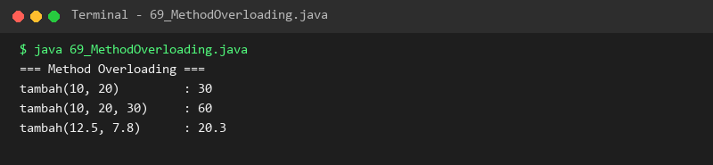

### 70. 70_VarargsMethods.java
- **Tujuan:** Menerima argumen dengan jumlah bervariasi tanpa membuat banyak overloading atau array manual.
- **Konsep Utama:** Parameter berakhiran `...` diubah menjadi array internal oleh compiler Java.
- **Penjelasan Source Code:** Method `hitungTotal()` menerima 2 angka, 5 angka, hingga tanpa angka secara fleksibel.
- **Cara Menjalankan:**
  ```bash
  java 70_VarargsMethods.java
  ```
- **Hasil yang Diharapkan:** Total perhitungan untuk setiap variasi pemanggilan tercetak akurat.
- **Screenshot Hasil Eksekusi:**
  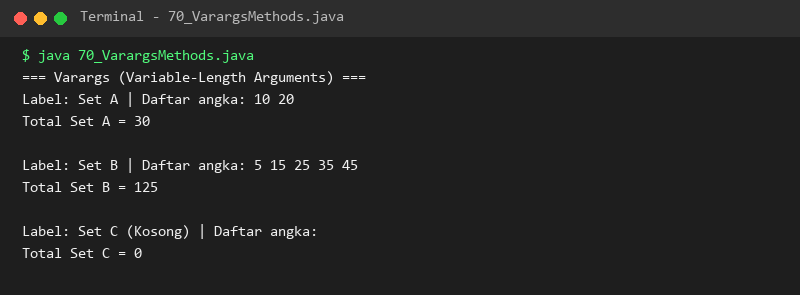

### 71. 71_MethodScope.java
- **Tujuan:** Memahami batas jangkauan pengaksesan variabel dalam lingkup method, blok, dan class.
- **Konsep Utama:** Variabel lokal hanya hidup di dalam blok tempat ia dideklarasikan, sedangkan field class dapat diakses bersama.
- **Penjelasan Source Code:** Menguji aksesibilitas variabel lokal method, variabel blok `if`, dan variabel global class.
- **Cara Menjalankan:**
  ```bash
  java 71_MethodScope.java
  ```
- **Hasil yang Diharapkan:** Nilai variabel pada masing-masing tingkatan scope ditampilkan.
- **Screenshot Hasil Eksekusi:**
  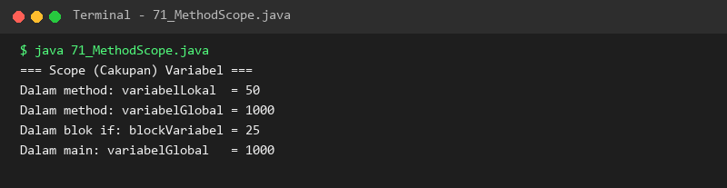

### 72. 72_StaticMethods.java
- **Tujuan:** Memahami fungsi static method yang terikat langsung pada definisi class.
- **Konsep Utama:** Static method tidak memerlukan pembuatan instance objek (`new`) untuk dapat dipanggil.
- **Penjelasan Source Code:** Membuat fungsi konversi suhu Celsius ke Fahrenheit dan sebaliknya sebagai method statis.
- **Cara Menjalankan:**
  ```bash
  java 72_StaticMethods.java
  ```
- **Hasil yang Diharapkan:** Hasil konversi suhu bolak-balik ditampilkan dengan presisi.
- **Screenshot Hasil Eksekusi:**
  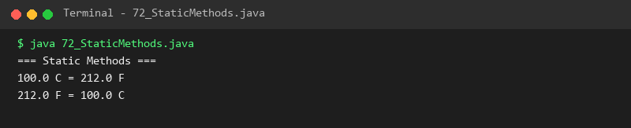

### 73. 73_InstanceMethods.java
- **Tujuan:** Memahami method yang beroperasi pada state milik objek instansiasi spesifik.
- **Konsep Utama:** Instance method memiliki akses ke keyword `this` dan atribut unik objek masing-masing.
- **Penjelasan Source Code:** Mengubah kecepatan dan memanggil aksi rem pada objek `Mobil` melalui referensinya.
- **Cara Menjalankan:**
  ```bash
  java 73_InstanceMethods.java
  ```
- **Hasil yang Diharapkan:** Perubahan status kecepatan kendaraan tercetak berurutan.
- **Screenshot Hasil Eksekusi:**
  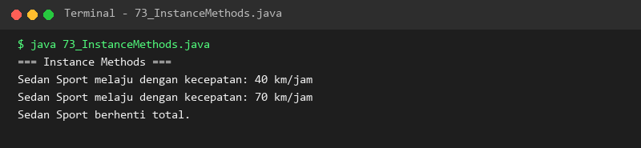

### 74. 74_RecursiveMethods.java
- **Tujuan:** Memahami dasar pemanggilan method rekursif dan pentingnya *base case*.
- **Konsep Utama:** Method memanggil dirinya sendiri dengan parameter yang menyusut menuju kondisi henti.
- **Penjelasan Source Code:** Menjalankan hitung mundur angka dari 5 hingga mencapai base case 0.
- **Cara Menjalankan:**
  ```bash
  java 74_RecursiveMethods.java
  ```
- **Hasil yang Diharapkan:** Rangkaian hitung mundur tampil berantai hingga kondisi henti tercapai.
- **Screenshot Hasil Eksekusi:**
  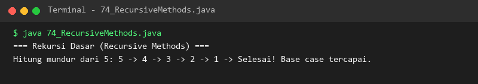

### 75. 75_RecursiveFactorial.java
- **Tujuan:** Mengimplementasikan definisi rekursif matematika faktorial.
- **Konsep Utama:** Hubungan `n! = n * (n - 1)!` dengan kondisi henti `n <= 1`.
- **Penjelasan Source Code:** Menghitung nilai faktorial untuk angka 0, 1, 4, 6, dan 8 menggunakan fungsi rekursif murni.
- **Cara Menjalankan:**
  ```bash
  java 75_RecursiveFactorial.java
  ```
- **Hasil yang Diharapkan:** Hasil faktorial untuk seluruh daftar angka uji tercetak tepat.
- **Screenshot Hasil Eksekusi:**
  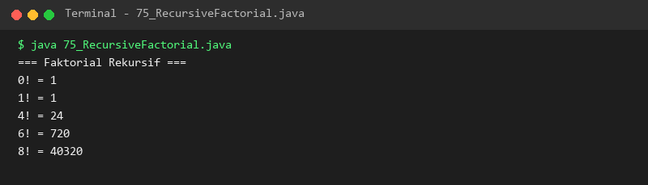

### 76. 76_RecursiveFibonacci.java
- **Tujuan:** Menyelesaikan deret Fibonacci menggunakan metode rekursif bercabang.
- **Konsep Utama:** `F(n) = F(n-1) + F(n-2)` dengan dua kondisi henti pada nilai 0 dan 1.
- **Penjelasan Source Code:** Menghitung dan mencetak deret 10 bilangan Fibonacci pertama.
- **Cara Menjalankan:**
  ```bash
  java 76_RecursiveFibonacci.java
  ```
- **Hasil yang Diharapkan:** Deret Fibonacci 0 1 1 2 3 5 8 13 21 34 ditampilkan.
- **Screenshot Hasil Eksekusi:**
  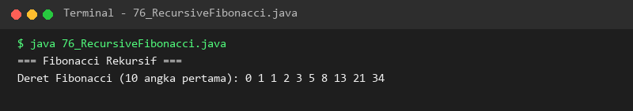

### 77. 77_MethodReferencesIntro.java
- **Tujuan:** Memahami sintaks referensi method (`::`) yang diperkenalkan sejak Java 8.
- **Konsep Utama:** Menjadikan method sebagai argumen fungsi (seperti pada `forEach`) dengan penulisan ringkas.
- **Penjelasan Source Code:** Menampilkan elemen daftar framework Java menggunakan referensi method kustom dan `System.out::println`.
- **Cara Menjalankan:**
  ```bash
  java 77_MethodReferencesIntro.java
  ```
- **Hasil yang Diharapkan:** Seluruh elemen list tercetak melalui pemanggilan method reference.
- **Screenshot Hasil Eksekusi:**
  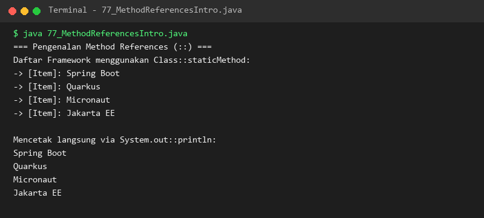

### 78. 78_PackagesBasic.java
- **Tujuan:** Memahami pengorganisasian berkas dan hierarki modularisasi dengan paket (*package*).
- **Konsep Utama:** Pencegahan tabrakan nama class (*namespace collision*) dan impor class menggunakan instruksi `import`.
- **Penjelasan Source Code:** Menjelaskan konvensi domain terbalik penamaan package dan menggunakan class dari `java.time`.
- **Cara Menjalankan:**
  ```bash
  java 78_PackagesBasic.java
  ```
- **Hasil yang Diharapkan:** Penjelasan konsep package dan cetakan tanggal saat ini ditampilkan di konsol.
- **Screenshot Hasil Eksekusi:**
  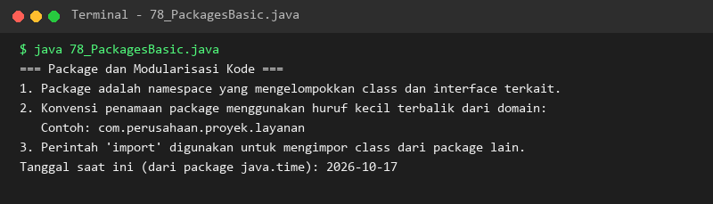

---

## Ringkasan Modul
Modul 6 telah membahas tuntas seluruh teknik dekomposisi masalah menjadi fungsi-fungsi method modular. Kita telah menguasai aliran data melalui parameter dan return value, fleksibilitas overloading dan varargs, pemisahan static versus instance methods, daya komputasi elegan rekursi matematis, serta abstraksi modern method references dan pengorganisasian package. Modularisasi ini menjadi jembatan langsung menuju babak berikutnya: struktur data array dan manipulasi teks.
