# MODUL 7: Array dan Manipulasi String

## Deskripsi Modul
Modul ini membahas pengorganisasian data homogen menggunakan struktur data array dan pengelolaan teks dinamis dengan class `String`, `StringBuilder`, `StringBuffer`, serta *regular expressions* (Regex). Materi mencakup array satu dimensi, indeksasi, penelusuran (*iteration*), perhitungan agregat (jumlah, rata-rata, min/max), algoritma pencarian linier (*linear search*), pengurutan (*sorting*), matriks multidimensi beserta operasi matematika matriks (penjumlahan dan perkalian). Di sisi pengolahan teks, dibahas method-method esensial String, perbandingan referensi versus isi objek (*String Pool*), pencarian dan penggantian teks, pemisahan data (*split* dan *StringTokenizer*), hingga pembuatan sistem pemrosesan teks (*text processing analyzer*).

## Tujuan Pembelajaran
Setelah menyelesaikan modul ini, pembelajar diharapkan mampu:
1. Mendeklarasikan, menginisialisasi, dan mengakses elemen array 1 dimensi dan multidimensi.
2. Melakukan operasi agregat (hitung total, rata-rata, nilai ekstrem) pada kumpulan data.
3. Menerapkan algoritma pencarian linier dan pengurutan data array.
4. Melakukan operasi matriks matematika (penjumlahan dan perkalian ordo 2x2).
5. Memahami perbedaan mendasar operator `==` dan method `.equals()` pada objek teks.
6. Memilih antara `String` (immutable), `StringBuilder` (mutable cepat), dan `StringBuffer` (thread-safe).
7. Menerapkan pola *Regular Expressions* (Regex) untuk validasi format masukan data.

---

## Daftar Materi dan Submodul

| No | Berkas | Materi Pembelajaran |
|---|---|---|
| 79 | [79_ArrayBasic.java](79_ArrayBasic.java) | Array dasar |
| 80 | [80_ArrayInitialization.java](80_ArrayInitialization.java) | Inisialisasi array |
| 81 | [81_ArrayIndexing.java](81_ArrayIndexing.java) | Akses indeks array |
| 82 | [82_ArrayIteration.java](82_ArrayIteration.java) | Iterasi array |
| 83 | [83_ArraySumAverage.java](83_ArraySumAverage.java) | Jumlah dan rata-rata array |
| 84 | [84_ArrayMinMax.java](84_ArrayMinMax.java) | Nilai minimum dan maksimum |
| 85 | [85_ArraySearch.java](85_ArraySearch.java) | Pencarian elemen array |
| 86 | [86_ArraySorting.java](86_ArraySorting.java) | Pengurutan array |
| 87 | [87_MultidimensionalArray.java](87_MultidimensionalArray.java) | Array multidimensi |
| 88 | [88_MatrixAddition.java](88_MatrixAddition.java) | Penjumlahan matriks |
| 89 | [89_MatrixMultiplication.java](89_MatrixMultiplication.java) | Perkalian matriks |
| 90 | [90_StringMethods.java](90_StringMethods.java) | Metode dasar String |
| 91 | [91_StringComparison.java](91_StringComparison.java) | Perbandingan string |
| 92 | [92_StringSearching.java](92_StringSearching.java) | Pencarian teks |
| 93 | [93_StringReplacement.java](93_StringReplacement.java) | Penggantian teks |
| 94 | [94_StringSplitting.java](94_StringSplitting.java) | Pemisahan string |
| 95 | [95_StringBuilder.java](95_StringBuilder.java) | Penggunaan `StringBuilder` |
| 96 | [96_StringBuffer.java](96_StringBuffer.java) | Penggunaan `StringBuffer` |
| 97 | [97_StringFormatting.java](97_StringFormatting.java) | Pemformatan teks |
| 98 | [98_RegularExpressions.java](98_RegularExpressions.java) | Regular expressions |
| 99 | [99_StringTokenizer.java](99_StringTokenizer.java) | Pemisahan token teks |
| 100 | [100_TextProcessing.java](100_TextProcessing.java) | Pemrosesan teks |

---

## Penjelasan Setiap Submodul

### 79. 79_ArrayBasic.java
- **Tujuan:** Mengenal struktur alokasi memori berukuran tetap (*fixed size*) pada array.
- **Konsep Utama:** Deklarasi tipe array, operator alokasi `new`, dan penggunaan atribut `.length`.
- **Penjelasan Source Code:** Mengalokasikan 5 slot integer dan mengisi nilai pada indeks tertentu.
- **Cara Menjalankan:** `java 79_ArrayBasic.java`
- **Hasil yang Diharapkan:** Panjang array dan nilai elemen pertama serta terakhir ditampilkan.
- **Screenshot Hasil Eksekusi:** 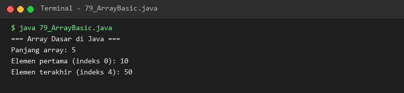

### 80. 80_ArrayInitialization.java
- **Tujuan:** Mengisi elemen array secara langsung saat deklarasi.
- **Konsep Utama:** Inisialisasi cepat dengan array literal `{...}` tanpa menyebutkan panjang secara manual.
- **Penjelasan Source Code:** Membuat array nama-nama kota dan array harga barang.
- **Cara Menjalankan:** `java 80_ArrayInitialization.java`
- **Hasil yang Diharapkan:** Jumlah elemen dan isi data terinisialisasi dicetak ke konsol.
- **Screenshot Hasil Eksekusi:** 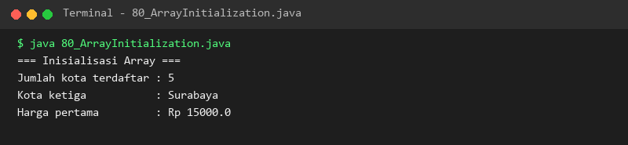

### 81. 81_ArrayIndexing.java
- **Tujuan:** Membaca dan memperbarui nilai pada indeks spesifik array.
- **Konsep Utama:** Penomoran indeks berbasis nol (*zero-based indexing*) dari 0 s.d. panjang - 1.
- **Penjelasan Source Code:** Mengubah nilai skor ujian pada indeks ke-2 dari 78 menjadi 95.
- **Cara Menjalankan:** `java 81_ArrayIndexing.java`
- **Hasil yang Diharapkan:** Perubahan nilai sebelum dan sesudah mutasi tampil jelas.
- **Screenshot Hasil Eksekusi:** 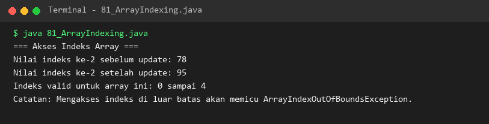

### 82. 82_ArrayIteration.java
- **Tujuan:** Menelusuri seluruh elemen array dengan berbagai jenis perulangan.
- **Konsep Utama:** Perbandingan perulangan berindeks `for(int i=0; i<arr.length; i++)` dan `for(Tipe e : arr)`.
- **Penjelasan Source Code:** Menampilkan nama-nama buah menggunakan kedua model iterasi.
- **Cara Menjalankan:** `java 82_ArrayIteration.java`
- **Hasil yang Diharapkan:** Daftar buah tercetak rapi melalui kedua cara iterasi.
- **Screenshot Hasil Eksekusi:** 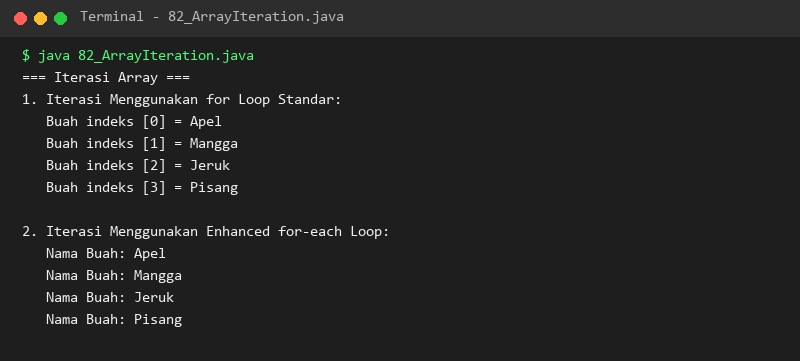

### 83. 83_ArraySumAverage.java
- **Tujuan:** Menghitung jumlah total nilai dan rata-rata aritmetika elemen array.
- **Konsep Utama:** Akumulasi nilai angka dan pembagian berpresisi desimal double.
- **Penjelasan Source Code:** Menjumlahkan skor nilai 7 orang siswa dan membaginya dengan jumlah data.
- **Cara Menjalankan:** `java 83_ArraySumAverage.java`
- **Hasil yang Diharapkan:** Total dan rata-rata nilai siswa terhitung tepat.
- **Screenshot Hasil Eksekusi:** 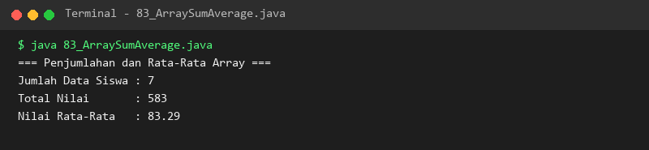

### 84. 84_ArrayMinMax.java
- **Tujuan:** Menemukan nilai ekstrem terkecil dan terbesar dalam array.
- **Konsep Utama:** Inisialisasi kandidat awal dengan elemen pertama dan pembandingan beruntun.
- **Penjelasan Source Code:** Menemukan angka 5 sebagai nilai minimum dan 98 sebagai nilai maksimum.
- **Cara Menjalankan:** `java 84_ArrayMinMax.java`
- **Hasil yang Diharapkan:** Nilai minimum dan maksimum ditemukan dan dicetak ke layar.
- **Screenshot Hasil Eksekusi:** 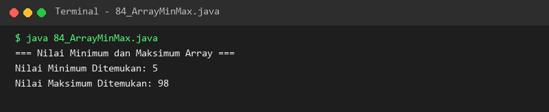

### 85. 85_ArraySearch.java
- **Tujuan:** Mencari keberadaan elemen dalam array menggunakan Linear Search.
- **Konsep Utama:** Penelusuran sekuensial dan penghentian lebih dini saat kecocokan ditemukan.
- **Penjelasan Source Code:** Mencari posisi indeks barang "Mouse" dalam kumpulan nama perangkat keras.
- **Cara Menjalankan:** `java 85_ArraySearch.java`
- **Hasil yang Diharapkan:** Posisi indeks ditemukannya barang tercetak di konsol.
- **Screenshot Hasil Eksekusi:** 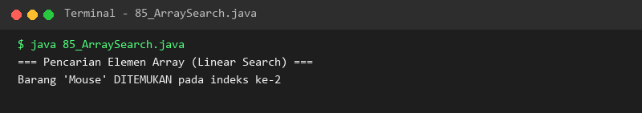

### 86. 86_ArraySorting.java
- **Tujuan:** Mengurutkan elemen array secara alfabetis dan numerik menaik (*ascending*).
- **Konsep Utama:** Penggunaan metode bawaan `java.util.Arrays.sort()`.
- **Penjelasan Source Code:** Mengurutkan array bilangan bulat acak dan array nama orang.
- **Cara Menjalankan:** `java 86_ArraySorting.java`
- **Hasil yang Diharapkan:** Data terurut dari nilai terkecil ke terbesar / dari A ke Z.
- **Screenshot Hasil Eksekusi:** 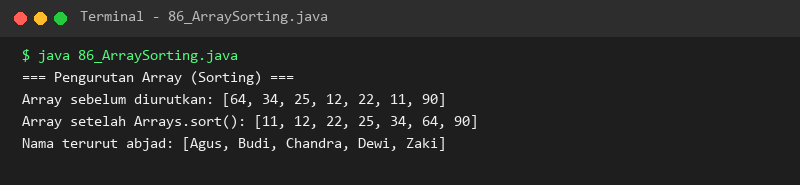

### 87. 87_MultidimensionalArray.java
- **Tujuan:** Mengelola data dalam bentuk baris dan kolom dua dimensi.
- **Konsep Utama:** Konsep matriks di mana setiap baris merupakan array tersendiri.
- **Penjelasan Source Code:** Membuat dan mencetak matriks 2x3 menggunakan perulangan bersarang.
- **Cara Menjalankan:** `java 87_MultidimensionalArray.java`
- **Hasil yang Diharapkan:** Grid matriks tercetak rapi dengan format tabulasi.
- **Screenshot Hasil Eksekusi:** 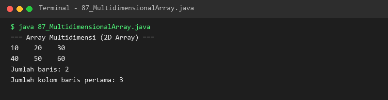

### 88. 88_MatrixAddition.java
- **Tujuan:** Mengimplementasikan operasi matematika penjumlahan dua buah matriks.
- **Konsep Utama:** Menjumlahkan elemen matriks A dan B yang memiliki koordinat [baris][kolom] sama.
- **Penjelasan Source Code:** Menjumlahkan dua matriks ordo 2x2 dan menampung hasilnya pada matriks baru.
- **Cara Menjalankan:** `java 88_MatrixAddition.java`
- **Hasil yang Diharapkan:** Matriks hasil penjumlahan tercetak akurat.
- **Screenshot Hasil Eksekusi:** 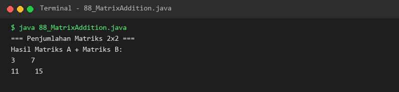

### 89. 89_MatrixMultiplication.java
- **Tujuan:** Mengimplementasikan perkalian matriks menggunakan perkalian baris kali kolom (*dot product*).
- **Konsep Utama:** Tiga lapis nested loop untuk mengakumulasikan hasil perkalian pasangan elemen.
- **Penjelasan Source Code:** Mengalikan dua matriks 2x2 sesuai kaidah aljabar linear.
- **Cara Menjalankan:** `java 89_MatrixMultiplication.java`
- **Hasil yang Diharapkan:** Matriks hasil kali tercetak secara terstruktur.
- **Screenshot Hasil Eksekusi:** 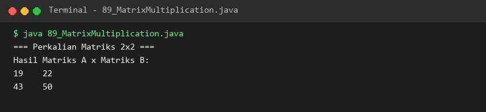

### 90. 90_StringMethods.java
- **Tujuan:** Menguasai method bawaan class `String` untuk manipulasi teks.
- **Konsep Utama:** Method `length()`, `charAt()`, `trim()`, `toUpperCase()`, `toLowerCase()`, dan `substring()`.
- **Penjelasan Source Code:** Memanipulasi teks kalimat dan mengekstrak bagian tertentu dari string.
- **Cara Menjalankan:** `java 90_StringMethods.java`
- **Hasil yang Diharapkan:** Hasil transformasi teks ditampilkan di konsol.
- **Screenshot Hasil Eksekusi:** 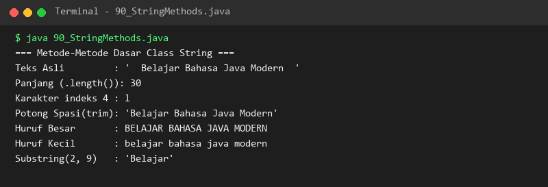

### 91. 91_StringComparison.java
- **Tujuan:** Memahami perbedaan krusial antara `==` dan method `.equals()`.
- **Konsep Utama:** Perbandingan alamat memori pada String Constant Pool vs perbandingan nilai karakter.
- **Penjelasan Source Code:** Membandingkan string literal dan string objek baru di heap.
- **Cara Menjalankan:** `java 91_StringComparison.java`
- **Hasil yang Diharapkan:** Evaluasi perbandingan referensi dan perbandingan nilai tercetak jelas.
- **Screenshot Hasil Eksekusi:** 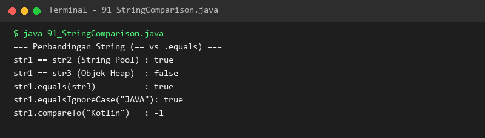

### 92. 92_StringSearching.java
- **Tujuan:** Menemukan posisi dan mendeteksi keberadaan pola kata dalam teks.
- **Konsep Utama:** Method `contains()`, `indexOf()`, `lastIndexOf()`, `startsWith()`, dan `endsWith()`.
- **Penjelasan Source Code:** Mencari posisi kemunculan kata "Java" dan memeriksa format awalan/akhiran kalimat.
- **Cara Menjalankan:** `java 92_StringSearching.java`
- **Hasil yang Diharapkan:** Posisi indeks dan status kebenaran pencarian ditampilkan.
- **Screenshot Hasil Eksekusi:** 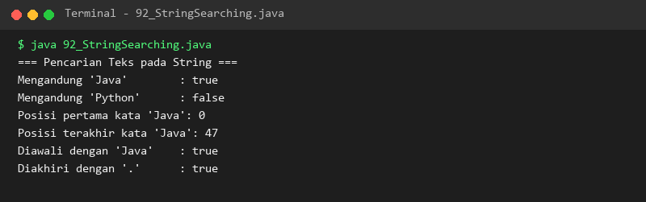

### 93. 93_StringReplacement.java
- **Tujuan:** Mengganti bagian teks tertentu dengan string baru.
- **Konsep Utama:** Perbedaan `replace()` (literal semua), `replaceFirst()`, dan `replaceAll()` (berbasis regex).
- **Penjelasan Source Code:** Mengganti nama buah dan membersihkan tanda baca dari sebuah kalimat.
- **Cara Menjalankan:** `java 93_StringReplacement.java`
- **Hasil yang Diharapkan:** Teks baru hasil penggantian tercetak sempurna.
- **Screenshot Hasil Eksekusi:** 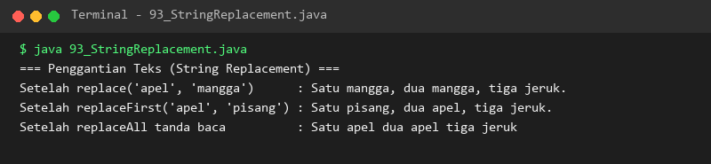

### 94. 94_StringSplitting.java
- **Tujuan:** Memecah string menjadi array elemen dan menggabungkannya kembali.
- **Konsep Utama:** Penggunaan method `.split()` dengan delimiter dan utilitas `String.join()`.
- **Penjelasan Source Code:** Mengurai baris data karyawan CSV lalu merangkainya kembali dengan pemisah pipa (|).
- **Cara Menjalankan:** `java 94_StringSplitting.java`
- **Hasil yang Diharapkan:** Daftar bagian hasil pemecahan teks tercetak rapi.
- **Screenshot Hasil Eksekusi:** 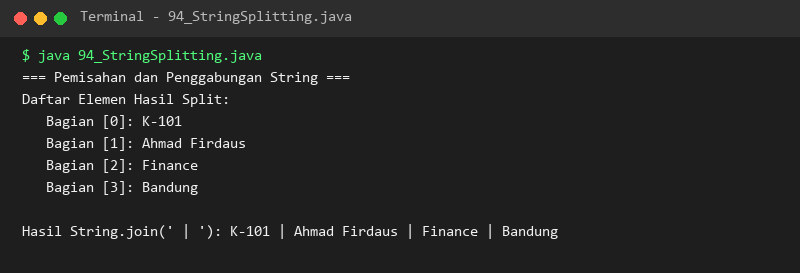

### 95. 95_StringBuilder.java
- **Tujuan:** Memanipulasi teks dinamis dengan efisiensi memori menggunakan `StringBuilder`.
- **Konsep Utama:** Objek teks yang dapat dimutasi (*mutable*) tanpa membuat objek baru secara berulang.
- **Penjelasan Source Code:** Menjalankan operasi `append()`, `insert()`, dan `reverse()`.
- **Cara Menjalankan:** `java 95_StringBuilder.java`
- **Hasil yang Diharapkan:** Teks yang telah disambung, disisipi, dan dibalik urutannya ditampilkan.
- **Screenshot Hasil Eksekusi:** 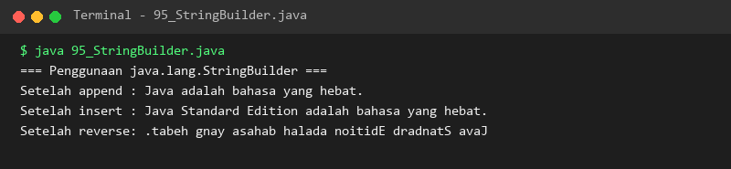

### 96. 96_StringBuffer.java
- **Tujuan:** Menggunakan `StringBuffer` untuk manipulasi teks yang aman di lingkungan multithreading.
- **Konsep Utama:** Kesamaan fungsionalitas dengan StringBuilder namun seluruh method-nya disinkronisasi (*synchronized*).
- **Penjelasan Source Code:** Menjalankan operasi penambahan dan penghapusan karakter pada buffer teks.
- **Cara Menjalankan:** `java 96_StringBuffer.java`
- **Hasil yang Diharapkan:** Manipulasi isi buffer teks tercetak di konsol.
- **Screenshot Hasil Eksekusi:** 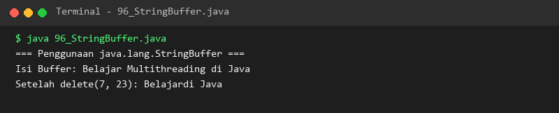

### 97. 97_StringFormatting.java
- **Tujuan:** Membangun format data tabular rapi menggunakan `String.format()`.
- **Konsep Utama:** Penataan lebar kolom, perataan kiri/kanan, dan pemisah ribuan pada angka moneter.
- **Penjelasan Source Code:** Menghasilkan tabel inventaris produk dengan kolom rata kiri dan harga rata kanan.
- **Cara Menjalankan:** `java 97_StringFormatting.java`
- **Hasil yang Diharapkan:** Tabel rapi dengan pembatas kolom tercetak di layar.
- **Screenshot Hasil Eksekusi:** 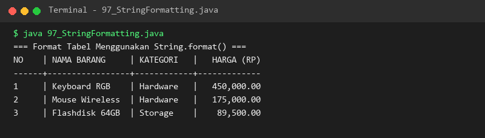

### 98. 98_RegularExpressions.java
- **Tujuan:** Memvalidasi format pola string menggunakan Regular Expressions (Regex).
- **Konsep Utama:** Menggunakan class `Pattern` dan `Matcher` untuk pengujian pola masukan.
- **Penjelasan Source Code:** Memvalidasi kumpulan alamat email untuk mendeteksi email yang valid dan tidak valid.
- **Cara Menjalankan:** `java 98_RegularExpressions.java`
- **Hasil yang Diharapkan:** Status kevalidan setiap alamat email tercetak berurutan.
- **Screenshot Hasil Eksekusi:** 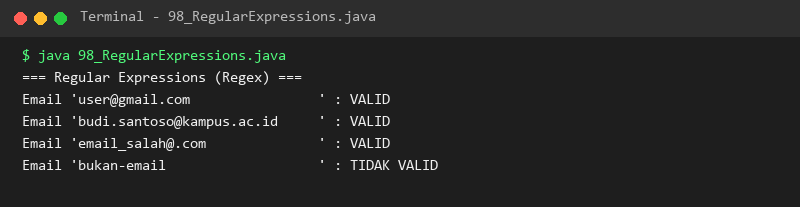

### 99. 99_StringTokenizer.java
- **Tujuan:** Memecah string menjadi token berbasis karakter pemisah dengan `StringTokenizer`.
- **Konsep Utama:** Iterasi berbasis kursor menggunakan `hasMoreTokens()` dan `nextToken()`.
- **Penjelasan Source Code:** Mengurai untaian warna pelangi yang dipisahkan oleh karakter titik koma.
- **Cara Menjalankan:** `java 99_StringTokenizer.java`
- **Hasil yang Diharapkan:** Setiap token warna tercetak dengan nomor urut.
- **Screenshot Hasil Eksekusi:** 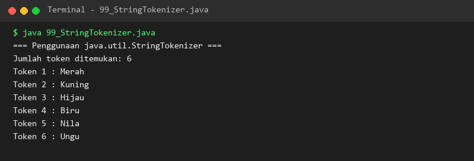

### 100. 100_TextProcessing.java
- **Tujuan:** Membangun aplikasi pemrosesan dan analisis teks terpadu.
- **Konsep Utama:** Kombinasi array, iterasi karakter, regex whitespace, dan pencarian karakter.
- **Penjelasan Source Code:** Menganalisis sebuah paragraf artikel untuk menghitung jumlah kata, karakter, dan huruf vokal.
- **Cara Menjalankan:** `java 100_TextProcessing.java`
- **Hasil yang Diharapkan:** Laporan statistik analisis teks ditampilkan lengkap.
- **Screenshot Hasil Eksekusi:** 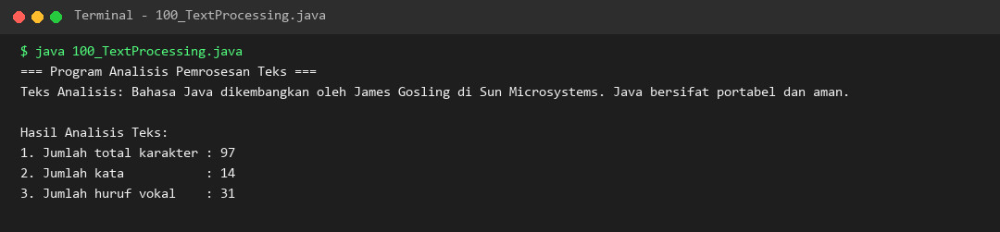

---

## Ringkasan Modul
Modul 7 telah memberikan keahlian komprehensif dalam mengelola struktur data array satu dan multi-dimensi serta manipulasi teks dari level dasar hingga analisis lanjut. Dengan menguasai array agregasi, aljabar matriks, ekosistem String, StringBuilder, Regex, dan pemrosesan teks, pembelajar memiliki fondasi data solid untuk memasuki paradigma Pemrograman Berorientasi Objek (OOP) pada Modul 8.
