# MODUL 8: Object-Oriented Programming (OOP) Dasar

## Deskripsi Modul
Modul ini membahas konsep dasar paradigma Pemrograman Berorientasi Objek (*Object-Oriented Programming / OOP*) pada bahasa Java. Pembahasan mencakup perancangan class sebagai *blueprint*, instansiasi objek dengan operator `new`, pemanfaatan *instance variables* dan *instance methods*, pembuatan constructor dan *constructor overloading*, fungsi kata kunci `this` dalam menangani *variable shadowing*, penerapan access modifier (`public`, `protected`, default, `private`), prinsip enkapsulasi data dengan getter dan setter, penggunaan variabel dan method statis (*class-level members*), *static initialization blocks*, pembatasan modifikasi dengan modifier `final` (pada variabel, method, dan class), serta eksplorasi class akar `java.lang.Object` beserta kontrak metode standarnya (`toString()`, `equals()`, dan `hashCode()`).

## Tujuan Pembelajaran
Setelah menyelesaikan modul ini, pembelajar diharapkan mampu:
1. Memahami konsep Class sebagai tipe data bentukan dan Object sebagai wujud instansiasi di memori heap.
2. Menginisialisasi objek menggunakan constructor tunggal maupun constructor overloading.
3. Menggunakan kata kunci `this` untuk merujuk pada instance aktif.
4. Menerapkan 4 level hak akses (*access modifiers*) untuk melindungi data sensitif.
5. Menerapkan prinsip Enkapsulasi melalui method *getter* dan *setter* yang dilengkapi validasi.
6. Membedakan anggota statis (*static members*) milik class dengan anggota instansiasi milik objek.
7. Menggunakan kata kunci `final` untuk mencegah perubahan nilai, override method, atau pewarisan class.
8. Meng-override method warisan `java.lang.Object` (`toString`, `equals`, dan `hashCode`) sesuai kaidah standar Java.

---

## Daftar Materi dan Submodul

| No | Berkas | Materi Pembelajaran |
|---|---|---|
| 101 | [101_ClassBasic.java](101_ClassBasic.java) | Class dan object |
| 102 | [102_ObjectInstantiation.java](102_ObjectInstantiation.java) | Instansiasi object |
| 103 | [103_InstanceVariables.java](103_InstanceVariables.java) | Instance variables |
| 104 | [104_InstanceMethods.java](104_InstanceMethods.java) | Instance methods |
| 105 | [105_Constructors.java](105_Constructors.java) | Constructor |
| 106 | [106_ConstructorOverloading.java](106_ConstructorOverloading.java) | Constructor overloading |
| 107 | [107_ThisKeyword.java](107_ThisKeyword.java) | Keyword `this` |
| 108 | [108_AccessModifiers.java](108_AccessModifiers.java) | `public`, `private`, dan `protected` |
| 109 | [109_Encapsulation.java](109_Encapsulation.java) | Encapsulation |
| 110 | [110_GettersSetters.java](110_GettersSetters.java) | Getter dan setter |
| 111 | [111_StaticVariables.java](111_StaticVariables.java) | Static variables |
| 112 | [112_StaticMethods.java](112_StaticMethods.java) | Static methods |
| 113 | [113_StaticBlocks.java](113_StaticBlocks.java) | Static initialization blocks |
| 114 | [114_FinalVariables.java](114_FinalVariables.java) | Final variables |
| 115 | [115_FinalMethods.java](115_FinalMethods.java) | Final methods |
| 116 | [116_FinalClasses.java](116_FinalClasses.java) | Final classes |
| 117 | [117_ObjectClass.java](117_ObjectClass.java) | Class `Object` |
| 118 | [118_ToStringMethod.java](118_ToStringMethod.java) | Method `toString()` |
| 119 | [119_EqualsMethod.java](119_EqualsMethod.java) | Method `equals()` |
| 120 | [120_HashCodeMethod.java](120_HashCodeMethod.java) | Method `hashCode()` |

---

## Penjelasan Setiap Submodul

### 101. 101_ClassBasic.java
- **Tujuan:** Memahami definisi class dan penciptaan objek pertama.
- **Konsep Utama:** Class bertindak sebagai cetak biru atribut dan method objek.
- **Penjelasan Source Code:** Membuat objek buku dari class `BukuDasar` dan mengisi atribut judul, penulis, serta harga.
- **Cara Menjalankan:** `java 101_ClassBasic.java`
- **Hasil yang Diharapkan:** Data atribut buku tercetak di layar.
- **Screenshot Hasil Eksekusi:** 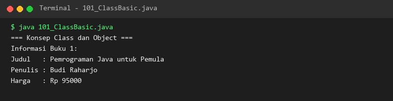

### 102. 102_ObjectInstantiation.java
- **Tujuan:** Memahami independensi memori antar beberapa objek dari class yang sama.
- **Konsep Utama:** Setiap instansiasi dengan keyword `new` mengalokasikan area memori terpisah di Heap.
- **Penjelasan Source Code:** Membuat dua objek kucing dengan nama dan warna berbeda.
- **Cara Menjalankan:** `java 102_ObjectInstantiation.java`
- **Hasil yang Diharapkan:** Properti kedua objek kucing dicetak secara terpisah.
- **Screenshot Hasil Eksekusi:** 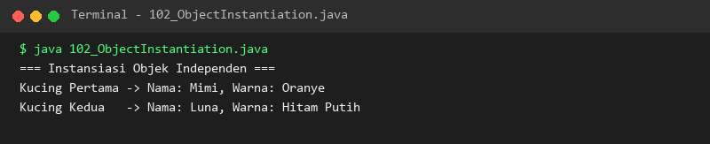

### 103. 103_InstanceVariables.java
- **Tujuan:** Mengelola variabel instansi yang menyimpan status unik objek.
- **Konsep Utama:** Mutasi pada variabel instansi suatu objek tidak memengaruhi objek lain.
- **Penjelasan Source Code:** Menetapkan level akses berbeda pada dua objek akun pengguna.
- **Cara Menjalankan:** `java 103_InstanceVariables.java`
- **Hasil yang Diharapkan:** Status masing-masing akun pengguna ditampilkan.
- **Screenshot Hasil Eksekusi:** 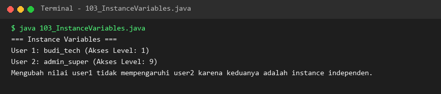

### 104. 104_InstanceMethods.java
- **Tujuan:** Menjalankan operasi dan mengubah status objek melalui instance method.
- **Konsep Utama:** Method dapat membaca dan mengubah nilai field internal objek.
- **Penjelasan Source Code:** Menyalakan, memadamkan, dan memeriksa status lampu kamar tidur.
- **Cara Menjalankan:** `java 104_InstanceMethods.java`
- **Hasil yang Diharapkan:** Log perubahan status lampu kamar tercetak di konsol.
- **Screenshot Hasil Eksekusi:** 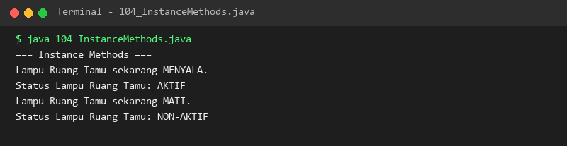

### 105. 105_Constructors.java
- **Tujuan:** Menginisialisasi state objek saat pertama kali dibuat dengan constructor.
- **Konsep Utama:** Constructor dieksekusi otomatis ketika keyword `new` dipanggil.
- **Penjelasan Source Code:** Constructor `MahasiswaConst` menerima parameter NIM, nama, dan IPK.
- **Cara Menjalankan:** `java 105_Constructors.java`
- **Hasil yang Diharapkan:** Data mahasiswa tercetak lengkap melalui inisialisasi constructor.
- **Screenshot Hasil Eksekusi:** 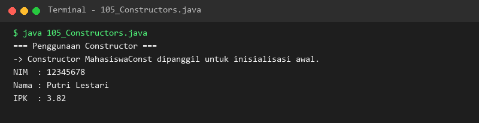

### 106. 106_ConstructorOverloading.java
- **Tujuan:** Menyediakan berbagai cara pembuatan objek dengan signature constructor yang berbeda.
- **Konsep Utama:** Overloading parameter constructor untuk fleksibilitas pembentukan objek.
- **Penjelasan Source Code:** Membuat produk menggunakan constructor default, dua parameter, dan tiga parameter lengkap.
- **Cara Menjalankan:** `java 106_ConstructorOverloading.java`
- **Hasil yang Diharapkan:** Ketiga produk tercetak dengan data sesuai constructor yang digunakan.
- **Screenshot Hasil Eksekusi:** 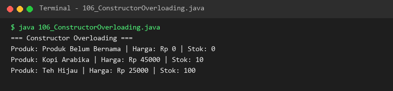

### 107. 107_ThisKeyword.java
- **Tujuan:** Mengatasi benturan nama parameter dan atribut (*variable shadowing*).
- **Konsep Utama:** Keyword `this` merujuk secara eksplisit pada instance objek yang sedang aktif.
- **Penjelasan Source Code:** Mengisi nilai koordinat `x` dan `y` menggunakan sintaks `this.x = x`.
- **Cara Menjalankan:** `java 107_ThisKeyword.java`
- **Hasil yang Diharapkan:** Koordinat titik tercetak dengan akurat.
- **Screenshot Hasil Eksekusi:** 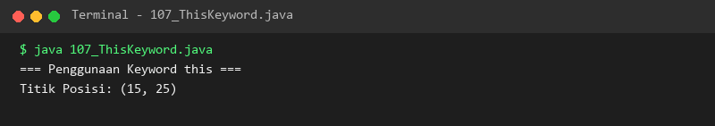

### 108. 108_AccessModifiers.java
- **Tujuan:** Memahami hak akses modifier `public`, `protected`, `default`, dan `private`.
- **Konsep Utama:** Pembatasan visibilitas variabel untuk keamanan arsitektur sistem.
- **Penjelasan Source Code:** Menguji akses berbagai field dan membaca data privat melalui method pembantu.
- **Cara Menjalankan:** `java 108_AccessModifiers.java`
- **Hasil yang Diharapkan:** Pesan hak akses pada masing-masing level ditampilkan.
- **Screenshot Hasil Eksekusi:** 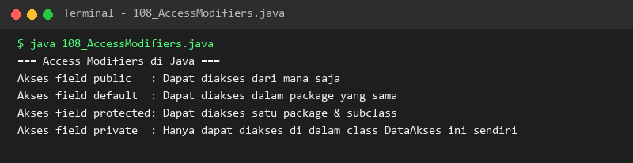

### 109. 109_Encapsulation.java
- **Tujuan:** Menerapkan enkapsulasi untuk memvalidasi setiap perubahan saldo dompet digital.
- **Konsep Utama:** Atribut privat hanya bisa diubah melalui method publik yang memiliki logika validasi.
- **Penjelasan Source Code:** Mensimulasikan top up dan penarikan saldo, termasuk penolakan transaksi saat saldo kurang.
- **Cara Menjalankan:** `java 109_Encapsulation.java`
- **Hasil yang Diharapkan:** Log transaksi top up, penarikan sukses, dan penarikan gagal ditampilkan.
- **Screenshot Hasil Eksekusi:** 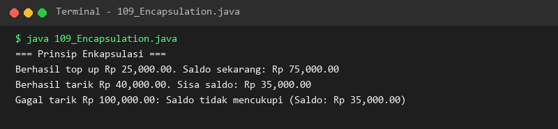

### 110. 110_GettersSetters.java
- **Tujuan:** Mengimplementasikan pola standar accessor (getter) dan mutator (setter).
- **Konsep Utama:** Standar konvensi JavaBean untuk properti objek yang aman.
- **Penjelasan Source Code:** Mengatur nama dan gaji pegawai serta menolak penetapan gaji negatif.
- **Cara Menjalankan:** `java 110_GettersSetters.java`
- **Hasil yang Diharapkan:** Data gaji valid tersimpan dan pesan penolakan gaji negatif muncul.
- **Screenshot Hasil Eksekusi:** 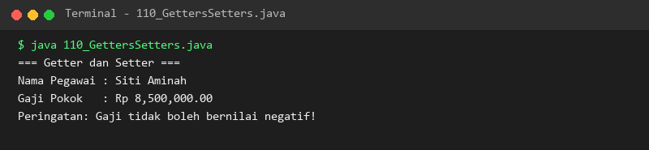

### 111. 111_StaticVariables.java
- **Tujuan:** Berbagi satu nilai variabel di seluruh instance menggunakan keyword `static`.
- **Konsep Utama:** Static variable terikat pada class dan disimpan sekali di area memori metod.
- **Penjelasan Source Code:** Menghitung jumlah seluruh objek yang berhasil diinstansiasi secara global.
- **Cara Menjalankan:** `java 111_StaticVariables.java`
- **Hasil yang Diharapkan:** Counter total objek bertambah otomatis pada setiap pembuatan objek baru.
- **Screenshot Hasil Eksekusi:** 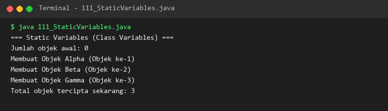

### 112. 112_StaticMethods.java
- **Tujuan:** Membangun method utilitas yang dapat langsung dipanggil tanpa instansiasi objek.
- **Konsep Utama:** Method `static` tidak bergantung pada atribut instance mana pun.
- **Penjelasan Source Code:** Membuat class utilitas matematika untuk operasi penjumlahan dan perkalian.
- **Cara Menjalankan:** `java 112_StaticMethods.java`
- **Hasil yang Diharapkan:** Hasil komputasi matematika statis tercetak di konsol.
- **Screenshot Hasil Eksekusi:** 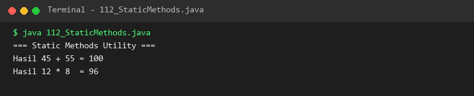

### 113. 113_StaticBlocks.java
- **Tujuan:** Menginisialisasi sumber daya statis satu kali saat class pertama kali dimuat.
- **Konsep Utama:** Blok `static { ... }` dieksekusi sebelum method main atau constructor mana pun.
- **Penjelasan Source Code:** Memuat konfigurasi nama sistem dan versi API secara otomatis saat class dimuat.
- **Cara Menjalankan:** `java 113_StaticBlocks.java`
- **Hasil yang Diharapkan:** Pesan eksekusi static block tampil sebelum alur utama membaca variabel.
- **Screenshot Hasil Eksekusi:** 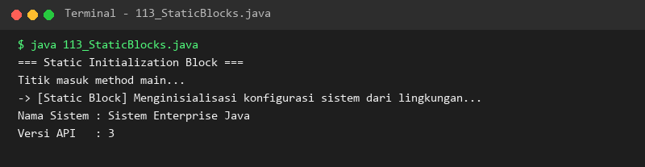

### 114. 114_FinalVariables.java
- **Tujuan:** Mengunci nilai variabel agar bersifat konstan dan tidak dapat diubah lagi.
- **Konsep Utama:** `final` field wajib diberi nilai dan bersifat read-only setelahnya.
- **Penjelasan Source Code:** Menetapkan konstanta PI dan jari-jari lingkaran yang nilainya permanen.
- **Cara Menjalankan:** `java 114_FinalVariables.java`
- **Hasil yang Diharapkan:** Nilai konstanta dan hasil perhitungan luas lingkaran ditampilkan.
- **Screenshot Hasil Eksekusi:** 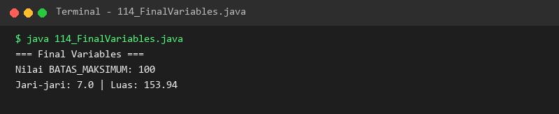

### 115. 115_FinalMethods.java
- **Tujuan:** Mengunci implementasi method agar tidak dapat ditimpa (*overridden*) oleh subclass.
- **Konsep Utama:** Proteksi logika inti keamanan sistem dari modifikasi yang berpotensi membahayakan.
- **Penjelasan Source Code:** Menunjukkan subclass yang meng-override method biasa namun dilarang mengubah method final.
- **Cara Menjalankan:** `java 115_FinalMethods.java`
- **Hasil yang Diharapkan:** Penjelasan proteksi method final tercetak di konsol.
- **Screenshot Hasil Eksekusi:** 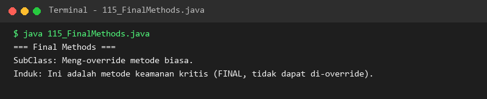

### 116. 116_FinalClasses.java
- **Tujuan:** Menghentikan rantai pewarisan class (*inheritance termination*).
- **Konsep Utama:** Menandai class dengan keyword `final` mencegah class lain memperluasnya (`extends`).
- **Penjelasan Source Code:** Class keamanan kripto dideklarasikan sebagai final class yang aman dan tertutup.
- **Cara Menjalankan:** `java 116_FinalClasses.java`
- **Hasil yang Diharapkan:** Operasi enkripsi berhasil dijalankan dengan penjelasan karakteristik final class.
- **Screenshot Hasil Eksekusi:** 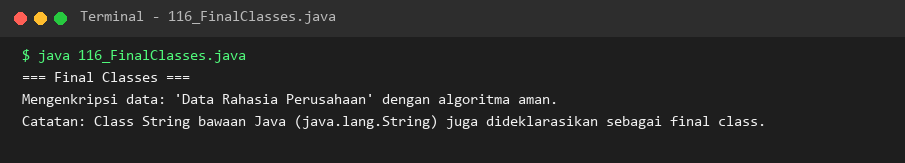

### 117. 117_ObjectClass.java
- **Tujuan:** Memahami kedudukan `java.lang.Object` sebagai induk tertinggi seluruh class Java.
- **Konsep Utama:** Semua class secara otomatis mewarisi method dari Object (`getClass`, `hashCode`, `toString`).
- **Penjelasan Source Code:** Memeriksa class type, hash code bawaan, dan menguji relasi `instanceof Object`.
- **Cara Menjalankan:** `java 117_ObjectClass.java`
- **Hasil yang Diharapkan:** Metadata bawaan class Object dari instance kendaraan ditampilkan.
- **Screenshot Hasil Eksekusi:** 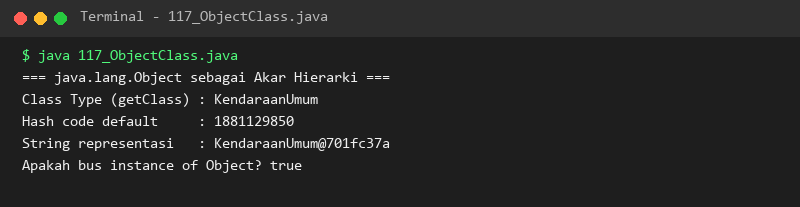

### 118. 118_ToStringMethod.java
- **Tujuan:** Menghasilkan format representasi teks yang informatif saat objek dicetak.
- **Konsep Utama:** Meng-override method `@Override public String toString()` milik class Object.
- **Penjelasan Source Code:** Mencetak objek buku perpustakaan langsung ke konsol dengan format JSON-like yang jelas.
- **Cara Menjalankan:** `java 118_ToStringMethod.java`
- **Hasil yang Diharapkan:** Teks deskriptif buku perpustakaan tercetak rapi.
- **Screenshot Hasil Eksekusi:** 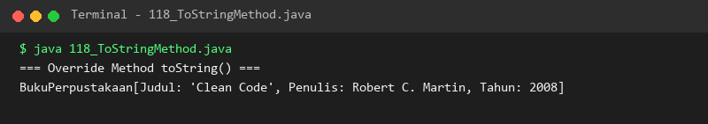

### 119. 119_EqualsMethod.java
- **Tujuan:** Membandingkan kesamaan nilai logis dua objek yang berbeda di memori heap.
- **Konsep Utama:** Meng-override method `equals()` untuk memeriksa kesamaan NIK KTP pengguna.
- **Penjelasan Source Code:** Membandingkan dua objek KTP dengan alamat memori berbeda namun memiliki NIK yang sama.
- **Cara Menjalankan:** `java 119_EqualsMethod.java`
- **Hasil yang Diharapkan:** Operator `==` menghasilkan false, namun `.equals()` menghasilkan true.
- **Screenshot Hasil Eksekusi:** 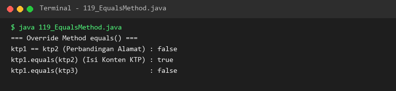

### 120. 120_HashCodeMethod.java
- **Tujuan:** Menjaga keutuhan kontrak antara method `equals()` dan `hashCode()`.
- **Konsep Utama:** Dua objek yang dianggap sama oleh `equals()` wajib mengembalikan nilai `hashCode()` yang identik.
- **Penjelasan Source Code:** Menghasilkan kode hash terhitung menggunakan `Objects.hash()` berdasarkan kode produk.
- **Cara Menjalankan:** `java 120_HashCodeMethod.java`
- **Hasil yang Diharapkan:** Dua objek produk yang setara menghasilkan hash code angka yang persis sama.
- **Screenshot Hasil Eksekusi:** 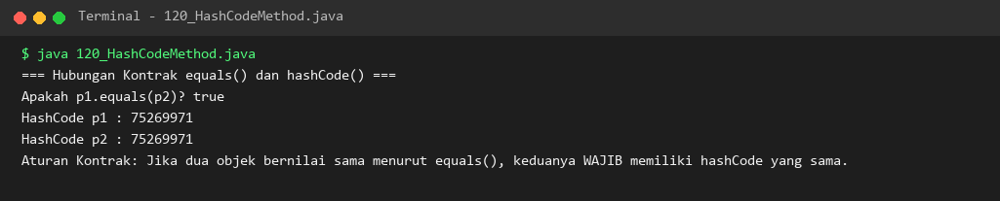

---

## Ringkasan Modul
Modul 8 telah membekali pembelajar dengan pemahaman mendalam tentang prinsip-prinsip dasar Pemrograman Berorientasi Objek di Java. Kita telah mempelajari arsitektur class dan object, enkapsulasi data melalui access modifier dan accessor/mutator, siklus inisialisasi constructor, pemisahan anggota statis dan instansiasi, modifier final untuk keamanan integritas kode, serta implementasi standar kontrak class Object (`toString`, `equals`, `hashCode`). Fondasi ini menjadi modal utama untuk melanjutkan ke Modul 9 yang membahas OOP lanjutan: pewarisan, polimorfisme, dan interface.
