# MODUL 11: Java Collections Framework

## Deskripsi Modul
Modul ini membahas arsitektur struktur data dinamis dalam *Java Collections Framework (JCF)*. Materi mencakup seluruh hierarki interface dan class koleksi standar: `List` (`ArrayList`, `LinkedList`, `Vector`, `Stack`), antarmuka antrian `Queue` dan `Deque` (`LinkedList`, `PriorityQueue`, `ArrayDeque`), himpunan unik `Set` (`HashSet`, `LinkedHashSet`, `TreeSet`), pemetaan kunci-nilai `Map` (`HashMap`, `LinkedHashMap`, `TreeMap`, `Hashtable`), mekanisme penelusuran aman (`Iterator` dan `ListIterator`), standarisasi pengurutan objek (`Comparable` dan `Comparator`), utilitas class `Collections` (pengurutan, pembalikan, pencarian biner), serta pembuatan koleksi tahan modifikasi (*Immutable Collections*) dengan *factory methods* `List.of()`, `Set.of()`, dan `Map.of()`.

## Tujuan Pembelajaran
Setelah menyelesaikan modul ini, pembelajar diharapkan mampu:
1. Memilih struktur data koleksi yang optimal berdasarkan kebutuhan kompleksitas waktu (time complexity).
2. Membedakan karakteristik List (berindeks), Set (himpunan unik), Queue (antrian FIFO/prioritas), dan Map (asosiasi key-value).
3. Melakukan manipulasi elemen secara aman saat penelusuran menggunakan `Iterator.remove()`.
4. Menerapkan antarmuka `Comparable` untuk urutan alami dan `Comparator` untuk berbagai variasi strategi pengurutan.
5. Memanfaatkan algoritma pencarian biner `Collections.binarySearch` pada data terurut.
6. Menerapkan koleksi immutable untuk menjamin keamanan *thread-safety* dan mencegah mutasi data yang tidak diinginkan.

---

## Daftar Materi dan Submodul

| No | Berkas | Materi Pembelajaran |
|---|---|---|
| 157 | [157_ArrayListBasic.java](157_ArrayListBasic.java) | `ArrayList` |
| 158 | [158_LinkedListBasic.java](158_LinkedListBasic.java) | `LinkedList` |
| 159 | [159_VectorCollection.java](159_VectorCollection.java) | `Vector` |
| 160 | [160_StackCollection.java](160_StackCollection.java) | `Stack` |
| 161 | [161_QueueInterface.java](161_QueueInterface.java) | `Queue` |
| 162 | [162_PriorityQueue.java](162_PriorityQueue.java) | `PriorityQueue` |
| 163 | [163_ArrayDeque.java](163_ArrayDeque.java) | `ArrayDeque` |
| 164 | [164_HashSet.java](164_HashSet.java) | `HashSet` |
| 165 | [165_LinkedHashSet.java](165_LinkedHashSet.java) | `LinkedHashSet` |
| 166 | [166_TreeSet.java](166_TreeSet.java) | `TreeSet` |
| 167 | [167_HashMap.java](167_HashMap.java) | `HashMap` |
| 168 | [168_LinkedHashMap.java](168_LinkedHashMap.java) | `LinkedHashMap` |
| 169 | [169_TreeMap.java](169_TreeMap.java) | `TreeMap` |
| 170 | [170_HashTable.java](170_HashTable.java) | `Hashtable` |
| 171 | [171_IteratorInterface.java](171_IteratorInterface.java) | Iterator |
| 172 | [172_ListIterator.java](172_ListIterator.java) | ListIterator |
| 173 | [173_ComparableInterface.java](173_ComparableInterface.java) | Interface `Comparable` |
| 174 | [174_ComparatorInterface.java](174_ComparatorInterface.java) | Interface `Comparator` |
| 175 | [175_CollectionsUtility.java](175_CollectionsUtility.java) | Class `Collections` |
| 176 | [176_CollectionSorting.java](176_CollectionSorting.java) | Pengurutan koleksi |
| 177 | [177_CollectionSearching.java](177_CollectionSearching.java) | Pencarian koleksi |
| 178 | [178_ImmutableCollections.java](178_ImmutableCollections.java) | Koleksi tidak dapat dimodifikasi |

---

## Penjelasan Setiap Submodul

### 157. 157_ArrayListBasic.java
- **Tujuan:** Menggunakan array dinamis `ArrayList` untuk penyimpanan data berurutan.
- **Konsep Utama:** Kapasitas bertambah otomatis, mendukung akses cepat berdasarkan indeks `get(i)`.
- **Penjelasan Source Code:** Menambah, membaca, mengubah (`set`), dan menghapus elemen nama siswa.
- **Cara Menjalankan:** `java 157_ArrayListBasic.java`
- **Hasil yang Diharapkan:** Perubahan elemen dan daftar akhir siswa tercetak di konsol.
- **Screenshot Hasil Eksekusi:** 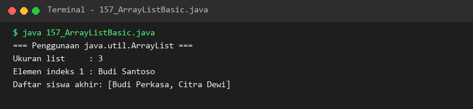

### 158. 158_LinkedListBasic.java
- **Tujuan:** Memanfaatkan simpul berantai ganda untuk operasi penyisipan/penghapusan efisien.
- **Konsep Utama:** Method `addFirst()`, `addLast()`, `getFirst()`, dan `removeFirst()` berkinerja konstan O(1).
- **Penjelasan Source Code:** Mensimulasikan antrian prioritas pelanggan menggunakan method ujung linked list.
- **Cara Menjalankan:** `java 158_LinkedListBasic.java`
- **Hasil yang Diharapkan:** Elemen pertama, terakhir, dan sisa antrian tercetak rapi.
- **Screenshot Hasil Eksekusi:** 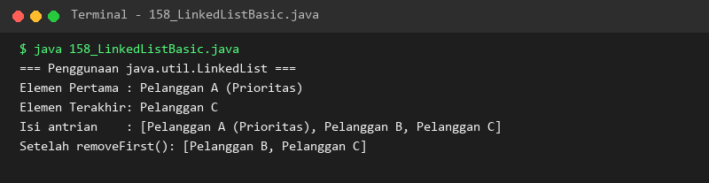

### 159. 159_VectorCollection.java
- **Tujuan:** Mengenal class koleksi berutas aman (*thread-safe*) peninggalan Java klasik.
- **Konsep Utama:** Setiap method tersinkronisasi dan kapasitas membesar dengan kelipatan tertentu.
- **Penjelasan Source Code:** Memeriksa ukuran dan kapasitas internal Vector saat elemen ditambahkan melebihi batas.
- **Cara Menjalankan:** `java 159_VectorCollection.java`
- **Hasil yang Diharapkan:** Perubahan kapasitas dinamis Vector tercetak di layar.
- **Screenshot Hasil Eksekusi:** 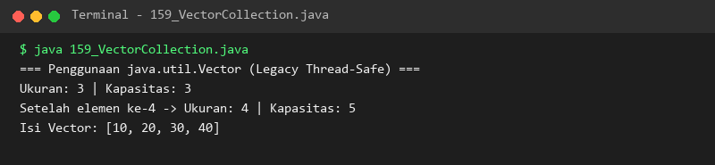

### 160. 160_StackCollection.java
- **Tujuan:** Menerapkan struktur data tumpukan berprinsip *Last-In, First-Out* (LIFO).
- **Konsep Utama:** Operasi `push()` untuk menaruh data di atas dan `pop()` untuk mengambil data teratas.
- **Penjelasan Source Code:** Menumpuk judul buku pelajaran dan mengambil buku teratas.
- **Cara Menjalankan:** `java 160_StackCollection.java`
- **Hasil yang Diharapkan:** Judul buku pada puncak tumpukan dan hasil pop tercetak di konsol.
- **Screenshot Hasil Eksekusi:** 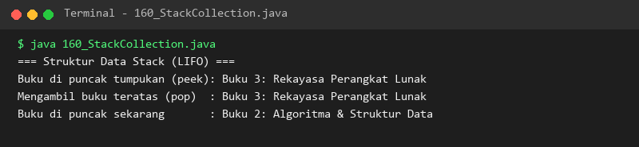

### 161. 161_QueueInterface.java
- **Tujuan:** Menerapkan struktur antrian berprinsip *First-In, First-Out* (FIFO).
- **Konsep Utama:** Method `offer()` untuk mendaftar antrian dan `poll()` untuk memproses antrian terdepan.
- **Penjelasan Source Code:** Mengelola nomor antrian tiket layanan dari nomor 001 sampai selesai dilayani.
- **Cara Menjalankan:** `java 161_QueueInterface.java`
- **Hasil yang Diharapkan:** Alur pelayanan antrian tiket tercetak berurutan sesuai kedatangan.
- **Screenshot Hasil Eksekusi:** 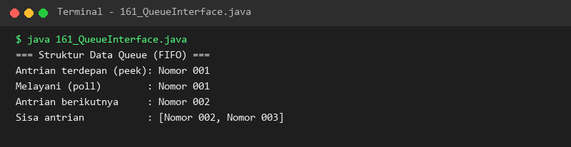

### 162. 162_PriorityQueue.java
- **Tujuan:** Mengatur urutan keluar elemen berdasarkan prioritas nilai bukan waktu kedatangan.
- **Konsep Utama:** Implementasi berbasis binary min-heap di mana nilai terkecil selalu berada di kepala antrian.
- **Penjelasan Source Code:** Memasukkan angka acak dan mengeluarkannya terurut dari nilai terkecil.
- **Cara Menjalankan:** `java 162_PriorityQueue.java`
- **Hasil yang Diharapkan:** Angka dikeluarkan secara berurutan: 10, 20, 30, 50.
- **Screenshot Hasil Eksekusi:** 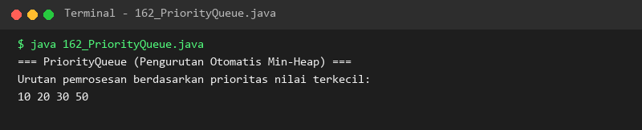

### 163. 163_ArrayDeque.java
- **Tujuan:** Memanfaatkan antrian dua arah (Double-Ended Queue) berperforma tinggi.
- **Konsep Utama:** Mengizinkan penambahan dan penarikan di kedua ujung (depan dan belakang).
- **Penjelasan Source Code:** Menambahkan elemen ke depan dan belakang serta mengeluarkannya bergantian.
- **Cara Menjalankan:** `java 163_ArrayDeque.java`
- **Hasil yang Diharapkan:** Operasi pengambilan ujung depan dan belakang tercetak jelas.
- **Screenshot Hasil Eksekusi:** 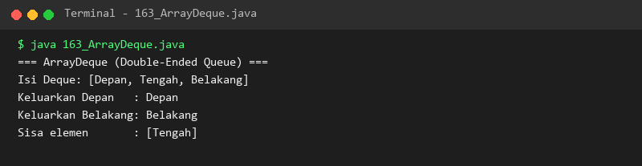

### 164. 164_HashSet.java
- **Tujuan:** Menjamin keunikan data menggunakan tabel pencacahan (*hash table*).
- **Konsep Utama:** Himpunan mengabaikan elemen duplikat dan tidak menjamin urutan iterasi.
- **Penjelasan Source Code:** Mendaftarkan hobi unik dan menguji penolakan terhadap entri duplikat.
- **Cara Menjalankan:** `java 164_HashSet.java`
- **Hasil yang Diharapkan:** Elemen duplikat diabaikan dan daftar hobi unik ditampilkan.
- **Screenshot Hasil Eksekusi:** 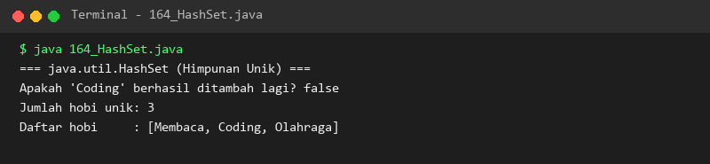

### 165. 165_LinkedHashSet.java
- **Tujuan:** Menyimpan elemen unik sekaligus mempertahankan urutan waktu penyisipan.
- **Konsep Utama:** Menggabungkan tabel hash dengan linked list internal untuk mengingat urutan.
- **Penjelasan Source Code:** Menyimpan nama-nama kota dan menampilkannya sesuai urutan pendaftaran awal.
- **Cara Menjalankan:** `java 165_LinkedHashSet.java`
- **Hasil yang Diharapkan:** Urutan kota tercetak konsisten sesuai urutan penyisipan.
- **Screenshot Hasil Eksekusi:** 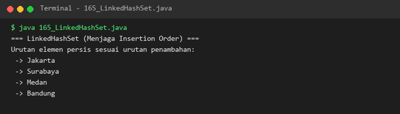

### 166. 166_TreeSet.java
- **Tujuan:** Menjaga himpunan elemen unik selalu dalam kondisi terurut (*sorted*).
- **Konsep Utama:** Struktur data Red-Black Tree mengurutkan elemen otomatis secara ascending.
- **Penjelasan Source Code:** Memasukkan bilangan acak dan mencetak himpunan yang telah terurut otomatis.
- **Cara Menjalankan:** `java 166_TreeSet.java`
- **Hasil yang Diharapkan:** Angka-angka tampil terurut dari yang terkecil hingga terbesar.
- **Screenshot Hasil Eksekusi:** 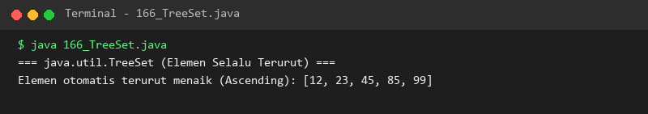

### 167. 167_HashMap.java
- **Tujuan:** Menyimpan dan mengambil data berpasangan (*key-value*) dengan kecepatan O(1).
- **Konsep Utama:** Kunci bersifat unik dan diasosiasikan dengan nilai tertentu via hashing.
- **Penjelasan Source Code:** Mengelola inventaris nama perangkat dan jumlah stok unitnya.
- **Cara Menjalankan:** `java 167_HashMap.java`
- **Hasil yang Diharapkan:** Akses stok spesifik dan iterasi seluruh pasangan key-value ditampilkan.
- **Screenshot Hasil Eksekusi:** 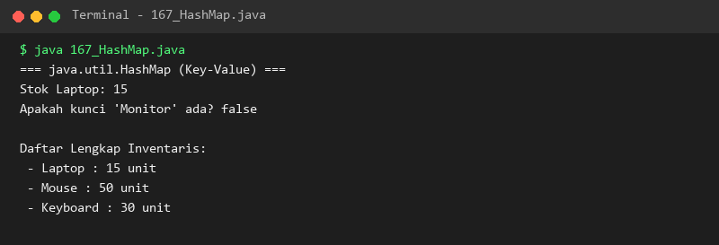

### 168. 168_LinkedHashMap.java
- **Tujuan:** Memetakan key-value dengan mempertahankan urutan penyisipan kunci.
- **Konsep Utama:** Mencegah pengacakan urutan kunci saat melakukan perulangan pada map.
- **Penjelasan Source Code:** Menyimpan daftar singkatan teknologi Java dan artinya berurutan.
- **Cara Menjalankan:** `java 168_LinkedHashMap.java`
- **Hasil yang Diharapkan:** Daftar singkatan tampil rapi sesuai urutan penambahan.
- **Screenshot Hasil Eksekusi:** 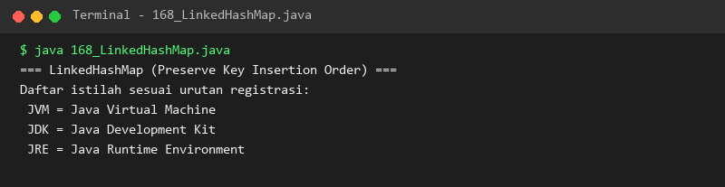

### 169. 169_TreeMap.java
- **Tujuan:** Memetakan pasangan key-value dengan kunci yang selalu terurut secara alfabetis/numerik.
- **Konsep Utama:** Implementasi NavigableMap berbasis pohon seimbang (*balanced tree*).
- **Penjelasan Source Code:** Menyimpan data nama mahasiswa dan IPK dengan kunci nama yang terurut otomatis.
- **Cara Menjalankan:** `java 169_TreeMap.java`
- **Hasil yang Diharapkan:** Nama-nama mahasiswa tersusun teratur secara abjad dari A sampai Z.
- **Screenshot Hasil Eksekusi:** 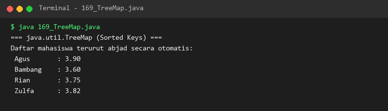

### 170. 170_HashTable.java
- **Tujuan:** Mengenal struktur map bersinkronisasi bawaan Java klasik.
- **Konsep Utama:** Thread-safe namun tidak mengizinkan kunci atau nilai bernilai `null`.
- **Penjelasan Source Code:** Memetakan kode status HTTP ke pesan deskripsinya.
- **Cara Menjalankan:** `java 170_HashTable.java`
- **Hasil yang Diharapkan:** Kode status HTTP berhasil dibaca dari objek Hashtable.
- **Screenshot Hasil Eksekusi:** 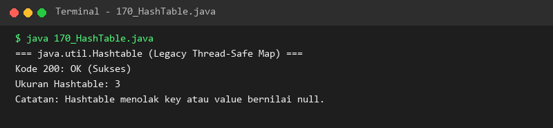

### 171. 171_IteratorInterface.java
- **Tujuan:** Menghapus elemen secara aman saat proses iterasi data berlangsung.
- **Konsep Utama:** Menggunakan `iterator.remove()` untuk mencegah `ConcurrentModificationException`.
- **Penjelasan Source Code:** Menyaring dan menghapus seluruh nilai ujian di bawah standar kelulusan 70.
- **Cara Menjalankan:** `java 171_IteratorInterface.java`
- **Hasil yang Diharapkan:** Elemen di bawah 70 tereliminasi dan menyisakan nilai yang lulus.
- **Screenshot Hasil Eksekusi:** 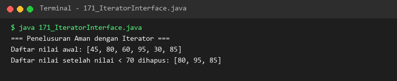

### 172. 172_ListIterator.java
- **Tujuan:** Menelusuri elemen list ke arah depan (*forward*) maupun ke arah belakang (*backward*).
- **Konsep Utama:** Method `hasNext()`/`next()` dipadukan dengan `hasPrevious()`/`previous()`.
- **Penjelasan Source Code:** Menjelajahi tahapan proses dari awal ke akhir lalu mundur kembali ke awal.
- **Cara Menjalankan:** `java 172_ListIterator.java`
- **Hasil yang Diharapkan:** Cetakan langkah penelusuran maju dan mundur tercetak jelas.
- **Screenshot Hasil Eksekusi:** 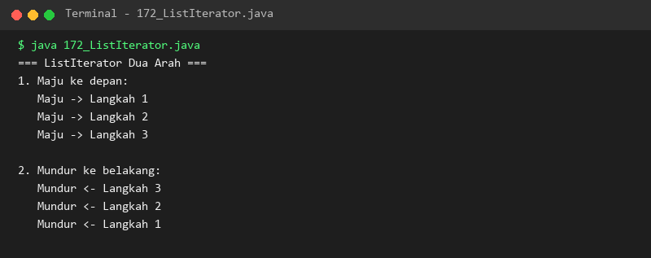

### 173. 173_ComparableInterface.java
- **Tujuan:** Menentukan urutan alami (*natural ordering*) internal pada class objek.
- **Konsep Utama:** Mengimplementasikan method `compareTo(T other)` pada class objek.
- **Penjelasan Source Code:** Mengurutkan daftar objek mahasiswa secara otomatis berdasarkan peringkat IPK tertinggi.
- **Cara Menjalankan:** `java 173_ComparableInterface.java`
- **Hasil yang Diharapkan:** Mahasiswa terurut menurun dari IPK tertinggi ke terendah.
- **Screenshot Hasil Eksekusi:** 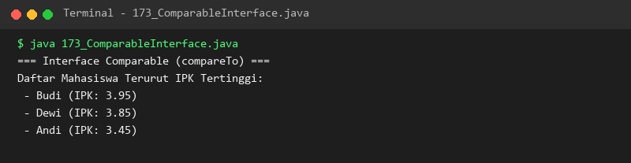

### 174. 174_ComparatorInterface.java
- **Tujuan:** Menyediakan berbagai strategi pengurutan eksternal yang fleksibel tanpa mengubah class objek.
- **Konsep Utama:** Memanfaatkan `Comparator.comparing()` untuk mengurutkan properti harga atau nama.
- **Penjelasan Source Code:** Mengurutkan produk berdasarkan harga termurah, kemudian diurutkan berdasarkan abjad nama.
- **Cara Menjalankan:** `java 174_ComparatorInterface.java`
- **Hasil yang Diharapkan:** Daftar produk tersusun akurat menurut masing-masing kriteria pembanding.
- **Screenshot Hasil Eksekusi:** 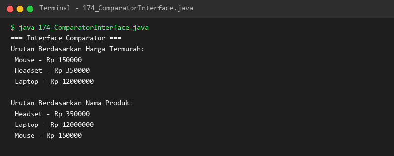

### 175. 175_CollectionsUtility.java
- **Tujuan:** Memanfaatkan fungsi utilitas bawaan class `java.util.Collections`.
- **Konsep Utama:** Method statis algoritma seperti `min()`, `max()`, `sort()`, dan `reverse()`.
- **Penjelasan Source Code:** Menemukan nilai ekstrem angka serta membalik urutan elemen list.
- **Cara Menjalankan:** `java 175_CollectionsUtility.java`
- **Hasil yang Diharapkan:** Nilai min, max, list terurut, dan list terbalik ditampilkan di layar.
- **Screenshot Hasil Eksekusi:** 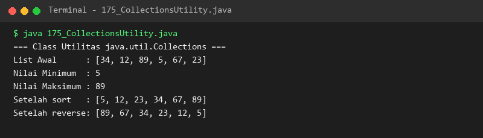

### 176. 176_CollectionSorting.java
- **Tujuan:** Menerapkan pengurutan modern dengan lambda expression pada `List.sort()`.
- **Konsep Utama:** Menggunakan lambda `(a, b) -> ...` sebagai argumen pembanding instan.
- **Penjelasan Source Code:** Mengurutkan daftar bahasa pemrograman berdasarkan panjang karakter string.
- **Cara Menjalankan:** `java 176_CollectionSorting.java`
- **Hasil yang Diharapkan:** Bahasa pemrograman terurut dari kata terpendek hingga terpanjang.
- **Screenshot Hasil Eksekusi:** 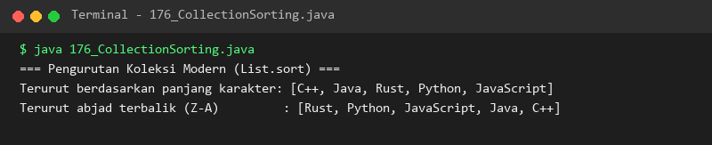

### 177. 177_CollectionSearching.java
- **Tujuan:** Melakukan pencarian elemen berkecepatan tinggi dengan algoritma Binary Search.
- **Konsep Utama:** Membagi rentang pencarian menjadi dua secara berulang pada list yang telah terurut.
- **Penjelasan Source Code:** Menemukan posisi indeks nama "Dewi" pada list nama yang telah diurutkan.
- **Cara Menjalankan:** `java 177_CollectionSearching.java`
- **Hasil yang Diharapkan:** Posisi indeks elemen target ditemukan dan ditampilkan di konsol.
- **Screenshot Hasil Eksekusi:** 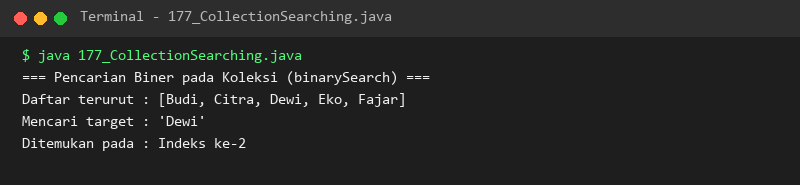

### 178. 178_ImmutableCollections.java
- **Tujuan:** Membuat koleksi data tetap yang kebal terhadap penambahan atau penghapusan elemen.
- **Konsep Utama:** Factory methods `List.of()`, `Set.of()`, dan `Map.of()` menghasilkan unmodifiable collections.
- **Penjelasan Source Code:** Membuat list hari kerja dan membuktikan pelemparan exception saat dicoba dimodifikasi.
- **Cara Menjalankan:** `java 178_ImmutableCollections.java`
- **Hasil yang Diharapkan:** Data koleksi tercetak dan upaya modifikasi ditolak oleh sistem.
- **Screenshot Hasil Eksekusi:** 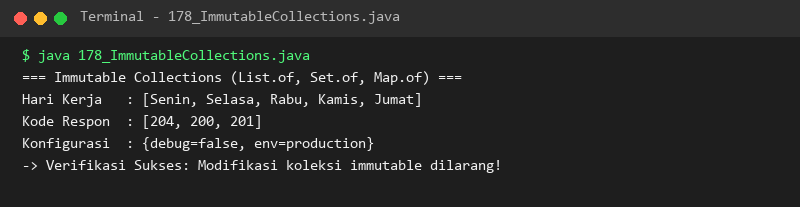

---

## Ringkasan Modul
Modul 11 telah menyajikan penguasaan mendalam atas Java Collections Framework. Pembelajar telah menguasai manajemen list dinamis, antrian FIFO dan berprioritas, himpunan unik, asosiasi pasangan key-value, mekanisme iterator dua arah, standarisasi pengurutan Comparable/Comparator, serta perlindungan data dengan koleksi immutable. Fondasi koleksi ini siap diperluas dengan parameterisasi tipe aman (*Generics*) dan paradigma fungsional (*Stream API*) pada Modul 12.
