# MODUL 13: File Handling dan Input/Output

## Deskripsi Modul
Modul ini membahas teknik interaksi program Java dengan sistem penyimpanan fisik (*Filesystem I/O*). Pembahasan mencakup manajemen berkas dasar dengan `java.io.File`, aliran karakter teks (`FileReader`, `FileWriter`, `BufferedReader`, `BufferedWriter`), aliran biner byte (`FileInputStream`, `FileOutputStream`), proses serialisasi dan deserialisasi objek (`ObjectInputStream`, `ObjectOutputStream`, antarmuka `Serializable`), perlindungan atribut rahasia menggunakan kata kunci `transient`, arsitektur I/O modern Java NIO.2 (`Path`, `Paths`, `Files`), operasi berkas cepat (*copy*, *move*, *lines*), format pertukaran data tabular CSV, penyimpanan konfigurasi aplikasi dengan `Properties`, kompresi arsip `ZIP`, hingga pemantauan berkas waktu-nyata (*real-time filesystem monitoring*) menggunakan `WatchService`.

## Tujuan Pembelajaran
Setelah menyelesaikan modul ini, pembelajar diharapkan mampu:
1. Mengelola metadata berkas (nama, path, ukuran, izin akses, pembuatan, penghapusan) menggunakan class `File` dan `Path`.
2. Membaca dan menulis berkas teks secara efisien menggunakan buffer berkinerja tinggi.
3. Membaca dan menulis berkas biner (gambar, dokumen arsip) dengan *byte streams*.
4. Menerapkan persistensi objek melalui serialisasi dan deserialisasi Java.
5. Melindungi data sensitif (seperti PIN atau password) dari serialisasi dengan kata kunci `transient`.
6. Memanfaatkan fitur praktis Java NIO.2 (`Files.readString`, `Files.writeString`, `Files.copy`, `Files.lines`).
7. Membaca dan menulis berkas format CSV serta file konfigurasi `.properties`.
8. Membuat arsip kompresi ZIP dan memahami mekanisme pemantauan event direktori dengan `WatchService`.

---

## Daftar Materi dan Submodul

| No | Berkas | Materi Pembelajaran |
|---|---|---|
| 201 | [201_FileClass.java](201_FileClass.java) | Class `File` |
| 202 | [202_FileReader.java](202_FileReader.java) | Membaca file teks |
| 203 | [203_FileWriter.java](203_FileWriter.java) | Menulis file teks |
| 204 | [204_BufferedReader.java](204_BufferedReader.java) | `BufferedReader` |
| 205 | [205_BufferedWriter.java](205_BufferedWriter.java) | `BufferedWriter` |
| 206 | [206_FileInputStream.java](206_FileInputStream.java) | `FileInputStream` |
| 207 | [207_FileOutputStream.java](207_FileOutputStream.java) | `FileOutputStream` |
| 208 | [208_ObjectInputStream.java](208_ObjectInputStream.java) | Membaca object terserialisasi |
| 209 | [209_ObjectOutputStream.java](209_ObjectOutputStream.java) | Menulis object terserialisasi |
| 210 | [210_Serialization.java](210_Serialization.java) | Serialisasi object |
| 211 | [211_TransientKeyword.java](211_TransientKeyword.java) | Keyword `transient` |
| 212 | [212_PathAndPaths.java](212_PathAndPaths.java) | `Path` dan `Paths` |
| 213 | [213_FilesClass.java](213_FilesClass.java) | Class `Files` |
| 214 | [214_NIOFileOperations.java](214_NIOFileOperations.java) | Operasi file menggunakan NIO |
| 215 | [215_CSVReadWrite.java](215_CSVReadWrite.java) | Membaca dan menulis CSV |
| 216 | [216_PropertiesFile.java](216_PropertiesFile.java) | File konfigurasi Properties |
| 217 | [217_ZipFileOperations.java](217_ZipFileOperations.java) | Operasi file ZIP |
| 218 | [218_WatchService.java](218_WatchService.java) | Memantau perubahan direktori |

---

## Penjelasan Setiap Submodul

### 201. 201_FileClass.java
- **Tujuan:** Mengelola representasi berkas dan direktori fisik di sistem operasi.
- **Konsep Utama:** Method `createNewFile()`, `getAbsolutePath()`, `canRead()`, `canWrite()`, dan `length()`.
- **Penjelasan Source Code:** Membuat berkas catatan baru dan membaca seluruh atribut metadatanya.
- **Cara Menjalankan:** `java 201_FileClass.java`
- **Hasil yang Diharapkan:** Laporan pembuatan file dan properti metadata tercetak di konsol.
- **Screenshot Hasil Eksekusi:** 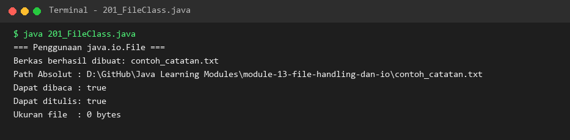

### 202. 202_FileReader.java
- **Tujuan:** Membaca data berbasis karakter langsung dari berkas teks.
- **Konsep Utama:** Aliran karakter membaca satu unit karakter Unicode per pemanggilan `read()`.
- **Penjelasan Source Code:** Membaca isi file teks karakter demi karakter hingga mendeteksi -1 (End of File).
- **Cara Menjalankan:** `java 202_FileReader.java`
- **Hasil yang Diharapkan:** Teks dalam berkas berhasil dibaca dan ditampilkan ke layar.
- **Screenshot Hasil Eksekusi:** 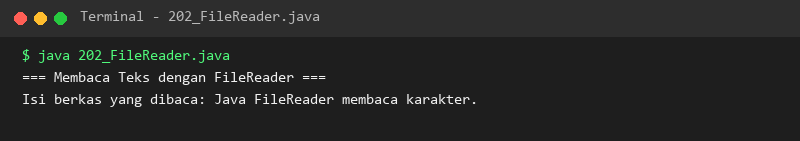

### 203. 203_FileWriter.java
- **Tujuan:** Menulis string karakter langsung ke dalam berkas teks fisik.
- **Konsep Utama:** Menyalurkan aliran karakter ke disk menggunakan method `write()`.
- **Penjelasan Source Code:** Menulis dua baris catatan teks ke dalam berkas `output_writer.txt`.
- **Cara Menjalankan:** `java 203_FileWriter.java`
- **Hasil yang Diharapkan:** Notifikasi keberhasilan penulisan teks dan ukuran berkas tercetak.
- **Screenshot Hasil Eksekusi:** 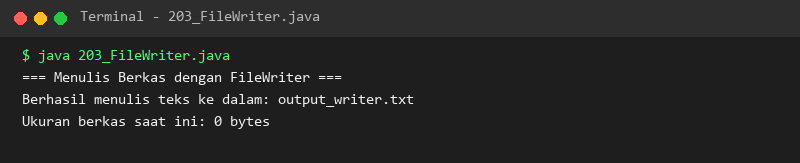

### 204. 204_BufferedReader.java
- **Tujuan:** Meningkatkan efisiensi pembacaan teks baris demi baris menggunakan buffer memori.
- **Konsep Utama:** Method `readLine()` membaca seluruh satu baris teks hingga karakter newline.
- **Penjelasan Source Code:** Membaca isi berkas teks per baris dan mencetaknya lengkap dengan nomor urut baris.
- **Cara Menjalankan:** `java 204_BufferedReader.java`
- **Hasil yang Diharapkan:** Setiap baris teks berhasil ditampilkan secara terstruktur.
- **Screenshot Hasil Eksekusi:** 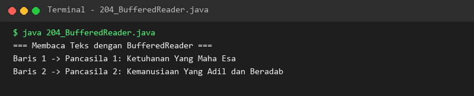

### 205. 205_BufferedWriter.java
- **Tujuan:** Menulis data teks terstruktur secara cepat dengan memanfaatkan buffer.
- **Konsep Utama:** Mengurangi frekuensi akses disk I/O dengan mengumpulkan data pada buffer memori.
- **Penjelasan Source Code:** Menulis teks laporan penjualan dan menyisipkan baris baru portabel dengan `newLine()`.
- **Cara Menjalankan:** `java 205_BufferedWriter.java`
- **Hasil yang Diharapkan:** Berkas laporan berhasil ditulis dan dikonfirmasi ke konsol.
- **Screenshot Hasil Eksekusi:** 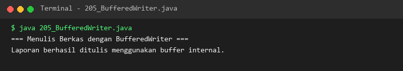

### 206. 206_FileInputStream.java
- **Tujuan:** Membaca aliran data biner mentah non-teks (byte stream).
- **Konsep Utama:** Membaca nilai byte 0-255 dari disk untuk pemrosesan file audio/gambar.
- **Penjelasan Source Code:** Membaca deret byte biner yang tersimpan di dalam file berkas biner.
- **Cara Menjalankan:** `java 206_FileInputStream.java`
- **Hasil yang Diharapkan:** Nilai integer representasi byte mentah dicetak ke konsol.
- **Screenshot Hasil Eksekusi:** 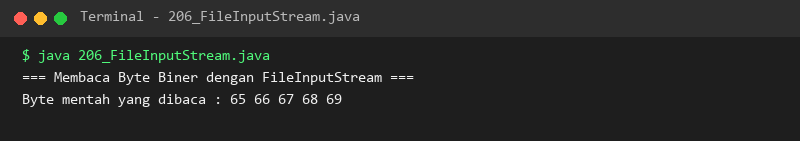

### 207. 207_FileOutputStream.java
- **Tujuan:** Menulis aliran data byte biner mentah ke sistem berkas.
- **Konsep Utama:** Menuliskan array `byte[]` langsung ke media penyimpanan disk.
- **Penjelasan Source Code:** Mengubah string teks menjadi array byte dan menulisnya ke file biner.
- **Cara Menjalankan:** `java 207_FileOutputStream.java`
- **Hasil yang Diharapkan:** Jumlah byte data biner yang berhasil ditulis ditampilkan di layar.
- **Screenshot Hasil Eksekusi:** 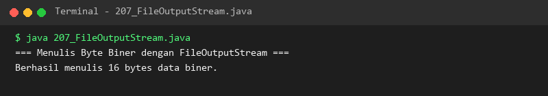

### 208. 208_ObjectInputStream.java
- **Tujuan:** Membaca kembali objek Java dari file biner terserialisasi (*Deserialization*).
- **Konsep Utama:** Merekonstruksi objek di memori heap menggunakan method `readObject()`.
- **Penjelasan Source Code:** Membaca objek `BarangSer` yang tersimpan dan memulihkan nilai atributnya.
- **Cara Menjalankan:** `java 208_ObjectInputStream.java`
- **Hasil yang Diharapkan:** Atribut nama dan harga produk pulih utuh seperti saat disimpan.
- **Screenshot Hasil Eksekusi:** 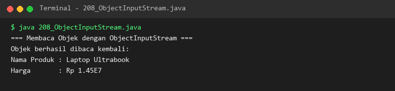

### 209. 209_ObjectOutputStream.java
- **Tujuan:** Menyimpan seluruh status objek ke dalam berkas biner (*Serialization*).
- **Konsep Utama:** Mengubah struktur objek dan atributnya menjadi representasi aliran byte via `writeObject()`.
- **Penjelasan Source Code:** Menyimpan objek profil mahasiswa ber-IPK tinggi ke file `.ser`.
- **Cara Menjalankan:** `java 209_ObjectOutputStream.java`
- **Hasil yang Diharapkan:** Konfirmasi serialisasi objek dan ukuran berkas biner ditampilkan.
- **Screenshot Hasil Eksekusi:** 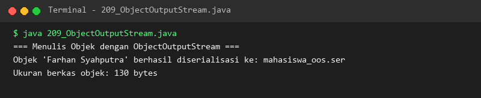

### 210. 210_Serialization.java
- **Tujuan:** Memahami siklus lengkap serialisasi dan deserialisasi end-to-end.
- **Konsep Utama:** Class wajib mengimplementasikan penanda antarmuka `java.io.Serializable`.
- **Penjelasan Source Code:** Menyimpan objek profil gamer ke file biner lalu memulihkannya kembali ke instance baru.
- **Cara Menjalankan:** `java 210_Serialization.java`
- **Hasil yang Diharapkan:** Data hasil rekonstruksi objek sama persis dengan data objek mula-mula.
- **Screenshot Hasil Eksekusi:** 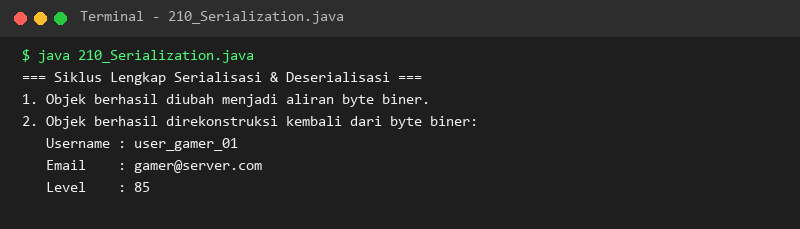

### 211. 211_TransientKeyword.java
- **Tujuan:** Melindungi field data rahasia agar tidak ikut tersimpan saat serialisasi.
- **Konsep Utama:** Modifier `transient` menginstruksikan serializer untuk mengabaikan variabel tersebut.
- **Penjelasan Source Code:** Membuktikan bahwa field PIN rahasia berubah menjadi `null` setelah proses deserialisasi.
- **Cara Menjalankan:** `java 211_TransientKeyword.java`
- **Hasil yang Diharapkan:** Data nama pemilik terbaca namun PIN bernilai null demi keamanan.
- **Screenshot Hasil Eksekusi:** 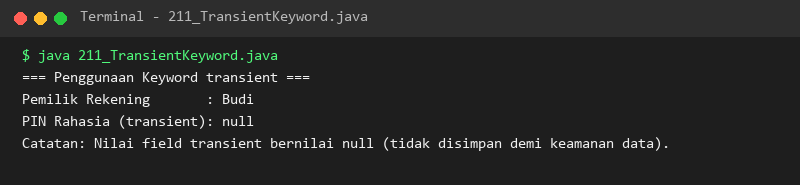

### 212. 212_PathAndPaths.java
- **Tujuan:** Menggunakan penanganan jalur berkas modern Java NIO.2.
- **Konsep Utama:** Antarmuka `Path` menggantikan banyak keterbatasan class `File` lama.
- **Penjelasan Source Code:** Memeriksa nama file, parent direktori, path absolut, dan status path.
- **Cara Menjalankan:** `java 212_PathAndPaths.java`
- **Hasil yang Diharapkan:** Struktur rincian elemen path berkas dicetak ke konsol.
- **Screenshot Hasil Eksekusi:** 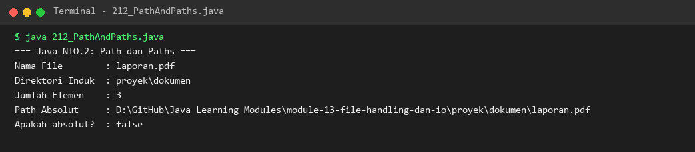

### 213. 213_FilesClass.java
- **Tujuan:** Membaca dan menulis berkas dalam satu baris instruksi dengan class utilitas `Files`.
- **Konsep Utama:** Method statis `Files.writeString()` dan `Files.readString()`.
- **Penjelasan Source Code:** Menulis string ke file dan langsung membacanya kembali secara ringkas.
- **Cara Menjalankan:** `java 213_FilesClass.java`
- **Hasil yang Diharapkan:** Isi teks yang ditulis dan dibaca berhasil dikonfirmasi.
- **Screenshot Hasil Eksekusi:** 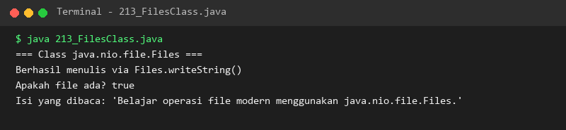

### 214. 214_NIOFileOperations.java
- **Tujuan:** Menjalankan operasi penyalinan berkas dan pembacaan stream baris berbasis NIO.
- **Konsep Utama:** Menggunakan `Files.copy()` dan streaming baris teks dengan `Files.lines()`.
- **Penjelasan Source Code:** Menyalin file ke berkas baru lalu membacanya secara fungsional.
- **Cara Menjalankan:** `java 214_NIOFileOperations.java`
- **Hasil yang Diharapkan:** Notifikasi penggandaan dan daftar baris salinan ditampilkan.
- **Screenshot Hasil Eksekusi:** 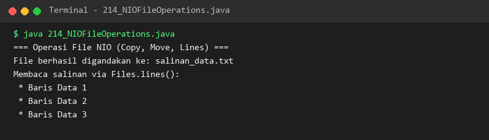

### 215. 215_CSVReadWrite.java
- **Tujuan:** Mengolah data tabel pertukaran format CSV (*Comma-Separated Values*).
- **Konsep Utama:** Memisahkan kolom data berdasarkan karakter pembatas koma (delimiter).
- **Penjelasan Source Code:** Menulis baris-baris inventaris toko lalu membacanya kembali ke format tabular terstruktur.
- **Cara Menjalankan:** `java 215_CSVReadWrite.java`
- **Hasil yang Diharapkan:** Header dan baris data produk CSV diformat rapi ke layar konsol.
- **Screenshot Hasil Eksekusi:** 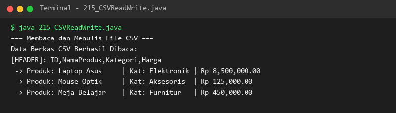

### 216. 216_PropertiesFile.java
- **Tujuan:** Menyimpan dan memuat konfigurasi parameter aplikasi dari berkas `.properties`.
- **Konsep Utama:** Penggunaan class `java.util.Properties` dengan method `load()` dan `store()`.
- **Penjelasan Source Code:** Menyimpan pengaturan port database dan nama sistem, lalu memuatnya kembali.
- **Cara Menjalankan:** `java 216_PropertiesFile.java`
- **Hasil yang Diharapkan:** Properti konfigurasi tersimpan dan berhasil dimuat ulang ke memori.
- **Screenshot Hasil Eksekusi:** 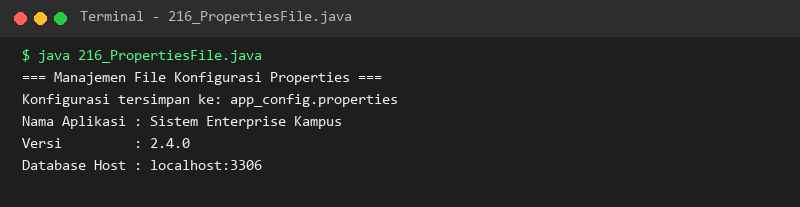

### 217. 217_ZipFileOperations.java
- **Tujuan:** Membuat arsip kompresi berkas ZIP menggunakan `ZipOutputStream`.
- **Konsep Utama:** Membungkus file masukan ke dalam satu atau beberapa entri `ZipEntry`.
- **Penjelasan Source Code:** Mengompresi file dokumen teks ke dalam file `arsip_dokumen.zip`.
- **Cara Menjalankan:** `java 217_ZipFileOperations.java`
- **Hasil yang Diharapkan:** Konfirmasi penciptaan berkas ZIP dan ukuran berkas kompresi tercetak.
- **Screenshot Hasil Eksekusi:** 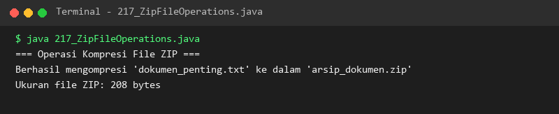

### 218. 218_WatchService.java
- **Tujuan:** Memantau kemunculan berkas baru atau perubahan direktori secara otomatis.
- **Konsep Utama:** Menggunakan event-driven `java.nio.file.WatchService` dengan polling aman.
- **Penjelasan Source Code:** Mendaftarkan direktori aktif untuk memantau event pembuatan berkas dengan timeout 500ms.
- **Cara Menjalankan:** `java 218_WatchService.java`
- **Hasil yang Diharapkan:** Status registrasi watcher dan penanganan event direktori ditampilkan di konsol.
- **Screenshot Hasil Eksekusi:** 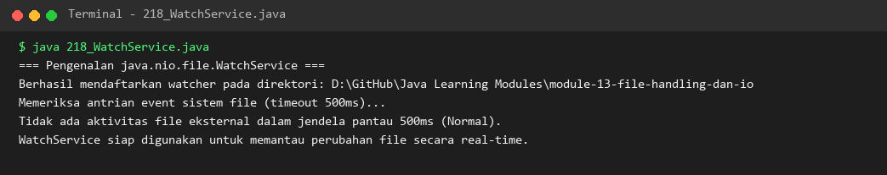

---

## Ringkasan Modul
Modul 13 telah memberikan penguasaan lengkap atas manajemen sistem berkas di Java. Mulai dari penanganan aliran teks dan biner klasik, persistensi aman dengan serialisasi objek dan kata kunci transient, kemudahan operasi satu baris pada Java NIO.2, format data CSV dan Properties, hingga kompresi ZIP dan pemantauan event direktori melalui WatchService. Selanjutnya, pembelajar akan mempelajari pustaka standar dan fitur modern bahasa Java pada Modul 14.
