# MODUL 15: Multithreading dan Concurrency

## Deskripsi Modul
Modul ini membahas konsep pemrosesan tugas simultan (*multitasking*) dan pemrograman paralel (*concurrency*) di Java. Pembahasan mencakup pembuatan thread dasar melalui pewarisan `Thread` dan implementasi `Runnable`, penggunaan antarmuka ber-return value `Callable` dan pemantauan `Future`, tahapan daur hidup thread (*Thread.State*), penundaan terukur dengan `Thread.sleep()`, proteksi data bersama dari kondisi balapan (*race conditions*) menggunakan `synchronized methods` dan `synchronized blocks`, visibilitas memori cache dengan kata kunci `volatile`, penguncian eksplisit dengan `ReentrantLock`, operasi atomik tanpa kunci (*lock-free CAS*) dengan `AtomicInteger`, pengelolaan thread pool menggunakan `ExecutorService`, penjadwalan periodik dengan `ScheduledExecutorService`, pipa pemrograman asinkronus reaktif dengan `CompletableFuture`, koleksi berutas aman `ConcurrentHashMap` dan `CopyOnWriteArrayList`, hingga wawasan arsitektur *Virtual Threads* (Project Loom).

## Tujuan Pembelajaran
Setelah menyelesaikan modul ini, pembelajar diharapkan mampu:
1. Membedakan proses pembuatan thread melalui class `Thread` dan antarmuka `Runnable`.
2. Menghasilkan nilai kembali dari thread menggunakan `Callable` dan `Future`.
3. Memahami transisi siklus hidup thread (NEW, RUNNABLE, TIMED_WAITING, TERMINATED).
4. Mencegah *race condition* dan *deadlock* menggunakan sinkronisasi, blok sinkron, dan `ReentrantLock`.
5. Memahami peran kata kunci `volatile` dalam menjamin visibilitas variabel antar cache CPU.
6. Menerapkan variabel atomik (`AtomicInteger`) untuk operasi komputasi bebas kunci berkinerja tinggi.
7. Mengelola alokasi thread pool industri dengan `ExecutorService` dan penjadwalan tugas dengan `ScheduledExecutorService`.
8. Merangkai alur asinkronus non-blocking dengan `CompletableFuture`.
9. Memahami revolusi skalabilitas konkurensi masa depan melalui *Virtual Threads*.

---

## Daftar Materi dan Submodul

| No | Berkas | Materi Pembelajaran |
|---|---|---|
| 237 | [237_ThreadBasic.java](237_ThreadBasic.java) | Thread dasar |
| 238 | [238_RunnableInterface.java](238_RunnableInterface.java) | Interface `Runnable` |
| 239 | [239_CallableInterface.java](239_CallableInterface.java) | Interface `Callable` |
| 240 | [240_FutureInterface.java](240_FutureInterface.java) | Interface `Future` |
| 241 | [241_ThreadLifecycle.java](241_ThreadLifecycle.java) | Siklus hidup thread |
| 242 | [242_ThreadSleep.java](242_ThreadSleep.java) | `Thread.sleep()` |
| 243 | [243_SynchronizedMethods.java](243_SynchronizedMethods.java) | Synchronized methods |
| 244 | [244_SynchronizedBlocks.java](244_SynchronizedBlocks.java) | Synchronized blocks |
| 245 | [245_VolatileKeyword.java](245_VolatileKeyword.java) | Keyword `volatile` |
| 246 | [246_ReentrantLock.java](246_ReentrantLock.java) | `ReentrantLock` |
| 247 | [247_AtomicVariables.java](247_AtomicVariables.java) | Atomic variables |
| 248 | [248_ExecutorService.java](248_ExecutorService.java) | `ExecutorService` |
| 249 | [249_ScheduledExecutorService.java](249_ScheduledExecutorService.java) | Penjadwalan tugas |
| 250 | [250_CompletableFuture.java](250_CompletableFuture.java) | `CompletableFuture` |
| 251 | [251_ConcurrentCollections.java](251_ConcurrentCollections.java) | Concurrent collections |
| 252 | [252_VirtualThreads.java](252_VirtualThreads.java) | Virtual threads |

---

## Penjelasan Setiap Submodul

### 237. 237_ThreadBasic.java
- **Tujuan:** Membuat dan menjalankan thread terpisah dengan mewarisi class `Thread`.
- **Konsep Utama:** Memanggil `.start()` untuk memicu JVM mengeksekusi logika di dalam method `run()` secara paralel.
- **Penjelasan Source Code:** Menjalankan dua worker thread yang memproses tiga tahapan kerja berurutan.
- **Cara Menjalankan:** `java 237_ThreadBasic.java`
- **Hasil yang Diharapkan:** Eksekusi selang-seling dari kedua pekerja tercetak di konsol.
- **Screenshot Hasil Eksekusi:** 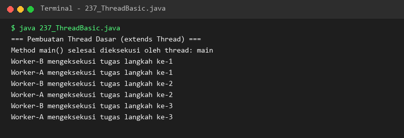

### 238. 238_RunnableInterface.java
- **Tujuan:** Memisahkan definisi tugas komputasi dari siklus hidup objek thread dengan `Runnable`.
- **Konsep Utama:** Menggunakan lambda expression untuk instansiasi Runnable dan menyelaraskannya dengan `.join()`.
- **Penjelasan Source Code:** Mensimulasikan dua downloader file yang berjalan bersamaan hingga tuntas.
- **Cara Menjalankan:** `java 238_RunnableInterface.java`
- **Hasil yang Diharapkan:** Log kemajuan unduhan dari masing-masing thread ditampilkan.
- **Screenshot Hasil Eksekusi:** 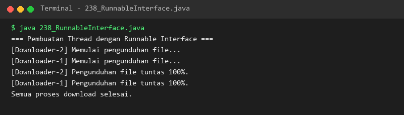

### 239. 239_CallableInterface.java
- **Tujuan:** Menghasilkan nilai balik dan menangani error checked exception dari thread pekerja.
- **Konsep Utama:** Antarmuka `Callable<V>` mengembalikan nilai tipe generik V melalui method `call()`.
- **Penjelasan Source Code:** Menghitung total transaksi dan mengembalikan angka integer ke thread utama.
- **Cara Menjalankan:** `java 239_CallableInterface.java`
- **Hasil yang Diharapkan:** Hasil penjumlahan transaksi dari thread latar belakang tercetak di layar.
- **Screenshot Hasil Eksekusi:** 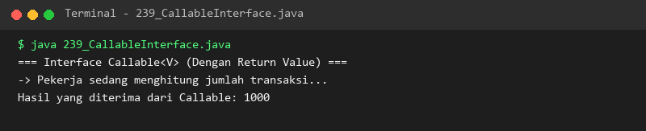

### 240. 240_FutureInterface.java
- **Tujuan:** Memantau kemajuan dan mengambil hasil komputasi asynchronous.
- **Konsep Utama:** Method `isDone()` untuk memeriksa kesiapan dan `get()` untuk memblokir hingga data tersedia.
- **Penjelasan Source Code:** Memeriksa status penyelesaian pembuatan laporan sebelum dan sesudah tuntas.
- **Cara Menjalankan:** `java 240_FutureInterface.java`
- **Hasil yang Diharapkan:** Perubahan status isDone dan isi laporan finansial ditampilkan.
- **Screenshot Hasil Eksekusi:** 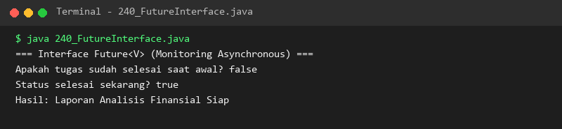

### 241. 241_ThreadLifecycle.java
- **Tujuan:** Melacak transisi status thread dari penciptaan hingga selesai.
- **Konsep Utama:** Meneliti tahapan status `NEW` -> `RUNNABLE` -> `TIMED_WAITING` -> `TERMINATED`.
- **Penjelasan Source Code:** Mengamati perubahan status thread uji pada setiap fase eksekusinya.
- **Cara Menjalankan:** `java 241_ThreadLifecycle.java`
- **Hasil yang Diharapkan:** Keempat tahapan status siklus hidup thread tercetak runtut.
- **Screenshot Hasil Eksekusi:** 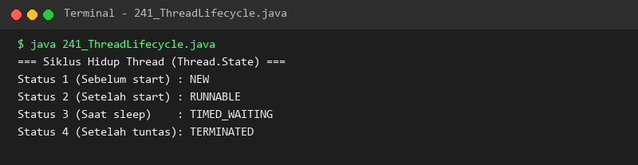

### 242. 242_ThreadSleep.java
- **Tujuan:** Menjeda laju eksekusi thread saat ini selama jangka waktu tertentu.
- **Konsep Utama:** Menangani `InterruptedException` dengan memulihkan status interupsi thread.
- **Penjelasan Source Code:** Menjalankan hitung mundur jeda waktu 300ms per detik.
- **Cara Menjalankan:** `java 242_ThreadSleep.java`
- **Hasil yang Diharapkan:** Hitung mundur berurutan dengan jeda waktu tampil di layar.
- **Screenshot Hasil Eksekusi:** 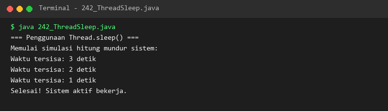

### 243. 243_SynchronizedMethods.java
- **Tujuan:** Mencegah ketidakkonsistenan data (race condition) akibat akses simultan banyak thread.
- **Konsep Utama:** Kunci intrinsik (*intrinsic monitor lock*) memastikan eksekusi eksklusif satu thread per waktu.
- **Penjelasan Source Code:** Dua thread menambah counter bersama masing-masing 1000 kali hingga tepat bernilai 2000.
- **Cara Menjalankan:** `java 243_SynchronizedMethods.java`
- **Hasil yang Diharapkan:** Total akhir counter bernilai akurat 2000 tanpa kehilangan data.
- **Screenshot Hasil Eksekusi:** 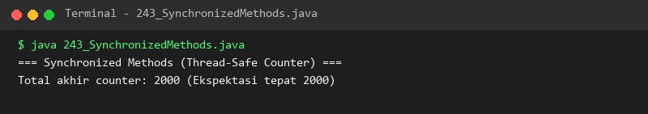

### 244. 244_SynchronizedBlocks.java
- **Tujuan:** Melakukan penguncian spesifik pada blok kode kritis tertentu untuk memaksimalkan performa paralel.
- **Konsep Utama:** Menggunakan objek mutex privat `lockKunci` di dalam blok `synchronized(lock)`.
- **Penjelasan Source Code:** Dua nasabah bank menyetor dana ke kotak uang bersama secara aman.
- **Cara Menjalankan:** `java 244_SynchronizedBlocks.java`
- **Hasil yang Diharapkan:** Rincian setoran dan saldo akhir bank tercetak tepat.
- **Screenshot Hasil Eksekusi:** 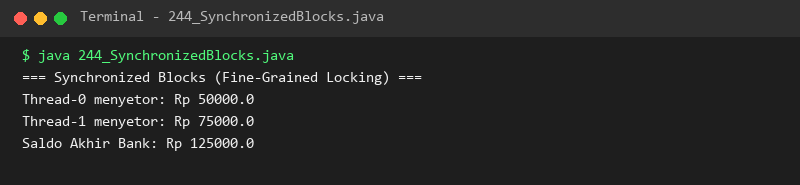

### 245. 245_VolatileKeyword.java
- **Tujuan:** Menjamin visibilitas perubahan variabel langsung ke memori utama (RAM).
- **Konsep Utama:** Mencegah thread membaca nilai lama (*stale data*) yang tersimpan di cache register CPU.
- **Penjelasan Source Code:** Thread pekerja segera mendeteksi perubahan flag `berhenti = true` dari thread utama.
- **Cara Menjalankan:** `java 245_VolatileKeyword.java`
- **Hasil yang Diharapkan:** Thread pekerja berhenti seketika saat flag volatile diubah.
- **Screenshot Hasil Eksekusi:** 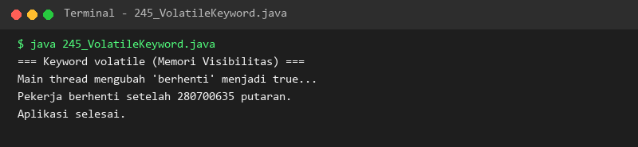

### 246. 246_ReentrantLock.java
- **Tujuan:** Menerapkan penguncian eksplisit tingkat lanjut menggunakan `ReentrantLock`.
- **Konsep Utama:** Memanggil `lock.lock()` dan wajib melepaskannya dengan `lock.unlock()` di dalam blok `finally`.
- **Penjelasan Source Code:** Mengamankan transaksi penarikan tunai dari dua pengguna secara bergantian.
- **Cara Menjalankan:** `java 246_ReentrantLock.java`
- **Hasil yang Diharapkan:** Alur masuk dan pelepasan kunci serta sisa saldo akhir ditampilkan.
- **Screenshot Hasil Eksekusi:** 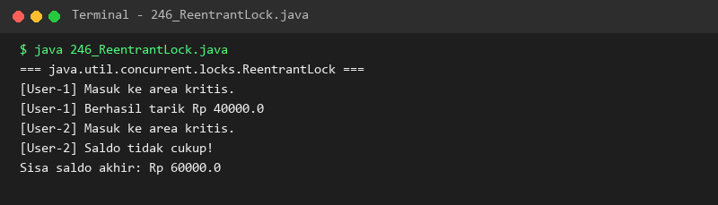

### 247. 247_AtomicVariables.java
- **Tujuan:** Melakukan mutasi angka aman tanpa menggunakan penguncian (lock-free programming).
- **Konsep Utama:** Operasi berbasis CPU hardware *Compare-And-Swap (CAS)* pada `AtomicInteger`.
- **Penjelasan Source Code:** Lima thread menambah counter secara serentak 500 kali tanpa kunci hingga mencapai 2500.
- **Cara Menjalankan:** `java 247_AtomicVariables.java`
- **Hasil yang Diharapkan:** Nilai counter atomik tepat bernilai 2500.
- **Screenshot Hasil Eksekusi:** 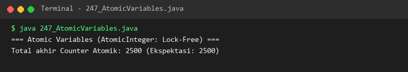

### 248. 248_ExecutorService.java
- **Tujuan:** Mengelola pool thread yang dapat digunakan kembali (*reusable thread pool*).
- **Konsep Utama:** Mencegah overhead pembuatan thread baru terus-menerus dengan `newFixedThreadPool(3)`.
- **Penjelasan Source Code:** Mengirimkan enam tugas komputasi untuk dieksekusi bergantian oleh 3 worker pool.
- **Cara Menjalankan:** `java 248_ExecutorService.java`
- **Hasil yang Diharapkan:** Enam tugas diproses bergantian oleh 3 pekerja pool yang terdaftar.
- **Screenshot Hasil Eksekusi:** 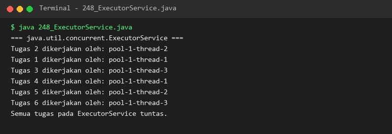

### 249. 249_ScheduledExecutorService.java
- **Tujuan:** Menjalankan tugas berkala atau tugas yang ditunda eksekusinya.
- **Konsep Utama:** Method `schedule()` dengan penundaan waktu delay dan satuan unit waktu.
- **Penjelasan Source Code:** Menjadwalkan pengiriman sinyal detak jantung (heartbeat) sistem setelah jeda 300ms.
- **Cara Menjalankan:** `java 249_ScheduledExecutorService.java`
- **Hasil yang Diharapkan:** Log penjadwalan dan eksekusi tugas tertunda tercetak rapi.
- **Screenshot Hasil Eksekusi:** 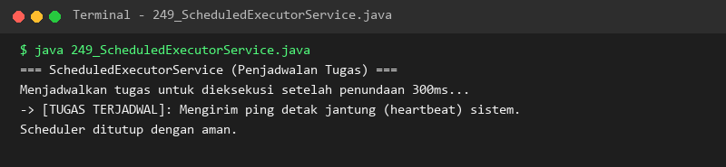

### 250. 250_CompletableFuture.java
- **Tujuan:** Merangkai alur kerja asinkronus reaktif non-blocking dengan `CompletableFuture`.
- **Konsep Utama:** Pipa pengolahan data berantai: `supplyAsync()` -> `thenApply()` -> `thenAccept()`.
- **Penjelasan Source Code:** Mengambil harga, memotong diskon 20%, dan mencetak total akhir secara asinkron.
- **Cara Menjalankan:** `java 250_CompletableFuture.java`
- **Hasil yang Diharapkan:** Ketiga tahapan pipeline asinkronus tercetak teratur.
- **Screenshot Hasil Eksekusi:** 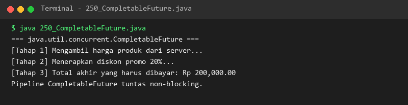

### 251. 251_ConcurrentCollections.java
- **Tujuan:** Menyimpan data bersama dengan koleksi yang aman diakses banyak thread secara serentak.
- **Konsep Utama:** `ConcurrentHashMap` menggunakan *lock striping* dan `CopyOnWriteArrayList` membuat salinan saat mutasi.
- **Penjelasan Source Code:** Dua thread menambah sesi pengguna dan mencatat log secara simultan.
- **Cara Menjalankan:** `java 251_ConcurrentCollections.java`
- **Hasil yang Diharapkan:** Jumlah sesi aktif dan daftar log hasil konkurensi ditampilkan.
- **Screenshot Hasil Eksekusi:** 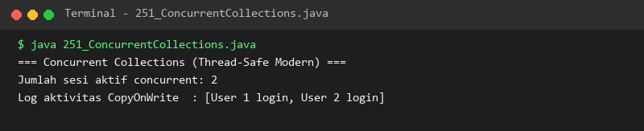

### 252. 252_VirtualThreads.java
- **Tujuan:** Memahami paradigma revolusioner Virtual Threads (Project Loom) untuk skalabilitas tinggi.
- **Konsep Utama:** Thread ringan yang dikelola JVM sehingga memungkinkan jutaan konkurensi dengan memori minimal.
- **Penjelasan Source Code:** Memaparkan perbedaan platform thread vs virtual thread dan mengeksekusi worker ringan.
- **Cara Menjalankan:** `java 252_VirtualThreads.java`
- **Hasil yang Diharapkan:** Edukasi perbandingan arsitektur thread dan eksekusi thread ringan ditampilkan di konsol.
- **Screenshot Hasil Eksekusi:** 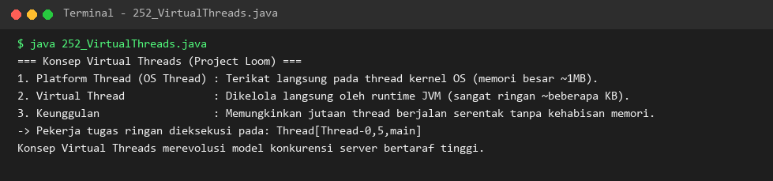

---

## Ringkasan Modul
Modul 15 telah mengupas tuntas seluruh pilar pemrograman konkuren dan multi-thread di Java. Pembelajar telah menguasai manajemen thread manual, sinkronisasi kunci, variabel atomik berkinerja tinggi, manajemen thread pool profesional dengan ExecutorService, rantai asinkronus CompletableFuture, hingga pemahaman arsitektur mutakhir Virtual Threads. Penguasaan konkurensi ini menjadi bekal berharga sebelum mempelajari interaksi basis data pada Modul 16: Database Programming dengan JDBC.
