# Modul 17: Testing, Build Tools, JVM, dan Keamanan

## Deskripsi Modul
Modul 17 memfokuskan pembelajaran pada kualitas perangkat lunak (*software quality*), otomatisasi *build*, arsitektur internal Java Virtual Machine (JVM), fitur-fitur bahasa modern Java (Java 14 - 17), serta pilar keamanan dan analisis statis. Pembelajar akan mempraktikkan unit testing dengan JUnit dan mocking dengan Mockito, memahami ekosistem Maven dan Gradle, mengelola struktur package dan arsip JAR, mendokumentasikan kode dengan JavaDoc, memanfaatkan logging dan teknik debugging, menginspeksi memori JVM dan Garbage Collector, menerapkan Switch Expressions, Pattern Matching, Text Blocks, Modularity JPMS, hingga mengimplementasikan kriptografi dasar SHA-256/AES serta analisis kode statis.

---

## Daftar Submodul & Panduan Praktikum

### 267. 267_JUnitBasic.java
- **Tujuan:** Memahami struktur dasar unit testing dengan anotasi `@Test` dan siklus hidup `@BeforeEach`.
- **Konsep Utama:** Isolasi state pengujian dan verifikasi logika bisnis dengan test runner reflektif.
- **Penjelasan Source Code:** Menguji operasi penambahan, perkalian, dan pembagian pada class Kalkulator.
- **Cara Menjalankan:** `java 267_JUnitBasic.java`
- **Hasil yang Diharapkan:** Laporan eksekusi test runner dengan status `[PASS]` pada seluruh method pengujian.
- **Screenshot Hasil Eksekusi:** 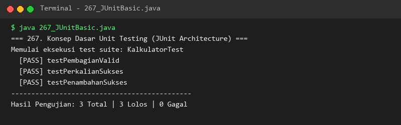

### 268. 268_JUnitAssertions.java
- **Tujuan:** Menerapkan berbagai metode asersi untuk memvalidasi keluaran program sesuai spesifikasi.
- **Konsep Utama:** `assertEquals`, `assertTrue`, `assertFalse`, `assertNull`, `assertNotNull`, dan `assertThrows`.
- **Penjelasan Source Code:** Memvalidasi operasi aritmetika, string, referensi null, dan pelemparan ArithmeticException.
- **Cara Menjalankan:** `java 268_JUnitAssertions.java`
- **Hasil yang Diharapkan:** Status `[ASSERT OK]` untuk keenam skenario pengujian tanpa ada AssertionError.
- **Screenshot Hasil Eksekusi:** 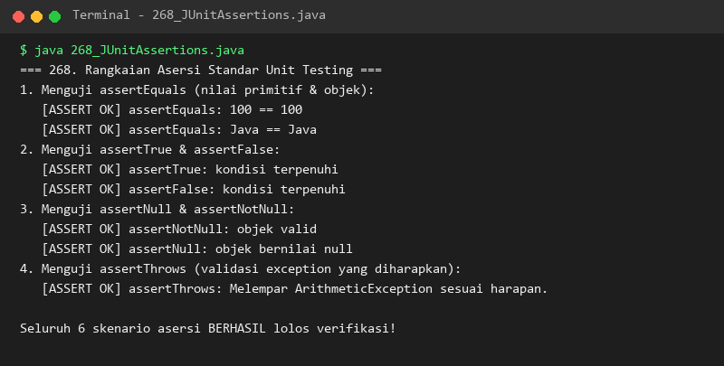

### 269. 269_ParameterizedTests.java
- **Tujuan:** Menjalankan pengujian berulang dengan berbagai variasi dataset input secara terparameterisasi.
- **Konsep Utama:** Pengujian berbasis `@ValueSource` dan `@CsvSource` untuk efisiensi penulisan kode test.
- **Penjelasan Source Code:** Menguji algoritma pendeteksi kata palindrom dan pemeriksa bilangan prima terhadap serangkaian data uji.
- **Cara Menjalankan:** `java 269_ParameterizedTests.java`
- **Hasil yang Diharapkan:** Hasil evaluasi setiap baris dataset input tercetak berurutan dengan status `[PASS]`.
- **Screenshot Hasil Eksekusi:** 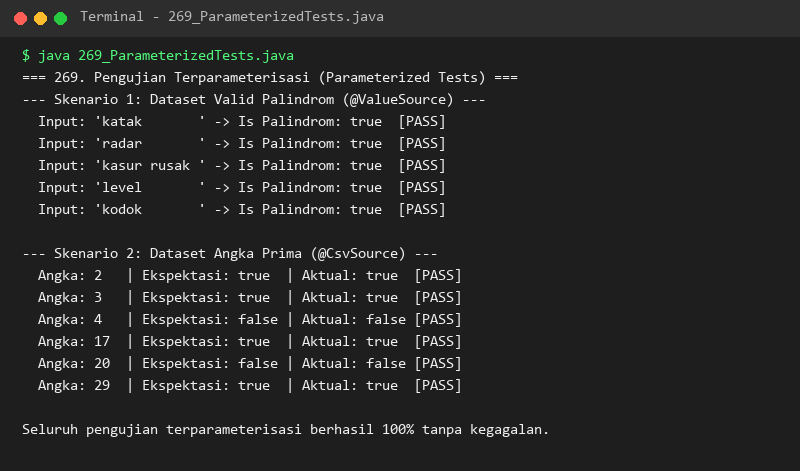

### 270. 270_MockitoBasic.java
- **Tujuan:** Mengisolasi dependensi eksternal menggunakan teknik Mocking dan stubbing metode.
- **Konsep Utama:** Pembuatan objek mock, stubbing perilaku `when(...).thenReturn(...)`, dan verifikasi pemanggilan `verify`.
- **Penjelasan Source Code:** Menguji layanan pembayaran tanpa harus memanggil API payment gateway bank sungguhan.
- **Cara Menjalankan:** `java 270_MockitoBasic.java`
- **Hasil yang Diharapkan:** Laporan status pembayaran sukses dan konfirmasi jumlah panggilan mock tepat 1 kali.
- **Screenshot Hasil Eksekusi:** 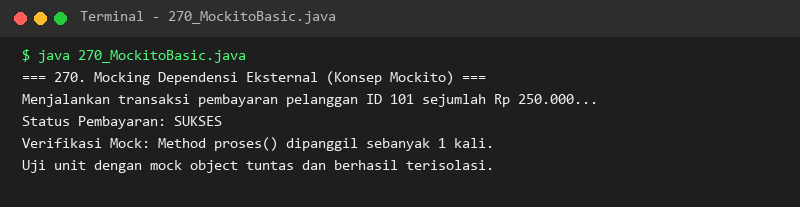

### 271. 271_IntegrationTesting.java
- **Tujuan:** Menguji kolaborasi end-to-end beberapa komponen perangkat lunak yang saling terhubung.
- **Konsep Utama:** Integrasi lapisan Controller -> Service -> Repository secara utuh.
- **Penjelasan Source Code:** Melakukan pendaftaran produk katalog dan memastikan data tersimpan serta terbaca sempurna melalui Controller.
- **Cara Menjalankan:** `java 271_IntegrationTesting.java`
- **Hasil yang Diharapkan:** Respon pendaftaran produk, daftar barang, dan validasi integritas antar layer bernilai lolos.
- **Screenshot Hasil Eksekusi:** 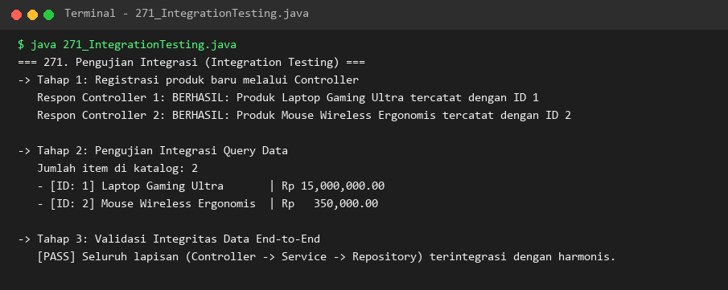

### 272. 272_MavenProject.java
- **Tujuan:** Memahami arsitektur Project Object Model (POM) Apache Maven dan build lifecycle standarnya.
- **Konsep Utama:** Koordinat GAV (`groupId`, `artifactId`, `version`), manajemen scope dependensi, dan fase `compile` hingga `deploy`.
- **Penjelasan Source Code:** Mensimulasikan model `pom.xml` dan tahapan lifecycle Maven dalam merakit proyek perangkat lunak.
- **Cara Menjalankan:** `java 272_MavenProject.java`
- **Hasil yang Diharapkan:** Informasi koordinat GAV, daftar dependensi, dan alur tahapan lifecycle Maven tercetak di konsol.
- **Screenshot Hasil Eksekusi:** 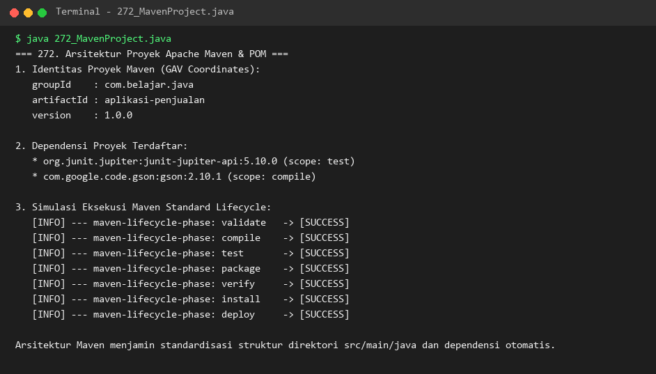

### 273. 273_GradleProject.java
- **Tujuan:** Memahami otomatisasi build modern dengan Gradle, konsep task graph, dan caching performa tinggi.
- **Konsep Utama:** Pendaftaran task bertahap (`compileJava`, `test`, `jar`), status UP-TO-DATE, dan Gradle Daemon.
- **Penjelasan Source Code:** Mensimulasikan eksekusi task `gradle build` dengan optimasi incremental build.
- **Cara Menjalankan:** `java 273_GradleProject.java`
- **Hasil yang Diharapkan:** Rincian status task build Gradle dan pesan BUILD SUCCESSFUL.
- **Screenshot Hasil Eksekusi:** 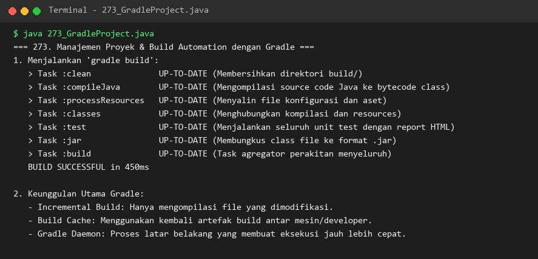

### 274. 274_ProjectPackageStructure.java
- **Tujuan:** Menerapkan konvensi penataan struktur package profesional pada arsitektur proyek Java.
- **Konsep Utama:** Reverse domain naming (`com.perusahaan.modul`) dan pemisahan lapisan (controller, service, repository, entity, dto).
- **Penjelasan Source Code:** Menampilkan hierarki package yang terstruktur rapi beserta tujuan fungsional masing-masing folder.
- **Cara Menjalankan:** `java 274_ProjectPackageStructure.java`
- **Hasil yang Diharapkan:** Pohon direktori package dan penjelasan manfaat modularitas proyek.
- **Screenshot Hasil Eksekusi:** 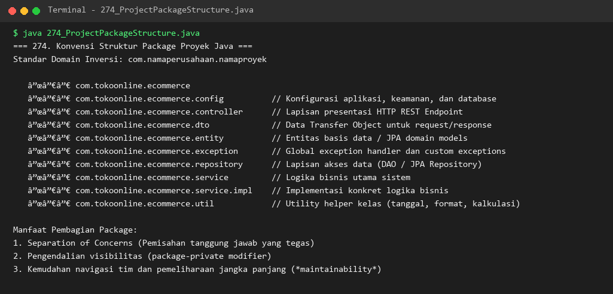

### 275. 275_JarPackaging.java
- **Tujuan:** Memahami pengemasan arsip Java Archive (JAR) dan konfigurasi file manifes `MANIFEST.MF`.
- **Konsep Utama:** Atribut `Main-Class`, `Class-Path`, dan perintah baris CLI `jar --create` serta `java -jar`.
- **Penjelasan Source Code:** Menampilkan isi spesifikasi berkas manifes executable JAR dan panduan kompilasi arsip.
- **Cara Menjalankan:** `java 275_JarPackaging.java`
- **Hasil yang Diharapkan:** Struktur atribut MANIFEST.MF dan panduan pembuatan file JAR yang dapat dieksekusi.
- **Screenshot Hasil Eksekusi:** 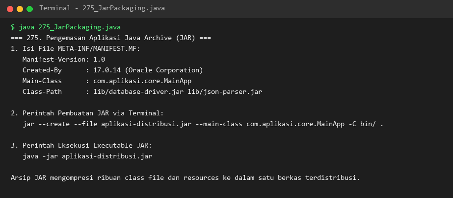

### 276. 276_JavaDoc.java
- **Tujuan:** Menulis dokumentasi teknis kode sumber menggunakan sintaks JavaDoc standar industri.
- **Konsep Utama:** Tag dokumentasi `@param`, `@return`, `@throws`, `@author`, dan `@version`.
- **Penjelasan Source Code:** Mendokumentasikan method kalkulasi finansial bunga majemuk dan perintah pembuatan situs web dokumentasi HTML.
- **Cara Menjalankan:** `java 276_JavaDoc.java`
- **Hasil yang Diharapkan:** Output kalkulasi finansial dan petunjuk perintah generator javadoc.
- **Screenshot Hasil Eksekusi:** 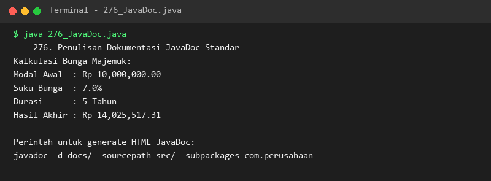

### 277. 277_JavaLogging.java
- **Tujuan:** Mengelola pencatatan aktivitas sistem profesional dengan `java.util.logging.Logger`.
- **Konsep Utama:** Hirarki level log (`INFO`, `CONFIG`, `WARNING`, `SEVERE`, `FINEST`) dan custom `LogRecord` formatter.
- **Penjelasan Source Code:** Mengonfigurasi logger sistem inventaris dengan format ringkas dan mencetak berbagai tingkatan pesan.
- **Cara Menjalankan:** `java 277_JavaLogging.java`
- **Hasil yang Diharapkan:** Baris-baris log terformat rapi sesuai tingkat keparahan masing-masing.
- **Screenshot Hasil Eksekusi:** 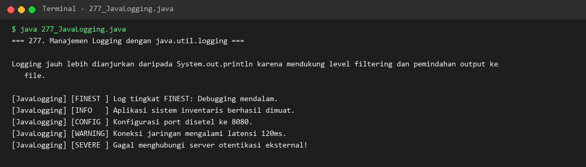

### 278. 278_DebuggingJava.java
- **Tujuan:** Mempelajari teknik investigasi kesalahan logika runtime melalui inspeksi Stack Trace mendalam.
- **Konsep Utama:** Stack trace elemen, identifikasi nama kelas, metode pemanggil, nama file, dan nomor baris error.
- **Penjelasan Source Code:** Memicu ArithmeticException dari panggilan fungsi bertingkat dan menangkap rincian stack trace-nya.
- **Cara Menjalankan:** `java 278_DebuggingJava.java`
- **Hasil yang Diharapkan:** Rantai pemanggilan metode dan jejak baris kode yang memicu terjadinya exception.
- **Screenshot Hasil Eksekusi:** 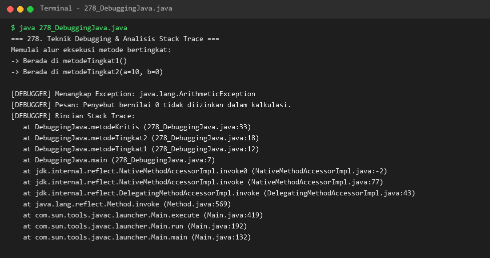

### 279. 279_JVMMemoryManagement.java
- **Tujuan:** Menginspeksi arsitektur memori internal JVM (Heap, Stack, Metaspace) pada saat aplikasi berjalan.
- **Konsep Utama:** Pengambilan metrik memori `Runtime.getRuntime()`: `maxMemory`, `totalMemory`, `freeMemory`, dan `usedMemory`.
- **Penjelasan Source Code:** Menghitung penggunaan memori heap dalam satuan Megabyte dan menjelaskan pembagian area memori.
- **Cara Menjalankan:** `java 279_JVMMemoryManagement.java`
- **Hasil yang Diharapkan:** Statistik kapasitas memori heap aktif dan penjelasan peran Heap, Stack, serta Metaspace.
- **Screenshot Hasil Eksekusi:** 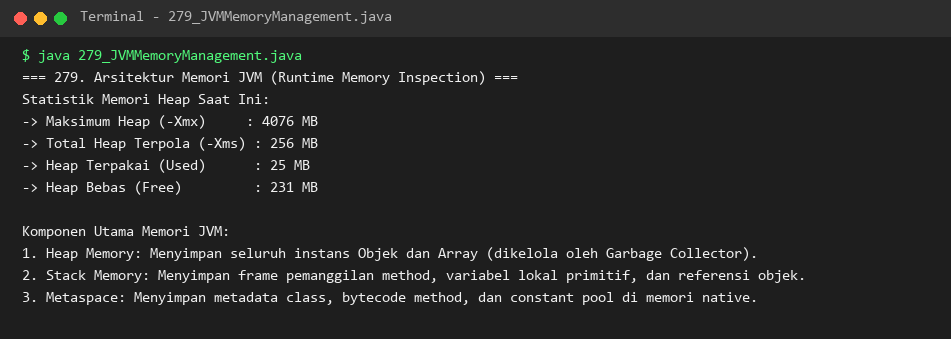

### 280. 280_GarbageCollection.java
- **Tujuan:** Memahami siklus hidup alokasi memori objek, status unreachable, dan proses kerja Garbage Collector.
- **Konsep Utama:** Reklamasi memori otomatis, `System.gc()`, dan perbandingan algoritma GC (Serial, Parallel, G1, ZGC).
- **Penjelasan Source Code:** Mengalokasikan puluhan ribu objek sementara, memicu proses GC, dan membandingkan memori sebelum dan sesudahnya.
- **Cara Menjalankan:** `java 280_GarbageCollection.java`
- **Hasil yang Diharapkan:** Nilai memori awal, lonjakan setelah alokasi, pembebasan memori setelah GC, dan profil jenis-jenis GC.
- **Screenshot Hasil Eksekusi:** 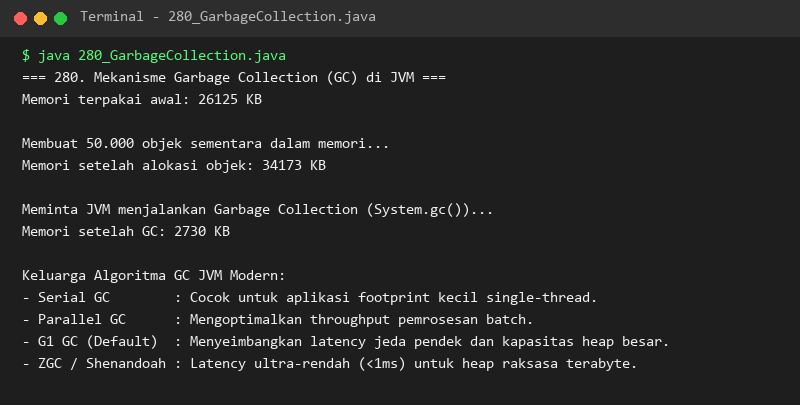

### 281. 281_JVMArguments.java
- **Tujuan:** Memahami konfigurasi parameter memori JVM (`-Xms`, `-Xmx`) dan parameter properti kustom (`-D`).
- **Konsep Utama:** Pembacaan argumen lingkungan via `System.getProperty()` dan rekomendasi flag runtime production.
- **Penjelasan Source Code:** Mengambil properti lingkungan aplikasi dan menampilkan informasi versi Java serta OS host.
- **Cara Menjalankan:** `java 281_JVMArguments.java`
- **Hasil yang Diharapkan:** Nilai properti sistem kustom dan spesifikasi lingkungan JVM terpasang.
- **Screenshot Hasil Eksekusi:** 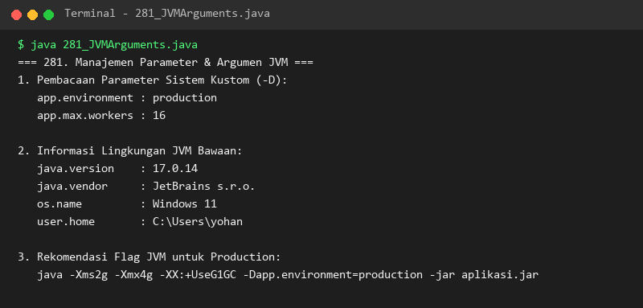

### 282. 282_SwitchExpressions.java
- **Tujuan:** Menggunakan fitur modern Switch Expression (Java 14+) dengan sintaks panah (`->`) dan keyword `yield`.
- **Konsep Utama:** Pengembalian nilai ekspresi langsung, multi-value case, dan eliminasi error `break` yang terlewat (*fall-through*).
- **Penjelasan Source Code:** Mengklasifikasikan kategori hari kerja/libur dan menghitung respon kepuasan pelanggan secara ringkas.
- **Cara Menjalankan:** `java 282_SwitchExpressions.java`
- **Hasil yang Diharapkan:** Hasil evaluasi tipe hari dan respon penilaian layanan tercetak sesuai input.
- **Screenshot Hasil Eksekusi:** 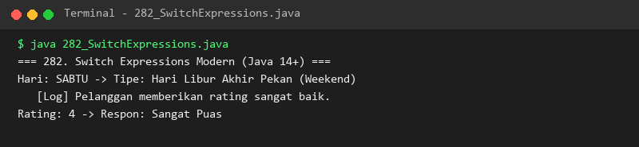

### 283. 283_PatternMatchingInstanceof.java
- **Tujuan:** Menyederhanakan pemeriksaan tipe objek dengan fitur Pattern Matching untuk `instanceof` (Java 16+).
- **Konsep Utama:** Deklarasi variabel pattern inline yang menghilangkan kebutuhan casting eksplisit `(Tipe) obj`.
- **Penjelasan Source Code:** Memproses koleksi heterogen (String, Integer, Double, Objek Kustom) secara elegan dan aman dari ClassCastException.
- **Cara Menjalankan:** `java 283_PatternMatchingInstanceof.java`
- **Hasil yang Diharapkan:** Rincian pemrosesan masing-masing objek sesuai tipe datanya yang terdeteksi otomatis.
- **Screenshot Hasil Eksekusi:** 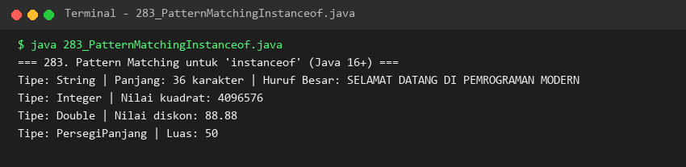

### 284. 284_PatternMatchingSwitch.java
- **Tujuan:** Memahami paradigma Pattern Matching berbasis tipe data untuk penyederhanaan logika polimorfik.
- **Konsep Utama:** Penanganan bentuk turunan geometris (Lingkaran, Segitiga, Persegi) dengan ekstraksi record terpadu.
- **Penjelasan Source Code:** Menghitung dan mendeskripsikan dimensi serta luas berbagai bentuk geometri secara dinamis.
- **Cara Menjalankan:** `java 284_PatternMatchingSwitch.java`
- **Hasil yang Diharapkan:** Deskripsi dimensi dan hasil kalkulasi luas dari ketiga varian bentuk geometri.
- **Screenshot Hasil Eksekusi:** 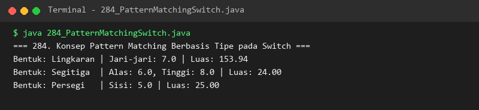

### 285. 285_TextBlocks.java
- **Tujuan:** Menulis string multibaris yang kompleks dan terformat menggunakan Text Blocks (Java 15+).
- **Konsep Utama:** Sintaks pembuka dan penutup tiga tanda kutip (`"""`), pemeliharaan indentasi, dan peniadaan karakter escape quote.
- **Penjelasan Source Code:** Mendefinisikan dokumen payload JSON dan kueri SQL multibaris yang bersih dan mudah dibaca.
- **Cara Menjalankan:** `java 285_TextBlocks.java`
- **Hasil yang Diharapkan:** Tampilan dokumen JSON dan SQL yang tercetak persis sesuai format aslinya.
- **Screenshot Hasil Eksekusi:** 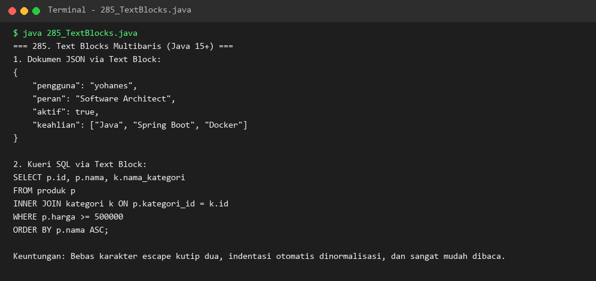

### 286. 286_ModuleSystem.java
- **Tujuan:** Memahami arsitektur Java Platform Module System (JPMS) dan konfigurasi file `module-info.java`.
- **Konsep Utama:** Keyword `module`, `requires`, `exports`, dan `opens` untuk enkapsulasi tingkat tinggi.
- **Penjelasan Source Code:** Menjelaskan blueprint modularitas arsitektur enterprise dan menginspeksi modul runtime yang aktif.
- **Cara Menjalankan:** `java 286_ModuleSystem.java`
- **Hasil yang Diharapkan:** Cetakan deklarasi module-info serta status modul runtime di konsol.
- **Screenshot Hasil Eksekusi:** 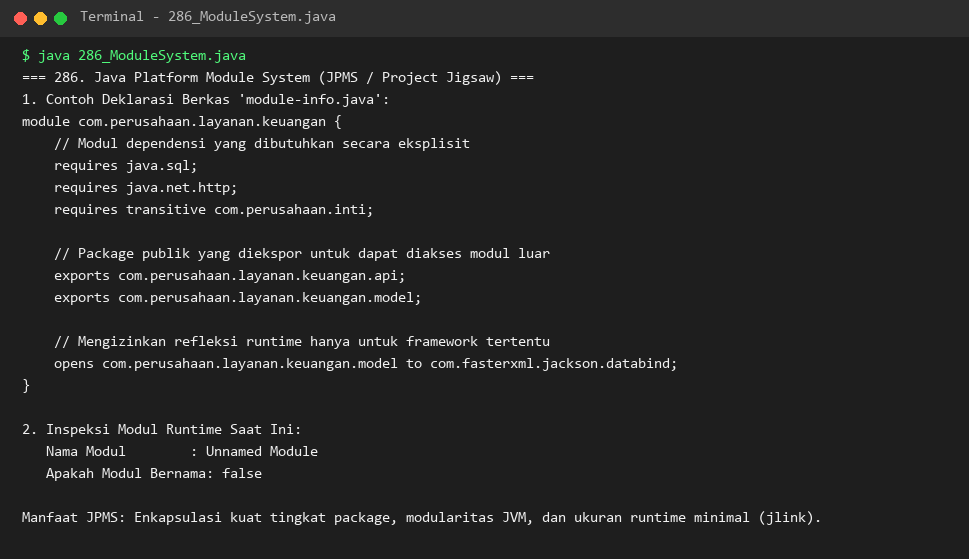

### 287. 287_CryptographyBasics.java
- **Tujuan:** Menerapkan dasar-dasar kriptografi Java untuk integritas dan kerahasiaan data.
- **Konsep Utama:** One-way hashing dengan SHA-256 (`MessageDigest`) dan enkripsi-dekripsi simetris AES-128 (`Cipher`).
- **Penjelasan Source Code:** Menghasilkan nilai hash 64-karakter heksadesimal serta mengenkripsi teks rahasia ke Base64 lalu mendekripsikannya kembali.
- **Cara Menjalankan:** `java 287_CryptographyBasics.java`
- **Hasil yang Diharapkan:** Nilai teks asli, hash SHA-256, ciphertext Base64, teks hasil dekripsi, dan konfirmasi validasi sukses.
- **Screenshot Hasil Eksekusi:** 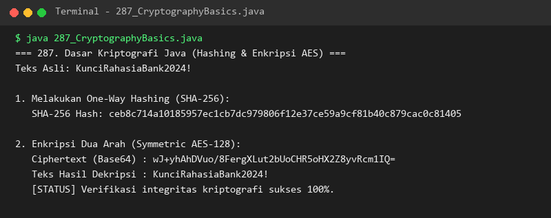

### 288. 288_StaticCodeAnalysis.java
- **Tujuan:** Mengenal konsep analisis kode statis untuk deteksi dini kerentanan keamanan dan *code smell*.
- **Konsep Utama:** Aturan linter (pembagian dengan nol, hardcoded credential, empty catch block) dan ekosistem SonarQube/SpotBugs.
- **Penjelasan Source Code:** Memeriksa beberapa baris kode dan mengklasifikasikan tingkat keparahan cacat kode (Blocker, Critical, Major).
- **Cara Menjalankan:** `java 288_StaticCodeAnalysis.java`
- **Hasil yang Diharapkan:** Laporan temuan cacat kode beserta nama rule dan rekomendasi perbaikannya.
- **Screenshot Hasil Eksekusi:** 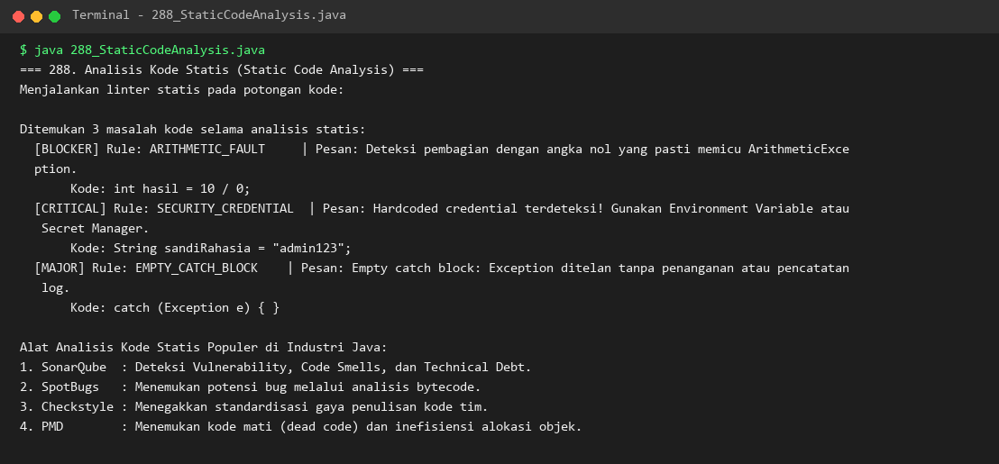

---

## Ringkasan Modul
Modul 17 memperkaya keahlian praktis dalam penjaminan kualitas kode melalui Unit Testing (JUnit, Mockito), otomatisasi manajemen proyek dengan Maven & Gradle, standarisasi arsitektur package, JavaDoc, serta logging dan debugging. Modul ini juga mendalami kinerja JVM (memori, Garbage Collection, JVM flags), fitur modern bahasa Java (Switch Expressions, Pattern Matching, Text Blocks, Modularity), serta fondasi keamanan melalui kriptografi dan Static Code Analysis. Penguasaan menyeluruh ini mempersiapkan pembelajar memasuki modul pamungkas, Modul 18: Framework dan Proyek Praktik Java.
