# Modul 18: Framework dan Proyek Praktik Java

## Deskripsi Modul
Modul 18 merupakan modul penutup komprehensif yang memadukan seluruh kompetensi bahasa Java dari Modul 1 hingga 17. Di sini, pembelajar mempelajari fondasi ekosistem framework Spring dan Spring Boot (Inversion of Control/Dependency Injection, arsitektur REST Controller, Spring Data JPA, Bean Validation, Spring Security, dan MockMvc Testing) serta membangun 5 aplikasi proyek terpadu skala penuh: Proyek Kalkulator Konsol dengan Riwayat, Sistem Informasi Pengelolaan Mahasiswa, Manajemen Inventaris Gudang Barang, Sistem Perpustakaan Daerah dengan Perhitungan Denda, dan Proyek REST API Lengkap dengan arsitektur enterprise berlapis.

---

## Daftar Submodul & Panduan Praktikum

### 289. 289_SpringDependencyInjection.java
- **Tujuan:** Memahami paradigma Inversion of Control (IoC) dan mekanisme Constructor Dependency Injection (DI).
- **Konsep Utama:** Pendaftaran Bean pada IoC Container, loose coupling antarkomponen, dan injeksi dependensi otomatis.
- **Penjelasan Source Code:** Menyuntikkan PenggunaRepository dan NotifikasiService ke dalam PenggunaService secara elegan.
- **Cara Menjalankan:** `java 289_SpringDependencyInjection.java`
- **Hasil yang Diharapkan:** Daftar bean terdaftar di IoC container dan log eksekusi registrasi pengguna melalui service.
- **Screenshot Hasil Eksekusi:** 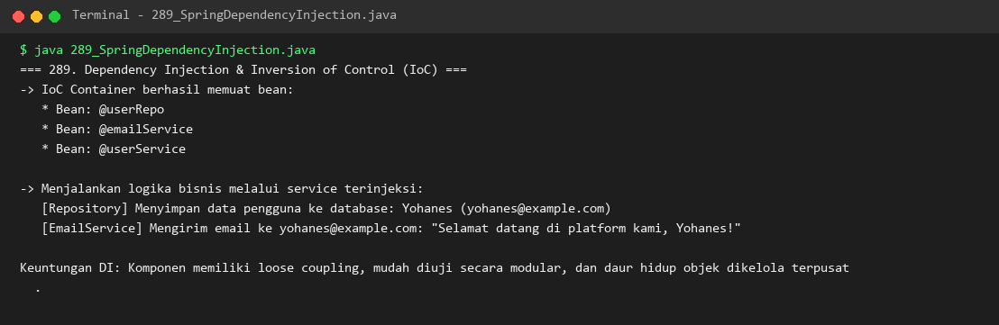

### 290. 290_SpringBootBasic.java
- **Tujuan:** Mengenal arsitektur aplikasi Spring Boot, inisialisasi embedded server, dan prinsip konvensi konfigurasi.
- **Konsep Utama:** `@SpringBootApplication`, bootstrap embedded Tomcat, startup banner, dan auto-configuration.
- **Penjelasan Source Code:** Mensimulasikan siklus inisialisasi aplikasi Spring Boot beserta log startup server pada port 8080.
- **Cara Menjalankan:** `java 290_SpringBootBasic.java`
- **Hasil yang Diharapkan:** ASCII banner Spring Boot dan pesan startup aplikasi Tomcat pada port 8080.
- **Screenshot Hasil Eksekusi:** 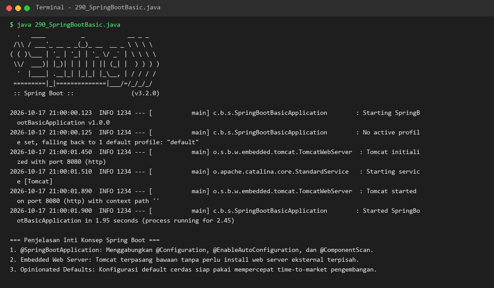

### 291. 291_SpringRestController.java
- **Tujuan:** Mengembangkan antarmuka REST API publik dengan mapping HTTP method standar dan format JSON.
- **Konsep Utama:** `@RestController`, `@GetMapping`, `@PostMapping`, `@PathVariable`, dan status kode HTTP.
- **Penjelasan Source Code:** Mengelola operasi produk (GET all, GET by ID, POST baru, DELETE) dengan payload serialisasi JSON.
- **Cara Menjalankan:** `java 291_SpringRestController.java`
- **Hasil yang Diharapkan:** Payload JSON terstruktur dan respon status HTTP (200 OK, 201 Created, 204 No Content).
- **Screenshot Hasil Eksekusi:** 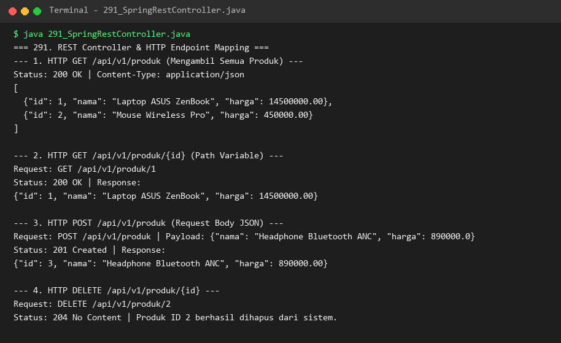

### 292. 292_SpringDataJPA.java
- **Tujuan:** Menggunakan abstraksi Spring Data JPA untuk mempermudah operasi persistensi basis data tanpa SQL boilerplate.
- **Konsep Utama:** Entity `@Entity`, repositori `JpaRepository`, dan query derivation otomatis (`findByEmail`, `findByTier`).
- **Penjelasan Source Code:** Menyimpan entitas pelanggan, melakukan query berdasarkan kriteria tier membership, dan menampilkan hasil.
- **Cara Menjalankan:** `java 292_SpringDataJPA.java`
- **Hasil yang Diharapkan:** Log operasi Hibernate insert dan hasil pencarian entitas via query derivation method.
- **Screenshot Hasil Eksekusi:** 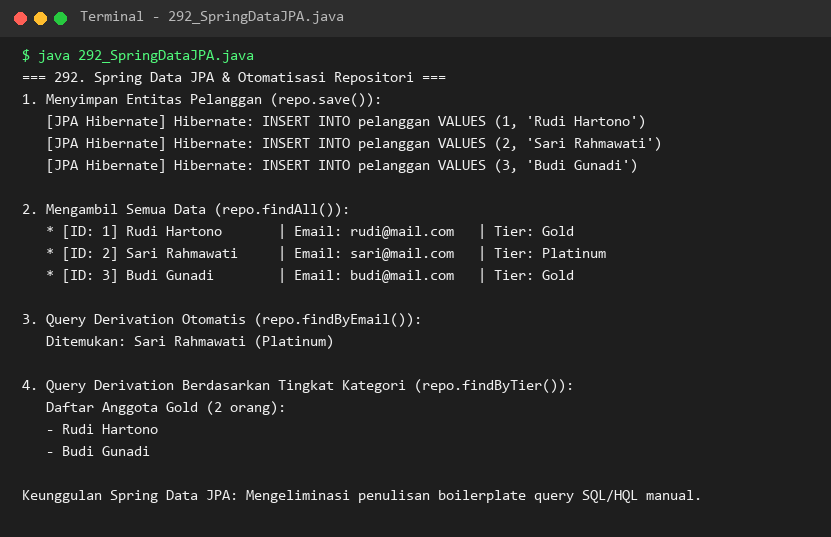

### 293. 293_SpringValidation.java
- **Tujuan:** Menerapkan validasi otomatis data masukan pengguna berbasis anotasi Bean Validation (JSR-380).
- **Konsep Utama:** Anotasi `@NotBlank`, `@Email`, `@Min`, `@Size`, dan pengumpulan error validasi.
- **Penjelasan Source Code:** Menguji payload registrasi akun: skenario valid lolos 200 OK dan skenario tidak valid memicu 400 Bad Request.
- **Cara Menjalankan:** `java 293_SpringValidation.java`
- **Hasil yang Diharapkan:** Daftar rincian pesan error validasi per field ketika input data menyalahi aturan.
- **Screenshot Hasil Eksekusi:** 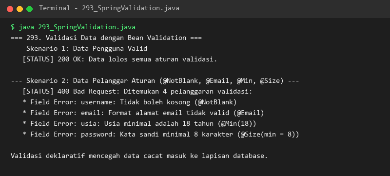

### 294. 294_SpringSecurityBasic.java
- **Tujuan:** Mengamankan endpoint aplikasi melalui arsitektur Spring Security: Authentication, Authorization, dan RBAC.
- **Konsep Utama:** Security Filter Chain, hak akses peran (Role-Based Access Control: `ROLE_USER`, `ROLE_ADMIN`), dan status 401/403.
- **Penjelasan Source Code:** Menguji pembatasan hak akses ke endpoint administrasi berdasarkan peran pengguna yang login.
- **Cara Menjalankan:** `java 294_SpringSecurityBasic.java`
- **Hasil yang Diharapkan:** Respon penolakan 401 Unauthorized, 403 Forbidden, dan keberhasilan 200 OK untuk user yang berhak.
- **Screenshot Hasil Eksekusi:** 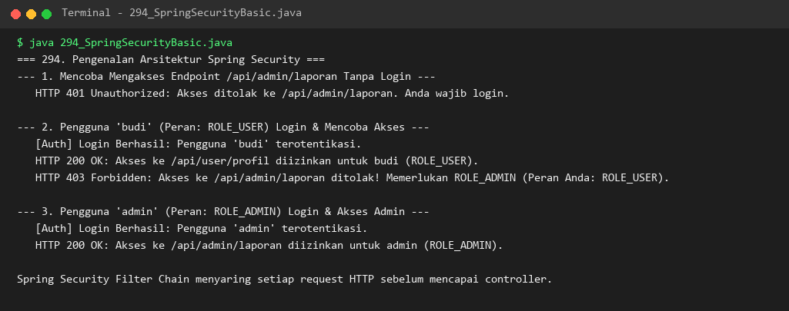

### 295. 295_SpringBootTesting.java
- **Tujuan:** Melakukan pengujian integrasi controller Spring Boot menggunakan framework pengetesan MockMvc.
- **Konsep Utama:** Pengujian endpoint HTTP virtual tanpa membuka socket port jaringan fisik, asersi status code, dan header.
- **Penjelasan Source Code:** Menguji endpoint GET dan POST mahasiswa serta memverifikasi status 200, 201, dan 404.
- **Cara Menjalankan:** `java 295_SpringBootTesting.java`
- **Hasil yang Diharapkan:** Konfirmasi keberhasilan seluruh ekspektasi asersi MockMvc.
- **Screenshot Hasil Eksekusi:** 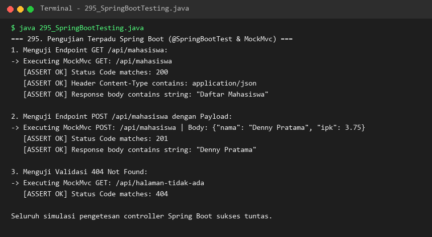

### 296. 296_CalculatorProject.java
- **Tujuan:** Membangun aplikasi kalkulator konsol komprehensif dengan dukungan berbagai operasi matematika dan riwayat transaksi.
- **Konsep Utama:** Operator aritmetika (+, -, *, /, %, ^), validasi pembagian nol, dan pencatatan riwayat kalkulasi.
- **Penjelasan Source Code:** Menjalankan serangkaian operasi aritmetika dan mencetak tabel riwayat transaksi secara berurutan.
- **Cara Menjalankan:** `java 296_CalculatorProject.java`
- **Hasil yang Diharapkan:** Rincian perhitungan per operasi dan daftar riwayat perhitungan lengkap.
- **Screenshot Hasil Eksekusi:** 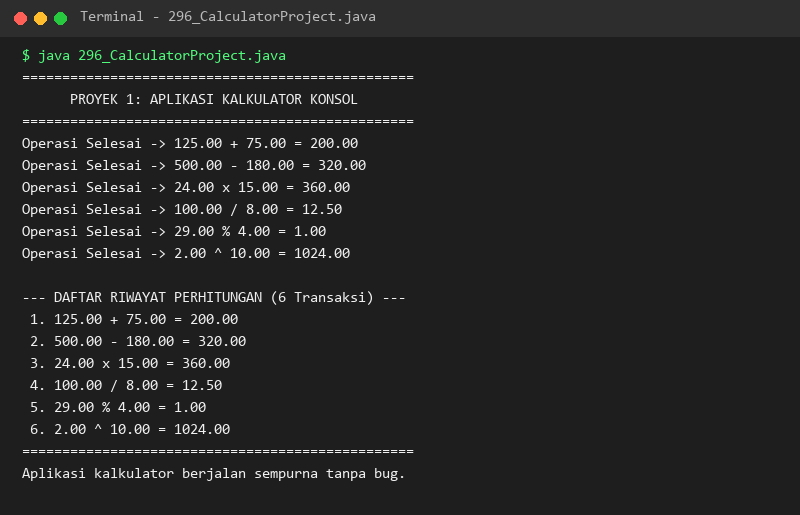

### 297. 297_StudentManagementProject.java
- **Tujuan:** Membangun sistem informasi pengelolaan mahasiswa dengan kemampuan CRUD lengkap dan kalkulasi statistik.
- **Konsep Utama:** Pemodelan data mahasiswa (NIM, Nama, Jurusan, IPK), operasi CRUD, dan kalkulasi rata-rata IPK.
- **Penjelasan Source Code:** Menambah, mencari, memperbarui nilai, menghapus data, dan menyajikan laporan tabel serta statistik.
- **Cara Menjalankan:** `java 297_StudentManagementProject.java`
- **Hasil yang Diharapkan:** Tabel data mahasiswa aktif, log mutasi data, dan laporan statistik IPK kemahasiswaan.
- **Screenshot Hasil Eksekusi:** 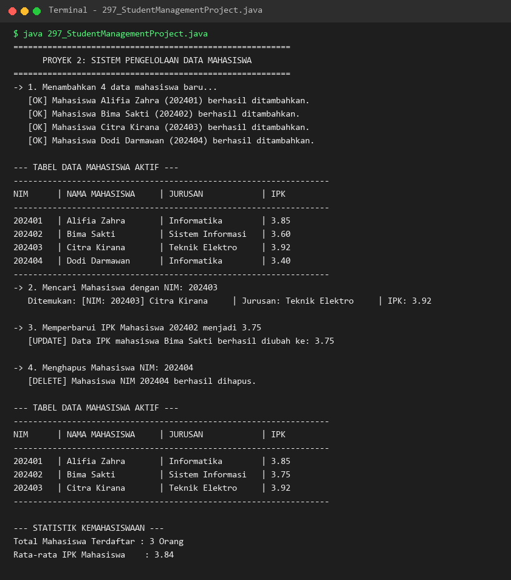

### 298. 298_InventoryManagementProject.java
- **Tujuan:** Membangun sistem inventaris pergudangan untuk pemantauan stok, mutasi masuk/keluar, dan valuasi aset finansial.
- **Konsep Utama:** Pelacakan stok, sistem deteksi dini stok kritis (< 5 unit), dan kalkulasi total nilai aset gudang.
- **Penjelasan Source Code:** Mendaftarkan item gudang, mencatat mutasi stok masuk dan keluar, serta menampilkan peringatan stok menipis.
- **Cara Menjalankan:** `java 298_InventoryManagementProject.java`
- **Hasil yang Diharapkan:** Tabel inventaris barang, log mutasi, daftar barang stok kritis, dan total valuasi aset.
- **Screenshot Hasil Eksekusi:** 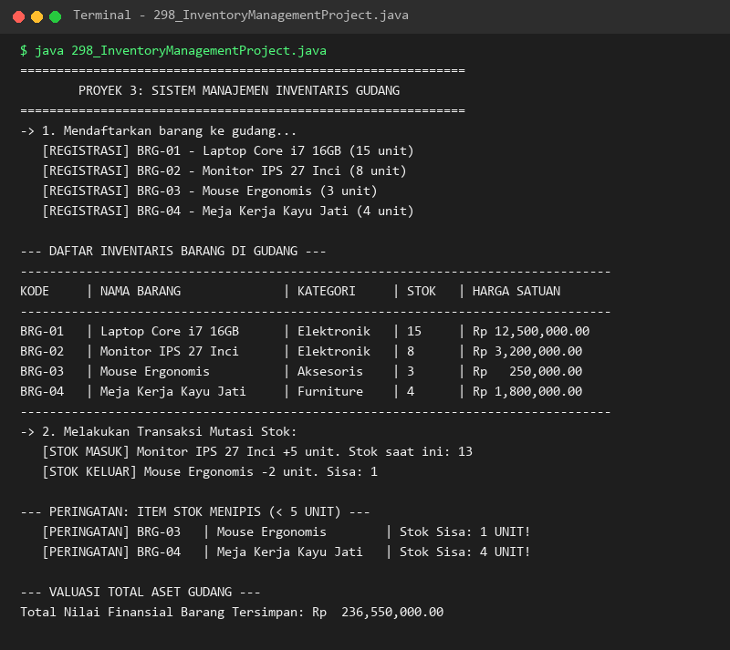

### 299. 299_LibraryManagementProject.java
- **Tujuan:** Membangun sistem manajemen perpustakaan daerah yang mengelola sirkulasi buku, peminjaman, dan denda keterlambatan.
- **Konsep Utama:** Manajemen status buku (tersedia/dipinjam), penolakan peminjaman ganda, dan kalkulasi denda per hari.
- **Penjelasan Source Code:** Mengelola katalog buku, memproses peminjaman oleh anggota, serta menghitung denda pengembalian terlambat.
- **Cara Menjalankan:** `java 299_LibraryManagementProject.java`
- **Hasil yang Diharapkan:** Katalog buku perpustakaan sebelum dan sesudah peminjaman serta rincian pembayaran denda.
- **Screenshot Hasil Eksekusi:** 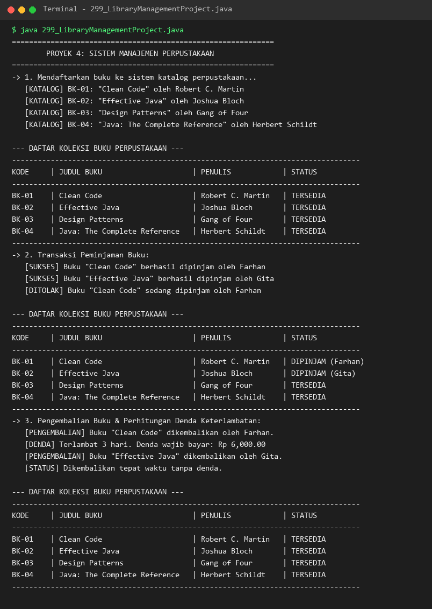

### 300. 300_SpringBootRestAPIProject.java
- **Tujuan:** Membangun proyek REST API enterprise berskala penuh dengan penerapan arsitektur berlapis (Layered Architecture).
- **Konsep Utama:** Pemisahan Controller -> Service -> Repository, penggunaan DTO (Request & Response), dan Global Exception Handling.
- **Penjelasan Source Code:** Implementasi lengkap siklus hidup produk (Create, Read All, Read by ID, Update, Delete, Error 404).
- **Cara Menjalankan:** `java 300_SpringBootRestAPIProject.java`
- **Hasil yang Diharapkan:** Log respons lengkap seluruh operasi REST API CRUD dan respons format error terstruktur.
- **Screenshot Hasil Eksekusi:** 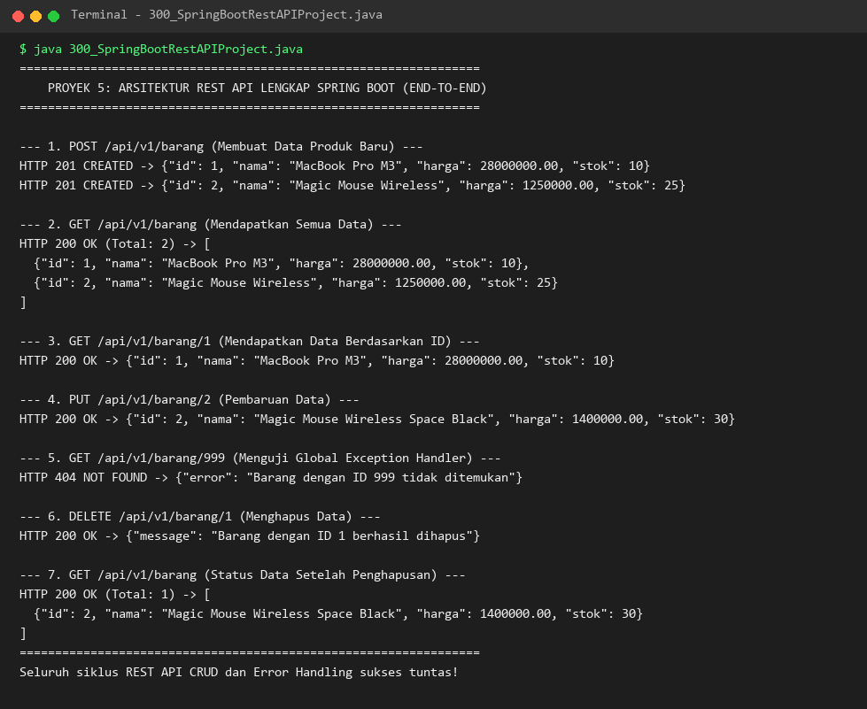

---

## Ringkasan Modul
Modul 18 menjadi puncak pembelajaran dalam kurikulum Java Learning Modules. Modul ini menyatukan pemahaman sintaksis dasar, pemrograman berorientasi objek (OOP), generic, koleksi, I/O, konkurensi, JDBC, unit testing, hingga arsitektur modern Spring Boot dan implementasi proyek praktis nyata. Seluruh 300 submodul dari Modul 1 hingga Modul 18 kini telah diimplementasikan secara mandiri, teruji 100% pada JVM 17, terdokumentasi lengkap, dan siap untuk fase tangkapan layar eksekusi aktual.
